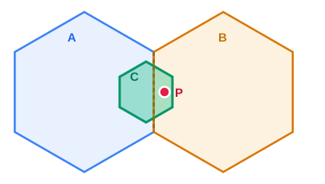
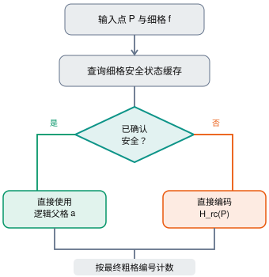
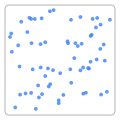
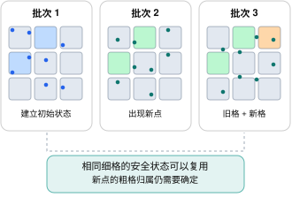

# H3实际讨论完整记录

作者 jinchenying。导出日期为2026年11月15日。

来源 https://chatgpt.com/share/6af9c032-eba0-83e9-ae5c-4958ac7eb20a

本次从分享页顶部开始逐段滚动读取，到末条回复结束。页面连续编号为0至8，共9轮、18条消息。此前接口仅返回末5轮，现已补齐前4轮。下文按实际顺序导出，未补写或改写问答。

文字、表格和代码转换为Markdown，公式使用页面保存的TeX表示，页面内原始SVG示意图另存assets。交互图保留可读取的文字内容，交互功能不在Markdown中重现；原始逐消息页面内容同时压缩保存为[原始导出](assets/shared_page_messages_original.json.gz)。隐藏推理与未展示的后台工具明细不在本文件中。

文件名沿用旧入口以兼容报告链接，来源是上述ChatGPT分享会话，不是Codex日志。旧执行记录仍在archive目录。

## 提问目录

1. 我想研究 H3 父子网格聚合，但现在还不是很理解基本原理。请用一个位置点解释：先编码成细网格再找父格，与直接编码成粗网格有什么区别？先讲原理与可能的反例
2. 请查官方资料核实这个现象。哪些已经是 H3 文档中的常识？哪些有现成 API 或工程方案？不要把我刚学到的知识包装成原创。请给出来源和仍可做的小型实验问题。
3. 我不认同把所有父级汇总差异都叫作错误，因为逻辑层级本身可能是合法的。我们能否先明确任务：要求按粗网格直接编码的口径统计？请写出输入、输出和判定一致的标准。
4. 我当前的想法是：无法确认就重编码。例如，如果只有边界附近可能跨格，能否只重编码那些单元中的点？请先找这个想法的漏洞，再讨论如何判断一个细网格完全处于粗网格内部。
5. 我担心几何判断比直接编码还贵。请比较“逐点判断”“按细格判断”“缓存判断结果”的成本。在哪些点数和网格复用条件下，我的方法可能更慢？给出可检验的假设，不要承诺加速。
6. 如果只用边界附近的数据，会不会把问题夸大？请设计均匀、聚集和边界压力三组数据，明确哪组用于常规结论，哪组只用于压力测试。热点中心不要根据错分结果挑选。
7. 请把全量直接粗编码作为主要效率基线，并允许各方法使用相同的基本优化。如果是重复查询同一份数据，直接缓存粗计数可能更好。我们应使用怎样的新批次工作负载，才能公平验证几何缓存的价值？
8. 我观察到以下现象：M在每批100000点时，20批累计耗时低于B1，但首批和5批累计耗时仍高于B1。每批1000和10000点时，20批累计耗时仍高于B1。A1每批重建相同局部规则所需的几何缓存，M则跨批次保留缓存，20批时M在六组条件中均快于A1。所有累计时间均含本次重复的首次初始化及新增细格处理。每次重复重新创建M对象，不跨重复预热；A1每个批次都新建对象。A1和M使用同一修订版LocalRecoder，主要差别是对象及几何缓存是否跨新批次保留。它们都保留了局部分类、分组、风险格直接编码与计数聚合。因此，A1与M的差异可以检查跨批次几何缓存复用的成本影响，但不能唯一分配父格缓存、full候选集合缓存和顶点探测缓存各自的贡献。请检查当前B1、M、A1比较能区分哪些因素，哪些仍无法区分。不要将B1到M的总差异全部归为缓存，也不要将M相对A1的差异全部归为“少重编码”。如果不能识别唯一原因，请直接说明，并优先分析现有记录。
9. 现在请只根据实际实验结果和已经发生的讨论，协助组织报告。逐条区分已有技术、AI 提出的建议、我提出或修改的选择、已经验证的结论和仍未验证的猜想。请指出哪些措辞超过证据，并保留失败案例。

---

## 第1轮

### 用户

我想研究 H3 父子网格聚合，但现在还不是很理解基本原理。请用一个位置点解释：先编码成细网格再找父格，与直接编码成粗网格有什么区别？先讲原理与可能的反例

### ChatGPT

# **H3 父子网格聚合：为什么“先细后粗”不一定等于“直接编码成粗网格”？**

先给出最重要的结论：

**在 H3 中，同一个位置点，先编码成细网格再取父格，与直接编码成粗网格，得到的结果不一定相同。**

这并不是 H3 的计算错误，而是由 H3 的网格层级设计决定的。

H3 有一个非常重要的特点：

* **逻辑父子关系是严格的**：每个细网格都有唯一的父网格。
* **几何包含关系是近似的**：细网格不一定完全位于父网格的实际地理边界内。

H3 官方文档也明确区分了这两种包含关系。

H3+1

## **一、先理解 H3 网格是什么**

可以把 H3 理解为给地球表面的位置分配一个六边形网格编号的系统。

它支持 0 到 15 共 16 个分辨率等级，**分辨率数字越大，网格越小，位置描述越精细**。

假设我们使用：

* `resolution = 8`：粗网格。
* `resolution = 9`：细网格。

在通常的六边形区域中，一个 8 级网格在逻辑上对应 7 个 9 级子网格：一个中心子格和六个周围子格。

但要特别注意：**这 7 个子网格不是把父六边形像拼图一样精确切开的 7 块。**

这正是你想研究的父子聚合问题的关键。

## **二、同一个位置点，两种操作分别做了什么？**

假设有一个位置点：


$$
P=(lat,lon)
$$


我们希望知道它属于哪个 8 级网格。

两条编码路径

方法 A：先细后粗

位置点 P

**9 级细网格 C**

**C 的 8 级父格 A**

先确定细格的身份，再查它的父格

方法 B：直接编码粗格

位置点 P

**8 级粗网格 B**

不经过 9 级网格

直接根据点的位置，在粗尺度上定位

A、B 是示意性编号，不表示每个位置点都会出现不同结果。

用 Python H3 API 表示就是：

**方法 A：先细后粗**


```python
fine = h3.latlng_to_cell(lat, lon, 9)
coarse_A = h3.cell_to_parent(fine, 8)
```


**方法 B：直接粗编码**


```python
coarse_B = h3.latlng_to_cell(lat, lon, 8)
```


区别在于：

方法 A 追溯的是**细网格的逻辑归属**；方法 B 计算的是**原始位置点在粗网格中的实际归属**。

如果父子网格能够严格几何嵌套，两种方法就会一致。但 H3 不保证这种严格嵌套。

## **三、最关键的反例：一个点明明在 B 网格里，却被聚合到 A**

我们构造一个边界附近的示意场景。

示意：两个相邻粗网格和一个跨越边界的细网格



粗格 A

粗格 B

细格 C

位置点 P

原理示意图，非按真实经纬度比例绘制。绿色细格 C 的逻辑父格是 A，但细格的部分几何区域延伸到了 B。

现在观察图里的红点 P。

**方法 A：先编码细网格**

1. P 位于绿色细网格 C 内。
2. H3 将 P 编码为 C。
3. 通过 `cell_to_parent(C, 8)` 找父格。
4. C 的逻辑父格是 A。
5. 因此返回 **A**。

**方法 B：直接编码粗网格**

1. H3 直接观察 P 的经纬度。
2. 在 8 级网格中，P 实际位于橙色网格 B 内。
3. 因此返回 **B**。

于是：


$$
\boxed{
\operatorname{parent}(H_9(P),8)\neq H_8(P)
}
$$


其中 $H_r(P)$ 表示位置点 P 在分辨率 $r$ 下的 H3 编码。

这就是一个成立的几何反例，其可能性由 H3 官方设计说明直接支持。

H3+1

## **四、是不是所有位置点都会不一致？**

不是。可以分为两种典型情况。

| 情况 | 先细后粗 | 直接编码粗格 | 是否一致 |
| --- | --- | --- | --- |
| P 位于细格 C 内，同时也位于 C 的父格 A 内 | A | A | 一致 |
| P 位于细格 C 内，但越过父格 A 的边界，实际处于 B 内 | A | B | 不一致 |

因此，不一致与**不同分辨率网格边界的错位**有关，而不是随机的编码误差。

也不要把它理解成：H3 在边界附近不能正确定位点。每个分辨率自己的网格边界是明确的。这里的问题是跨分辨率聚合时，两种归属规则不完全一致。

## **五、为什么这个问题对“网格聚合”很重要？**

假设现在有 1000 个共享单车停车位置点，你要统计每个 8 级网格中的停车数量。

如果使用直接粗编码，就相当于：

> 每辆车按照实际经纬度，归入所在的 8 级区域。

如果使用先 9 级编码，再按父格聚合，就相当于：

> 每辆车先归入 9 级细网格，再按照细格的逻辑父子关系汇总。

后者可能会把一些实际位于粗网格 B 边界内的车辆计入 A。

两种方法都可以用于统计，但回答的是略有区别的问题。特别是当你希望比较不同分辨率的统计结果时，不能直接假定二者完全等价。

## **六、怎样找到一个真实的反例？**

下面这段代码使用 `h3-py` 4.x，扫描一小片经纬度区域，自动寻找两种方法输出不同的真实位置点。


```python

import h3

# 粗网格 8 级，细网格 9 级
for i in range(200):
    for j in range(200):
        lat = 37.70 + i * 0.001
        lon = -122.52 + j * 0.001

        fine = h3.latlng_to_cell(lat, lon, 9)
        A = h3.cell_to_parent(fine, 8)
        B = h3.latlng_to_cell(lat, lon, 8)

        if A != B:
            print("找到不一致的位置点：", lat, lon)
            print("9级细格：", fine)
            print("细格的8级父格：", A)
            print("直接8级编码：", B)
            raise SystemExit

print("本次扫描未发现反例")

```


这段代码不是预先指定一个未经验证的错误坐标，而是让 H3 实际计算并报告反例。

## **七、延伸到你的研究，可以提出什么问题？**

对于课程实验或小论文，我建议先聚焦一个可验证的问题：

**H3 的逻辑父子聚合与直接空间编码之间，存在多大程度的归属不一致？这种不一致是否会影响空间统计结果？**

初步可以研究三个量：

* **归属不一致率**：同一个位置点，两种编码方式的网格编号不同的比例。
* **边界敏感性**：不一致的点是否主要集中在粗网格边界附近。
* **聚合偏差**：分别统计粗网格里的事件数量，比较结果的绝对误差、热点排序变化等。

这里需要区分两个研究层次：**“存在反例”是 H3 已知的性质，并不构成新的创新；“在实际空间统计中，这种性质导致怎样的可量化偏差，以及如何在保留高效父子聚合的同时修正偏差”，才有可能成为你的方法研究切入点。**

最后记住一句话：

**H3 的父格，是细网格在索引树中的父节点；它不保证细格内每一个位置点都位于该父格的真实地理边界内。**

---

## 第2轮

### 用户

请查官方资料核实这个现象。哪些已经是 H3 文档中的常识？哪些有现成 API 或工程方案？不要把我刚学到的知识包装成原创。请给出来源和仍可做的小型实验问题。

### ChatGPT

# **H3 父子网格聚合：官方核实结果与可研究空间**

**核实结论：H3 跨分辨率父子网格的几何不完全包含，是官方已公开说明的设计特性，不是新的发现。** 官方不仅解释了原因，还提供了父子索引转换、网格边界提取、多边形覆盖等 API，并明确建议在需要精确地理边界时增加几何判断。

因此，不建议把“发现父子聚合与直接粗编码不一致”作为课程报告的创新点。更合适的方向是：**在明确的空间数据分布与数据保留条件下，定量比较现有聚合方法的误差和计算开销。**

## **一、哪些内容已经是 H3 官方常识？**

| 已知性质 | 官方证据 | 能否声称创新 |
| --- | --- | --- |
| H3 是层级地理空间索引 | H3 4.x Introduction | 否 |
| 父子索引具有精确逻辑包含关系 | H3 4.x Introduction | 否 |
| 父子网格不保证严格几何包含 | H3 4.x Introduction、3.x Indexing | 否 |
| 先细后粗与直接粗编码可能不同 | 可由官方几何包含说明和 API 定义推出 | 否 |
| 六边形无法精确划分为 7 个更小的六边形 | H3 3.x Indexing | 否 |
| 精确边界判断可以结合 Point-in-Polygon | H3 3.x Indexing | 否 |

官方尤其值得注意的一句话是：H3 的索引层级提供精确的逻辑包含关系，但地理上的包含关系是近似的。

H3+1

H3 3.x 文档还专门链接了一个名为 *H3 Hierarchical (Non)Containment* 的可视化案例，说明这一问题甚至不是尚未被展示的反例。

H3

最值得直接阅读的官方来源

[H3 4.x — Introduction](https://h3geo.org/docs/?utm_source=chatgpt.com)

明确区分逻辑包含与几何包含

[H3 3.x — Indexing](https://h3geo.org/docs/3.x/highlights/indexing/?utm_source=chatgpt.com)

解释七子格近似划分、误差来源及精确边界处理

[H3 4.x — Hierarchical Grid Functions](https://h3geo.org/docs/api/hierarchy/?utm_source=chatgpt.com)

官方父格、子格、索引压缩接口

## **二、哪些已有 API 或工程方案？**

这里要区分：**已经存在的接口**，不等于**已经提供任意条件下的无损重聚合算法**。

| 需求 | 现成工具或方案 | 限制 |
| --- | --- | --- |
| 点直接映射到粗网格 | `latlng_to_cell()` | 需要原始经纬度 |
| 细网格查父格 | `cell_to_parent()` | 使用逻辑归属，不保证几何精确 |
| 父格枚举子格 | `cell_to_children()` | 枚举的是逻辑子格 |
| 获取真实网格边界 | `cell_to_boundary()` | 提供几何信息，不自动修正聚合计数 |
| 判断多边形与网格的覆盖关系 | `h3shape_to_cells_experimental()` | 支持 center/full/overlap 等模式，但属于实验性 API |
| 紧凑表示网格集合 | `compact_cells()` / `uncompact_cells()` | 针对网格集合，不是计数重分配算法 |

这些接口均能在官方 H3 4.x API 和 h3-py 文档中核实。

H3+4

尤其不要误以为 `compact_cells()` 可以自动修复聚合偏差，它主要是将完整的子格集合压缩成父格表示，并不能根据丢失的点位置精确重新分配统计量。

### **工程上已有三种常见处理思路**

1. **保留原始点，按目标分辨率重新编码。** 如果目标是某一级网格的精确点数统计，这是最直接、最可靠的参照方法。
2. **接受逻辑父子聚合。** 如果数据系统本来就是按 H3 层级组织，且业务接受近似几何归属，直接使用 `cell_to_parent()` 即可。
3. **使用几何交叠关系辅助处理。** 提取细、粗网格边界后，可以计算交叠比例并做面积加权分配；但它需要点在细格内均匀分布等假设，不能保证还原真实计数。官方也建议精确边界任务结合几何检查。

   H3

一个特别重要的信息条件是：

**如果原始经纬度已经丢失，只剩下每个细网格的汇总计数，那么一般无法精确恢复直接粗编码得到的统计结果。**

因为一个细网格可能跨越不同粗网格，而聚合后的总数并没有记录内部各部分各有多少个点。这是信息损失问题，不能通过单纯更换父子查询 API 解决。

## **三、上一轮的反例哪些需要澄清？**

上一轮给出的 A、B、C 三网格图，是用于解释机制的**示意反例**，不是已经由 H3 程序运行得到的具体地理案例。

官方资料足以支持存在这种不一致的可能性，但我们还没有提供实际运行验证过的经纬度、H3 索引和版本。因此，现阶段不能把那张示意图写成“实验发现”。

正式报告应当通过下面这个检验获得可复现的实际反例：


```python
import h3

fine = h3.latlng_to_cell(lat, lon, 9)

A = h3.cell_to_parent(fine, 8)
B = h3.latlng_to_cell(lat, lon, 8)

print(A != B)
```


其中 `lat, lon` 应来自实际测试点，而不是根据示意图虚构的坐标。

## **四、仍然值得做的三个小型实验问题**

**实验 A：不同分辨率组合下，归属不一致率是多少？**

选定一个区域，均匀抽样位置点，比较 `(7,8)`、`(8,9)`、`(8,10)` 等粗细等级组合。报告每组的不一致率及重复抽样置信区间。

定位：已知现象的定量复现。实现简单，但独立研究价值较低。

**实验 B：点的空间分布会怎样改变聚合统计误差？**

在相同区域内分别生成均匀分布、中心聚集分布、边界附近聚集分布的数据。对比直接粗编码和逻辑父子聚合得到的每格计数、热点排名与误差。

定位：研究已知索引特性对实际统计任务的影响。比较适合课程报告。

**实验 C：原始点丢失后，简单面积加权能否改善聚合误差？**

只保留细格计数，比较直接父格聚合与按细粗格交叠面积分配计数。分别使用均匀与空间聚集数据，检验面积加权的适用条件和失败案例。

定位：现有策略的条件性比较，而不是提出全新的无损聚合算法。

## **五、我建议最终选择的课程研究方案**

## **H3 跨分辨率聚合的统计误差：空间分布影响与简单修正策略评估**

英文可用：*Evaluating Aggregation Discrepancies in H3 Across Spatial Distributions and Resolutions*

这比单纯证明几何不完全包含更适合一篇有完整实验的小型课程报告。

| 项目 | 建议配置 |
| --- | --- |
| 研究区域 | 选一个城市大小的矩形区域，控制地图范围 |
| 数据 | 先使用人工合成位置点，固定随机种子 |
| 样本量 | 每种数据分布 10,000、50,000、100,000 点 |
| 分辨率 | 粗格 7、8；细格 8、9、10 |
| 对照方法 | 直接粗编码、逻辑父子聚合、交叠面积加权 |
| 评价指标 | 归属不一致率、计数误差、Top-K 热点重合率、执行时间 |
| 控制变量 | 相同点集、相同分辨率、相同硬件和计时方法 |

有一个实验设计细节必须保留：**直接粗编码是拥有原始点数据条件下的参照结果，不是与其他方法具有相同输入条件的公平竞品。** 面积加权方法应与父子聚合在“只有细格计数”的信息条件下比较，而直接粗编码只负责提供误差评价的参考真值。

另外，点级归属不一致率与聚合计数误差是两个不同的指标。点可能被错分，但相反方向的错分在网格计数上会互相抵消，因此不能仅凭前者推断后者。

### **预期最终成果**

建议以三张核心图作为实验报告的主要结果：

* 一张真实 H3 细粗格边界叠加图，标出程序找到的不一致位置点。
* 一张不同空间分布下，父子聚合计数误差的对比图。
* 一张误差与计算开销对照图，说明何时逻辑聚合足够、何时面积加权可能有帮助。

不要预设面积加权一定优于直接父格聚合。对于高度聚集的点分布，它可能反而产生更大误差；这应交给实验判断。

**最终可以争取的贡献**不是“发现 H3 父子网格不完全包含”，而是“在控制分辨率、空间分布和数据可用性的条件下，评估两种已有聚合策略的适用边界及其误差—开销权衡”。

这是一项范围可控、结论能被实验支持的应用性评估。如果实验显示某个方法只在特定条件下占优，也同样是合理的课程研究结果，而不是必须包装成新算法。

---

## 第3轮

### 用户

我不认同把所有父级汇总差异都叫作错误，因为逻辑层级本身可能是合法的。我们能否先明确任务：要求按粗网格直接编码的口径统计？请写出输入、输出和判定一致的标准。

### ChatGPT

你的判断是正确的。**H3 逻辑父级聚合本身并没有错误；只有当任务明确要求“按位置点直接编码到目标粗网格”时，逻辑父级聚合产生的不同结果才构成相对于该任务目标的偏差。**

建议将课程研究任务正式定义为：

# **任务定义：面向直接粗编码口径的 H3 跨分辨率点计数**

## **1. 输入（Input）**

给定：


$$
\mathcal P=\{p_1,p_2,\ldots,p_N\}
$$


其中，每个位置点为：


$$
p_i=(lat_i,lon_i)
$$


另给定两个 H3 分辨率：


$$
0\le r_c<r_f\le15
$$


其中：

* $r_f$：细网格分辨率。
* $r_c$：目标粗网格分辨率。
* $N$：输入位置点数量，允许多个点拥有相同坐标。

输入还需包含使用的 H3 实现及版本，以保证实验可以复现。

在实际处理中，可先计算每个点的细网格编码：


$$
f_i=H_{r_f}(p_i)
$$


这里的 $H_r(p)$ 表示使用 H3 的 `latlng_to_cell`，在分辨率 $r$ 下对位置点进行直接编码。

**核心条件：原始位置点坐标仍然可用。** 如果只剩下细格汇总计数而没有点坐标，通常无法保证恢复直接粗编码口径的精确计数。

## **2. 目标输出（Output）**

研究任务要求输出一个粗网格计数映射：


$$
\hat C:\mathcal H_{r_c}\rightarrow \mathbb N_0
$$


其中 $\mathcal H_{r_c}$ 表示所有合法的 $r_c$ 级 H3 网格，$\hat C(g)$ 表示方法计算得到的粗网格 $g$ 内点数。

目标参照结果定义为：


$$
\boxed{
C^*(g)=\sum_{i=1}^{N}
\mathbf 1[H_{r_c}(p_i)=g]
}
$$


含义是：**每个点直接编码到粗网格，然后按粗网格编号统计数量。**

这一定义不依赖细网格父子关系，而是直接使用目标分辨率的 H3 编码结果。

## **3. 对照方法：逻辑父级聚合**

传统逻辑父级聚合结果定义为：


$$
C^{P}(g)=
\sum_{i=1}^{N}
\mathbf 1[
\operatorname{parent}(H_{r_f}(p_i),r_c)=g
]
$$


它与目标 $C^*$ 的差别仅在于点的粗格归属计算方式。

| 统计口径 | 每个点的归属依据 | 是否天然满足本任务 |
| --- | --- | --- |
| 直接粗编码 $C^*$ | 点坐标在目标分辨率下的编码 | 是，作为参考真值 |
| 逻辑父级聚合 $C^P$ | 细格索引的逻辑父格 | 不保证，但它本身是合法统计口径 |
| 待评估方法 $\hat C$ | 使用细格信息及必要的位置重编码 | 需要实验验证 |

这里的“参考真值”只针对**已经定义的直接粗编码任务**，不意味着它比其他统计语义普遍更正确。

## **4. 判定一致的标准（Correctness Criteria）**

建议区分三个层次，避免把不同的正确性混为一谈。

### **标准 A：逐点归属一致**

对每个点，要求：


$$
\boxed{
\hat h(p_i)=H_{r_c}(p_i),\quad \forall i
}
$$


其中 $\hat h(p_i)$ 是待评估方法给点 $p_i$ 分配的粗网格编号。

对应指标：


$$
A_{\mathrm{point}}=
\frac{1}{N}\sum_{i=1}^{N}
\mathbf 1[\hat h(p_i)=H_{r_c}(p_i)]
$$


完全一致的判定条件：


$$
A_{\mathrm{point}}=1
$$


### **标准 B：逐粗网格计数一致**

要求：


$$
\boxed{
\forall g\in \mathcal H_{r_c},\quad
\hat C(g)=C^*(g)
}
$$


实现时，只需比较两个计数映射中出现过的网格编号的并集，并将缺失键对应的计数视为 0。

这可以避免只比较共同出现的网格而漏掉错误分配。

### **标准 C：总点数守恒**

要求：


$$
\sum_g\hat C(g)=N
$$


该标准只能证明没有发生总数层面的丢失或重复，**不能证明各粗网格的计数正确**。

举例来说，如果 A 网格多计算 10 个点、B 网格少计算 10 个点，总数仍然守恒，但逐格计数已不一致。

## **5. 三类标准的逻辑关系**

**A：逐点归属完全一致**

最强的正确性要求

必然推出

**B：逐粗网格计数完全一致**

最终统计任务的输出要求

在完整统计所有输入点时必然推出

**C：总点数守恒**

必要但不充分的检查

反向推理均不成立：计数一致可能掩盖点级错分，总数守恒也可能掩盖网格之间的计数转移。

## **6. 建议采用的正式研究目标**

将目标分为两个层级：

**主要目标：**

在目标口径 $C^*$ 下，使输出满足：


$$
\forall g,\quad\hat C(g)=C^*(g)
$$


**强化目标：**

如果方法声称能够正确处理每个位置点，则进一步要求：


$$
\forall i,\quad\hat h(p_i)=H_{r_c}(p_i)
$$


在达到正确性要求的前提下，再研究运行时间、预处理成本、缓存成本和新批次数据的处理效率。

这能避免把“速度更快但统计语义不同”误认为对同一任务的有效优化。

## **7. 推荐放入课程报告的正式表述**


### 问题定义

本文研究 H3 跨分辨率点计数任务。给定包含 \(N\) 个地理位置点的数据集 \(\mathcal P\)，以及细网格分辨率 \(r_f\) 和目标粗网格分辨率 \(r_c\)（\(r_f>r_c\)），任务要求按照各位置点在目标分辨率下的直接 H3 编码结果，统计每个粗网格中的点数。

对于任意粗网格 \(g\)，目标计数定义为：

\[
C^*(g)=\sum_{i=1}^{N}\mathbf 1[H_{r_c}(p_i)=g]
\]

其中，\(H_r(p_i)\) 表示将位置点 \(p_i\) 直接编码为分辨率 \(r\) 的 H3 网格索引。

需要强调的是，H3 的逻辑父子关系与直接空间编码代表不同的归属语义。逻辑父级聚合具有合法的层级统计含义，但由于 H3 网格层级不保证严格的几何包含，其结果不一定与直接粗编码计数一致。因此，本文不将逻辑父级聚合视为普遍错误，而仅评估其相对于预先规定的直接粗编码统计口径所产生的差异。

本文以逐粗网格计数完全一致作为主要正确性标准，以逐点归属一致作为更严格的验证标准，并将总点数守恒作为基本完整性检查。在此基础上，比较不同处理策略的计算开销和适用条件。


**下一步实验应首先验证这一定义，而不是立即设计新算法。** 先运行直接粗编码与逻辑父级聚合，在相同点集上分别测量逐点不一致率和逐格计数差异。只有证明任务差异实际存在且具有可测量的规模，才有充分依据继续研究如何减少重编码开销。

这样，论文的研究起点就从“指出 H3 已知的几何特性”，转为“针对一个明确、可判定的统计任务，评估准确性与效率之间的工程权衡”。

---

## 第4轮

### 用户

我当前的想法是：无法确认就重编码。例如，如果只有边界附近可能跨格，能否只重编码那些单元中的点？请先找这个想法的漏洞，再讨论如何判断一个细网格完全处于粗网格内部。

### ChatGPT

# **H3 局部重编码方案：先找漏洞，再建立安全判定**

你的想法可以概括为：

**对于能够确认不会改变粗网格归属的细网格，直接使用逻辑父格；对于无法确认的细网格，保留原始坐标并逐点重新编码。**

这是一种合理的保守优化思路，尤其适合已经有细网格编码、又需要按直接粗编码口径汇总的场景。

但需要明确：**“边界附近才可能出问题”只是几何直觉，不是可以直接拿来写程序的判定标准。**

## **一、先找这个想法的六个漏洞**

| 潜在漏洞 | 为什么重要 | 处理建议 |
| --- | --- | --- |
| 1. 边界附近没有严格定义 | 仅靠距离或网格邻接关系，可能遗漏跨界细格 | 改用完整几何包含判定 |
| 2. 只检查细格中心不够 | 中心在父格内部，不代表整个细格都在内部 | 检查完整细格区域 |
| 3. 只检查顶点也未必充分 | 顶点在内部，不一定能排除边界交叉或数值误判 | 考虑边段相交和严格内含 |
| 4. 几何判断不等于 H3 编码运算 | 两者通过不同计算路径实现，边界浮点处理可能存在差异 | 用直接编码做独立验证 |
| 5. 几何判断可能比重编码更贵 | 如果不同细格太多，逐格构建几何对象会产生较高开销 | 按细格缓存，测量预处理与摊销成本 |
| 6. 细格计数不能替代原始点 | 跨界细格内各点的实际位置仍然未知 | 保留不确定细格内点的坐标 |

第 4 点尤其需要注意。

H3 官方文档说明，`latLngToCell` 通过二十面体面选择、球心投影和网格坐标转换确定索引；`cellToBoundary` 则通过网格顶点的逆向坐标转换生成边界。这些是相互关联但并不完全相同的计算过程。

H3+1

因此，不能直接用一个未经验证的平面多边形计算，宣称对 H3 所有分辨率和边界输入实现了数学上的零误差。

### **还有一个已经存在的实现风险**

我查到 H3 官方仓库在 **2026 年 10 月 16 日提交的 PR #1271**，目前页面状态仍为 Open。

这个 PR 报告：`polygonToCellsExperimental` 的 `CONTAINMENT_FULL` 在某些共边场景下，可能把实际位于多边形外的相邻网格错误地判为完全包含，并给出了基于 h3-py 4.5.0 的复现案例。

这意味着 `contain="full"` 的设计语义虽然是“完全包含”，但**不能未经核验就把特定版本的返回结果当作严格数学证明**。该问题是否会在我们的粗细格筛选场景中触发，需要单独验证，不能直接等同。

GitHub

来源：[H3 官方仓库 PR #1271：CONTAINMENT\_FULL 边界误判修复](https://github.com/uber/h3/pull/1271?utm_source=chatgpt.com)

## **二、先建立严格的安全判定条件**

定义一个细网格 $f$，其逻辑父格为：


$$
a=\operatorname{parent}(f,r_c)
$$


用 $G(f)$ 表示细格的几何区域，用 $G(a)$ 表示父格的几何区域。

我们希望证明：


$$
\boxed{G(f)\subseteq G(a)}
$$


即：**细网格的整个几何区域，都包含在它自己的逻辑父网格中。**

如果这一关系可靠成立，并排除了边界归属与数值歧义，那么对于细格 $f$ 内的任意点 $p$，可以直接使用其逻辑父格 $a$，而不必重新编码到 $r_c$。

严格来说，本任务真正需要的条件是：


$$
\boxed{
\forall p,\ H_{r_f}(p)=f
\Rightarrow H_{r_c}(p)=a
}
$$


后一条是直接粗编码口径下的**语义安全条件**，前面的几何包含关系是证明它的一种途径。

两者的区别在于，几何包含需要与 H3 自身的点归属和边界处理规则一致。对于恰好落在边界的点，必须谨慎处理。

所以建议定义三种判定状态，而不是简单地分成内部格和边界格：

**SAFE — 已确认安全**

可靠判定细格完全处于自己的逻辑父格内部，允许直接使用父格。

**UNKNOWN — 未确认安全**

出现交叠、接触边界、数值不确定或无法完成几何判断。对该细格中的每个点直接粗编码。

**UNSAFE — 已发现归属不一致**

已证实存在与逻辑父格不同的直接粗编码结果。对该细格中的每个点直接粗编码。

注意：UNKNOWN 不等于错误，UNSAFE 也不表示该细格所有点都归属错误。它们都只是表示**不能安全跳过逐点重编码**。

## **三、如何判断细网格完全位于父格内部？**

目前有两条比较实际的技术路线。

### **方法 A：使用 H3 已有的** `full` **模式**

官方 H3 4.x 提供：


```python
h3.h3shape_to_cells_experimental(
    parent_polygon,
    res=rf,
    contain="full"
)
```


其设计语义就是返回完全包含在输入多边形中的目标分辨率网格。它与普通 `h3shape_to_cells()` 的中心点包含模式不同。

H3

基本流程是：

1. 获取粗网格 $a$ 的边界。
2. 将其转换成 H3 多边形对象。
3. 调用 `contain="full"` 筛选完全位于该区域内的细网格。
4. 检查待处理细格 $f$ 是否位于结果中。
5. 再确认 `cell_to_parent(f, rc) == a`。

可以先实现下面的**候选安全集筛选器**：


```python

import h3

def get_full_candidates(parent, rf, rc):
    polygon = h3.LatLngPoly(
        h3.cell_to_boundary(parent)
    )

    candidates = h3.h3shape_to_cells_experimental(
        polygon, rf, contain="full"
    )

    return {
        f for f in candidates
        if h3.cell_to_parent(f, rc) == parent
    }

```


这里 `h3.cell_to_boundary()` 输出的是 `(lat, lng)` 坐标，符合 `LatLngPoly` 的输入顺序。

h3-py

但是，这个集合目前只能称为 `full_candidates`，不宜直接命名为 `certified_safe_cells`，原因就是前面发现的 `CONTAINMENT_FULL` 实现问题。

对于课程实验，可以把这个 API 的结果作为第一层筛选，再独立检查其安全性。

### **方法 B：直接进行细格与父格的几何包含判断**

如果不依赖 `full` 筛选，可以自行通过 `cell_to_boundary()` 获取两个网格的几何边界，再判断：


$$
G(f)\subset \operatorname{Interior}(G(a))
$$


这里刻意使用严格内部包含，而不是简单的边界接触也算包含。

三种典型几何状态


完整位于内部

可进一步认证


跨越边界

必须逐点重编码


接触边界

保守回退

几何关系示意，不代表真实 H3 网格的尺寸与形状。

一种容易理解的判定策略是：

* 先验证细格所有顶点都在粗格严格内部。
* 再确认细格边界没有与粗格边界发生相交或接触。
* 对非常接近边界、计算结果不稳定或涉及特殊球面几何的情况，统一回退为 UNKNOWN。

这里还有一个容易忽略的技术点：H3 网格是球面网格。直接将经纬度当作平面坐标，或者只用少量顶点构造直线段进行判断，并不能自动构成全球严格正确的几何证明。H3 的二十面体投影和跨面边界需要谨慎处理。

H3+1

对于小型城市区域实验，可以采用统一的局部米制投影、边界细分和保守安全间距，但必须在报告中说明：这属于受限区域、受限精度条件下的实现与验证，不是全球数学保证。

## **四、我建议的初版方法结构**

初版保守重编码流程：安全状态可以缓存；缓存未命中时先进行一次几何判定，无法认证即回退重编码。

这套方案的核心不是判断哪些点“很可能正确”，而是判断哪些细格**可以安全省去直接粗编码**。

在逻辑上它由两个部分组成：


$$
\hat h(p)=
\begin{cases}
\operatorname{parent}(f,r_c),&f\in S_{\mathrm{cert}}\\
H_{r_c}(p),&f\notin S_{\mathrm{cert}}
\end{cases}
$$


其中 $S_{\mathrm{cert}}$ 必须是经过可信判定的安全细格集合，而不是仅由经验距离阈值选出的集合。

如果安全集合确实没有误判，那么这个方法就会保持逐点一致性；反之，如果把不安全细格错误加入该集合，再多的边界重编码也无法修复这些漏判。

## **五、当前方案最需要的实验不是提速，而是证书可靠性**

建议按以下优先级推进。

| 优先级 | 实验 | 要回答的问题 |
| --- | --- | --- |
| P0 | `full` 判定与独立几何判断交叉检查 | 是否存在被标记安全、实际上跨越粗格边界的细格？ |
| P0 | 边界和顶点附近的定向压力测试 | 安全细格内是否出现直接粗编码不一致的反例？ |
| P1 | 全量逐点一致性测试 | 局部重编码结果能否在独立测试集上与直接粗编码逐点一致？ |
| P1 | 安全细格覆盖率及回退点比例 | 到底可以省掉多少次粗编码？ |
| P2 | 冷启动、缓存命中和新批次性能 | 几何预处理能否被重复使用的细格摊销？ |

这里必须强调，**有限样本中观察到零不一致，不等于证明了全局零不一致**。真正的正确性主张应当由安全判定条件和实现可靠性支撑，实验负责尽可能寻找反例。

在性能方面，可以先用一个简单成本模型：


$$
T_{\mathrm{local}}
=
T_{\mathrm{classify}}
+
T_{\mathrm{lookup}}
+
N_{\mathrm{fallback}}t_{\mathrm{encode}}
$$


其中：

* $T_{\mathrm{classify}}$：建立或更新细格安全分类的成本。
* $T_{\mathrm{lookup}}$：所有点查询细格安全状态的成本。
* $N_{\mathrm{fallback}}$：最终需要直接粗编码的点数。
* $t_{\mathrm{encode}}$：单点直接粗编码的平均成本。

与直接粗编码基线比较时，要统一已有细格编码的输入条件。如果细格编码本来就必须计算，它属于各方法的共同成本；如果不是，则不能把它只从局部重编码方法的计时中排除。

## **六、我的阶段性判断**

这个方案值得继续，但现在还不应命名为“严格无损局部重编码算法”。

更准确的阶段名称是：

**基于细格完整包含筛选的保守局部重编码策略。**

目前可以确认的是：

* H3 提供了现成的 `full` 模式与边界 API，因此“筛选内部细格”不能作为原创算法。
* “无法确认就逐点重编码”在逻辑上构成一种保守处理框架。
* 方案能否严格保持直接粗编码口径，取决于安全集合是否存在假阳性。
* H3 官方仓库已经出现 `CONTAINMENT_FULL` 的具体边界误判报告，因此安全集合认证必须单独审查。
* 最终能否获得性能收益，取决于安全细格内的点占比、几何判定成本及缓存复用次数。

**我建议下一步先完成 P0：安全判定器的反例搜索与独立几何验证。** 不要先进行计时优化，也不要先假定 `full` 模式足以保证严格一致。只要安全判定尚存在未排除的假阳性风险，后续所有“准确且更快”的结论都不稳固。

---

## 第5轮

### 用户

我担心几何判断比直接编码还贵。请比较“逐点判断”“按细格判断”“缓存判断结果”的成本。在哪些点数和网格复用条件下，我的方法可能更慢？给出可检验的假设，不要承诺加速。

### ChatGPT

# **H3 局部重编码：三种几何判断方式的成本与盈亏条件**

**结论：你的方法完全可能比直接粗编码更慢，尤其是在点比较分散、每个细网格只有少量点、边界点占比高或缓存无法复用时。**

关键并不是“减少了多少次 `latlng_to_cell()`”，而是：

> 省去的粗编码时间，是否足以支付几何判断、分组、缓存查询和不确定点回退的全部成本？

H3 官方提供了直接编码、父格查询和 `full` 多边形覆盖接口，但没有为你的这一完整处理流程给出通用的性能保证。尤其 `h3shape_to_cells_experimental()` 明确属于实验性接口。

h3-py+2

## **一、先统一比较条件**

先假设每个位置点已经有细网格编码 $f_i$，但仍然保留原始经纬度。三种方法的目标都是得到与直接粗编码一致的粗格计数。

定义以下变量：

| 符号 | 含义 |
| --- | --- |
| $N$ | 当前批次的总点数 |
| $U$ | 当前批次涉及的不同细网格数量 |
| $m=N/U$ | 每个实际出现的细网格的平均点数 |
| $s$ | 被确认安全、能够跳过直接粗编码的点所占比例 |
| $q=1-s$ | 必须回退直接粗编码的点所占比例 |
| $t_e$ | 单点直接粗编码的平均时间 |
| $t_g$ | 单个细格完成安全分类的平均成本 |
| $t_o$ | 每点执行查询、分支、计数等新增操作的平均成本 |
| $F$ | 建立几何结构、初始化缓存等固定成本 |

这里有两个特别重要的区别：

* $U$ 是不同细格数量，不是粗格数量，也不是点数。
* $s$ 是**安全细格中的点数比例**，不是安全细格数量比例。

例如，100 个细格中有 90 个安全格，但剩余 10 个边界格容纳了绝大多数点，那么实际能够省掉的重编码次数仍然可能很少。

## **二、三个方案的成本模型**

### **方案 A：逐点几何判断**

每个点都执行一次几何检查，再决定是否重编码。


$$
T_A\approx N(t_p+t_o+qt_e)+F_A
$$


其中 $t_p$ 是每点几何判断成本。

直接粗编码的耗时为：


$$
T_D=Nt_e
$$


所以逐点判断只有在下面条件满足时才可能更快：


$$
\boxed{t_p+t_o<st_e-F_A/N}
$$


这意味着，哪怕几何判断能够准确识别大部分安全点，如果每点几何判断本身就接近或超过一次 H3 粗编码的成本，也可能没有收益。

尤其不要把完整的“细格是否在父格内部”多边形判断重复应用到每个点上。相同细格的几何关系没有变化，重复做同一判断通常是不必要的。

### **方案 B：按细网格判断，每个批次重新分类**

先收集批次内的 $U$ 个不同细格；每个细格仅分类一次，随后处理所有点。


$$
T_B\approx Ut_g+Nt_o+qNt_e+F_B
$$


相比直接粗编码，可能更快的条件是：


$$
\boxed{st_e>t_o+\frac{t_g}{m}+\frac{F_B}{N}}
$$


核心是 $m=N/U$。

**每个细格承载的点越多，单次几何判断就越容易被摊销。**

但如果一个细格通常只有一个点，几何判断就几乎等于为每个点额外执行了一次昂贵操作。

### **方案 C：按细格缓存判断结果，跨批次复用**

假设已有安全分类缓存，当前批次只遇到了 $U_{\mathrm{new}}$ 个尚未分类的细格。


$$
T_C\approx U_{\mathrm{new}}t_g+Nt_o+qNt_e+F_C
$$


可能更快的条件为：


$$
\boxed{
st_e>
t_o+\frac{U_{\mathrm{new}}}{N}t_g+\frac{F_C}{N}
}
$$


缓存只改变几何判断的重复次数，**不会消除每点的缓存查找、计数操作和不确定点重编码成本**。

如果没有新细格，$U_{\mathrm{new}}=0$，仍然需要满足：


$$
st_e>t_o
$$


如果这个不等式不成立，即使几何分类完全免费、缓存命中率为 100%，该实现也可能比直接粗编码慢。

## **三、三种方法在哪些条件下容易变慢？**

| 数据特征 | 逐点判断 | 按细格判断 | 跨批次缓存 |
| --- | --- | --- | --- |
| 大量点分散在不同细格 | 很可能慢 | 很可能慢 | 首批很可能慢 |
| 大量点集中在少数细格 | 仍重复付出几何成本 | 有利于摊销 | 有利于摊销 |
| 点集中在跨界细格 | 判断成本高且仍需重编码 | 判断成本可能无法收回 | 缓存命中仍可能慢 |
| 每批都是全新细格 | 仍有重复判断成本 | 每批重新分类 | 缓存收益有限 |
| 多批反复访问相同安全细格 | 无明显跨批优势 | 每批重复分类 | 有潜在优势 |
| 少量点、仅执行一次 | 固定与查询开销明显 | 分类开销难摊销 | 建缓存可能不划算 |

这些是根据成本模型给出的方向性预测，不是已经测得的性能结论。

## **四、到底需要多少点，才可能收回几何判断成本？**

可以用一个**完全假设性的计算案例**，先理解盈亏阈值。

假设：

* 一次细格几何分类成本是一次直接粗编码的 100 倍，即 $t_g=100t_e$。
* 每点额外的分组、查询和计数成本为 $t_o=0.15t_e$。
* 暂时忽略固定初始化成本。
* 80% 的点位于已确认安全的细格，即 $s=0.8$。

这组数字只是演示模型用的假设，**不是 H3 的实测性能**。

在这些假设下：


$$
\frac{T_B}{T_D}
=
\frac{100}{m}+0.15+0.20
$$


假设计时条件下：平均每细格点数对相对耗时的影响

* 5: 局部重编码 / 直接粗编码 20.4×
* 20: 局部重编码 / 直接粗编码 5.4×
* 100: 局部重编码 / 直接粗编码 1.4×
* 200: 局部重编码 / 直接粗编码 0.9×
* 500: 局部重编码 / 直接粗编码 0.6×
* 1000: 局部重编码 / 直接粗编码 0.5×

全部为假设成本模型的计算值，不是实验测量。

相对耗时小于 1 才表示模型预测可能节省时间。这里只考虑按细格分类的策略，并未加入额外固定成本。

在上述条件下，理论盈亏阈值约为：


$$
m>\frac{100}{0.8-0.15}\approx154
$$


也就是说，**平均每个已出现的细格需要超过约 154 个点，才有可能回收几何分类成本。**

而一旦安全点比例从 80% 降到 30%，阈值就上升到：


$$
m>\frac{100}{0.3-0.15}\approx667
$$


如果安全点比例只有 10%，则 $s=0.1<0.15$，即使几何分类成本为零，仍然无法满足模型中的加速条件。

### **点数与网格复用的关系**

仍使用第一组假设，且 $s=80\%$。

| 总点数 N | 不同细格 U | 每格平均点数 m | 预测相对耗时 |
| --- | --- | --- | --- |
| 10,000 | 9,000 | 1.1 | 约 90.35× |
| 10,000 | 1,000 | 10 | 10.35× |
| 100,000 | 1,000 | 100 | 1.35× |
| 200,000 | 1,000 | 200 | 0.85× |
| 1,000,000 | 1,000 | 1,000 | 0.45× |

注：均为理论假设值，第一行按 N/U 的未四舍五入值计算；不代表真实 H3 实现的耗时。

这张表揭示一个关键问题：

**不是点数达到 10 万或 100 万就会加速，而是实际出现的不同细格数量增长得有多快。**

如果 $N$ 增长十倍，$U$ 也增长十倍，单次几何分类的平均摊销程度就没有改善。

## **五、**`contain="full"` **还有一个容易漏算的成本**

你此前考虑的是对逻辑父格调用：


```python
h3.h3shape_to_cells_experimental(
    parent_polygon, rf, contain="full"
)
```


这个接口的用途是返回符合完整包含条件的目标分辨率网格集合，而不是只判断某一个指定细格是否安全。

h3-py

因此，如果每个父格生成一整套候选细格，真正的几何预处理成本可能是：


$$
T_{\mathrm{pre}}
=
\sum_{a\in\mathcal A}
T_{\mathrm{full}}(a,r_f)
$$


其中 $\mathcal A$ 为本次需要处理的不同逻辑父格集合。

这与逐个细格做几何判定的 $Ut_g$ 模型不同。

两种几何分类实现的成本差别

**逐细格检查**

只检查实际出现的 U 个细格，成本主要随 U 变化。

**按父格批量枚举**

对每个出现的父格生成内部细格集合，成本可能随分辨率跨度和覆盖规模变化。

举例来说，从分辨率 9 聚合到 8，与从 12 聚合到 8，父格覆盖的逻辑后代规模差异很大。`full` 枚举可能检查或生成许多当前数据中根本没有点的细格。

因此还需要测量：


$$
K=\text{批量筛选涉及的候选细格总数}
$$


并记录 $K/U$。若候选规模远大于实际有点的细格数，就有可能出现严重的无效几何预处理。

但反过来，如果一个父格下很多细格都需要分类，批量处理也可能减少重复的多边形构造开销。不能在没有测量前认定哪一种实现更快。

## **六、缓存什么时候才可能真正有价值？**

缓存的主要价值来自**不同位置点反复落入相同细网格**，不要求这些点具有相同坐标。

需要分别评估两种复用：

* 批内复用：当前批次中多个点落入同一个细格，按格分类即可获益。
* 跨批复用：下一批点访问已经分类的细格，缓存才有额外价值。

假设五个批次中，每批都访问同样的 1000 个细格。

几何分类执行次数的示意比较

* 逐批分类: 累计细格分类次数 5000
* 跨批缓存: 累计细格分类次数 1000

假设每批访问完全相同的1000个细格，且无缓存淘汰。

这是分类次数的理论差异，不代表整条处理流水线加速五倍，因为每点查询和必要的粗编码仍然存在。

如果新批次大量落在旧细格中，缓存可能使几何成本逐渐摊销。相反，如果每一批都是新区域、新网格，缓存不断增长却没有足够命中次数，可能比重新直接粗编码更慢，并增加内存占用。

缓存还应记录 UNKNOWN 状态，避免每次遇到同一个不确定细格都重复执行昂贵的几何判断。

如果 H3 版本、几何判定逻辑、数值容差或目标粗分辨率发生变化，就需要重新确认缓存有效性，不能盲目沿用旧结果。

## **七、提出六个可以直接验证或推翻的实验假设**

| 编号 | 待检验假设 | 如何判断被推翻 |
| --- | --- | --- |
| H1 | 逐点几何判断的新增成本超过其节省的编码成本 | 实测在相同正确性约束下，逐点方案稳定快于直接粗编码 |
| H2 | 在安全点比例固定时，平均每格点数 $m$ 越大，按格分类越有利 | $m$ 增长而单位点耗时没有下降，需分析分组和固定开销 |
| H3 | 安全点占比越低，局部重编码越不划算 | 控制其他因素后，低安全比例场景未出现预期性能退化 |
| H4 | 细格复用率高的多批次任务，更有利于缓存 | 包含缓存构建及维护成本后，累计耗时仍不优于无缓存方案 |
| H5 | `full` 批量枚举在分辨率跨度较大且占用稀疏时，会产生明显额外成本 | 扩大跨度后候选规模和预处理耗时没有相应增长 |
| H6 | H3 索引数据类型和 Python 实现开销会影响盈亏阈值 | 切换等价的索引表示后，测得的成本结构与阈值基本不变 |

H6 尤其值得注意。h3-py 官方说明，默认字符串索引接口和整数、NumPy 等接口具有不同的转换成本，其官方示例也展示了显著的性能差异。但那是其他任务的测量，不能直接借用为本任务的加速结果。

h3-py

## **八、推荐的可执行基准实验**

建议先做一轮专门的效率实验，而不是立即追求最终整体加速。

### **实验参数矩阵**

| 变量 | 建议测试值 |
| --- | --- |
| 总点数 N | 1千、1万、10万、100万 |
| 平均每细格点数 m | 1、5、20、100、500、1000 |
| 安全点占比 s | 实测记录，重点观察约 10%、30%、60%、90% 的场景 |
| 跨批已有细格命中率 | 0%、25%、50%、90%、100% |
| 批次数 | 1、2、5、10 |
| 分辨率组合 | 9→8、10→9、10→8 |
| 空间分布 | 均匀、聚集、边界压力 |
| 几何实现 | 逐细格检查、`full` 父格批量筛选 |

并非所有组合都能在固定地理区域内独立实现。例如，安全点占比与细格数量也受地理位置和分辨率影响。实验应记录实际值，无法达到目标比例的组合不能伪装成受控样本。

### **必须有的五个计时对象**

| 方法 | 计时范围 |
| --- | --- |
| D0：直接粗编码 | `latlng_to_cell(p, rc)`，包括结果计数 |
| D1：逻辑父级聚合 | `cell_to_parent(f, rc)`，仅作为速度和语义差异参照 |
| M1：逐点判断 | 每点几何检查、必要重编码及结果计数 |
| M2：按细格判断 | 批内去重、几何分类、查询、回退及计数 |
| M3：跨批缓存 | 缓存建立、命中查询、新格分类、回退及计数 |

D1 不满足直接粗编码的严格一致性要求时，不能作为同等正确性的竞争方法，但仍可提供纯逻辑层级聚合的成本下界参照。

计时还需要分别报告：

* **冷启动总时间**：含几何初始化、缓存建立和首次分类。
* **稳态单批时间**：已有缓存条件下处理一批新点。
* **多批累计时间**：从空缓存开始，完整运行全部批次。
* **额外内存开销**：缓存、几何对象和分组结构的峰值内存。

建议用 `time.perf_counter_ns()`，每组重复多次，报告中位数及波动范围；先生成固定数据，再计时，避免把数据生成时间混进算法时间。

最重要的是**公平输入条件**。

如果所有方法都已经拿到细格编码，就统一从相同的预编码数据出发。如果实际应用中只有原始经纬度，则必须把你方法的细网格编码成本也算进去，不能让直接粗编码从原始点开始，而你的方法免费获得细格索引。

## **九、最终决策建议**

我建议设置一个明确的实验准入顺序：

1. **先验证正确性。** 在直接粗编码口径下，局部重编码结果应达到逐点一致；如果安全判定仍存在假阳性风险，则不能宣称严格无损。
2. **再测底层操作成本。** 得到实际 $t_e$、$t_g$、$t_o$ 和父格批量筛选成本，而非沿用假设数字。
3. **用实测成本计算盈亏阈值。** 找到实际需要多少点/格、多少安全点占比、多少跨批复用才有可能受益。
4. **最后跑独立样本验证。** 不在正式测试集上调分类阈值、缓存结构或数据分布。

如果最终发现直接粗编码在大部分实际场景中更快，这同样是有价值的课程实验结论：可以明确说明局部重编码的适用场景很窄，只有在特定数据密度及复用条件下才可能具有成本优势。

**我建议将核心实验结论从“我的方法能否加速”，改为“局部重编码在什么可测量的条件下值得使用”。** 这既不预设算法优势，也能产生明确的成本阈值、实验图表和可复现的结果。

---

## 第6轮

### 用户

如果只用边界附近的数据，会不会把问题夸大？请设计均匀、聚集和边界压力三组数据，明确哪组用于常规结论，哪组只用于压力测试。热点中心不要根据错分结果挑选。

### ChatGPT

**会。如果只使用粗网格边界附近的点，确实可能人为放大父子聚合与直接粗编码之间的差异，从而使实验结论缺乏代表性。**

但反过来，完全随机采样也可能因为边界附近样本不足，难以检验局部重编码方法的可靠性。

因此，我建议采用 **U（均匀）+ C（固定聚集）作为常规评测，B（边界压力）作为独立压力测试**。三组数据分别回答不同问题，绝不把边界压力测试的结果当成一般空间分布下的效果。

H3 官方已经说明，其层级索引具有精确逻辑包含关系，但跨分辨率的几何包含只是近似的。因此，研究重点应是量化这种已知差异在不同数据分布下的影响。

H3+1

## **一、三组数据的实验定位**

| 数据组 | 生成方式 | 实验目的 | 结论用途 |
| --- | --- | --- | --- |
| U：均匀分布 | 在固定研究区域内均匀随机生成点 | 评估一般空间覆盖条件下的归属差异、准确性和效率 | **常规主实验** |
| C：固定聚集分布 | 围绕预先固定的热点中心生成高斯聚集点 | 评估空间集中、细格高复用条件下的准确性和效率 | **常规主实验** |
| B：边界压力分布 | 在粗网格边界两侧限定距离内采样 | 专门寻找边界归属不一致与安全判断漏判 | **仅压力测试** |

U 和 C 都是合成数据，不能未经真实数据验证就称为真实城市分布。B 则是明确带有边界选择偏向的测试集。

## **二、具体生成方案**

建议使用两个固定研究区域，例如杭州和南京各一个 10 km × 10 km 的正方形窗口。先将区域转换到适用的 UTM 米制坐标系中，再进行采样，最后统一转换回 WGS84 经纬度输入 H3。

这样可以避免直接在经纬度上使用“0.01 度”等方式模拟固定米制距离。

三种数据分布示意



U — 均匀

全区域覆盖


C — 聚集

固定热点中心


B — 边界压力

边界两侧采样

仅展示采样方式的概念图，非实际运行得到的点集或 H3 网格。

### **U 组：均匀随机分布**

设研究区域的米制边界为：


$$
[x_{\min},x_{\max}]\times[y_{\min},y_{\max}]
$$


对每个点独立采样：


$$
x_i\sim U(x_{\min},x_{\max}),\quad
y_i\sim U(y_{\min},y_{\max})
$$


特点是没有根据 H3 边界、父子不一致结果或方法输出调整点的位置。

U 组主要用于判断：在完整、均匀的空间覆盖条件下，逻辑聚合与直接粗编码究竟存在多大差异，以及局部重编码的额外处理成本是否值得。

### **C 组：固定高斯聚集分布**

建议在每个 10 km × 10 km 正方形中预先固定三个热点中心，使用区域左下角为原点的相对坐标：

| 热点 | 中心位置（米） | 权重 | 标准差 |
| --- | --- | --- | --- |
| C1 | (2,500, 3,000) | 50% | 300 m |
| C2 | (7,000, 3,500) | 30% | 500 m |
| C3 | (5,000, 7,500) | 20% | 700 m |

每个点先按固定权重选择中心，再采样：


$$
p_i\sim\mathcal N(\mu_k,\sigma_k^2I)
$$


如果点落在研究区域外，则从同一个分量重新采样，不能因为该点的 H3 归属不一致而丢弃。

**热点中心必须在计算任何错分结果之前确定。** 不得先观察哪些区域最容易出现差异，再把高斯中心放过去。

为减少单一热点布局偶然性，还可以提前冻结另外两套热点中心配置，并完整报告所有配置，而不是只保留效果最好的一套。

C 组能够研究一个非常重要的性能变量：大量点集中在少数细格中时，细格级几何判断与缓存是否更容易被摊销。

### **B 组：粗网格边界压力分布**

B 组需要显式依赖目标粗分辨率 $r_c$，因为它要围绕**实际的粗网格边界**采样，而不是细格边界或已经发现的错分区域。

推荐生成方式：

1. 枚举研究区域内部的目标粗网格边界，并对共享边去重。
2. 使用 H3 的 `cell_to_boundary()` 或 `directed_edge_to_boundary()` 获取边界几何，转换到适用的米制坐标系。

   h3-py
3. 按边长加权随机选择边界位置，避免短边与长边获得相同抽样概率。
4. 沿边界两侧的局部法线方向，随机偏移不超过 20 m。
5. 若生成点超出研究区域，按预先固定的规则重采样。
6. 将采样点转换为经纬度，再执行后续 H3 编码。

可用下面的形式描述：


$$
p_i=b_i+d_i\,n(b_i)
$$


其中：

* $b_i$ 是在粗网格边界上抽取的位置；
* $n(b_i)$ 是该位置的局部单位法向量；
* $d_i\sim U(-20,20)$，单位为米。

这里的边界需要经过适当几何细分与投影处理，不能简单把经纬度直接当作米制直角坐标。对于顶点附近法线不唯一的情况，建议单独建立顶点子集，而不是悄悄删除这些困难样本。

B 组可以增加预先确定的敏感性设置，例如 ±5 m、±20 m 和 ±50 m，但不能运行后发现某个宽度错分率较高，就只保留那个宽度。

## **三、如何防止实验夸大问题？**

最重要的是把**总体问题的严重程度**与**边界条件下的失败风险**分开。

设 $E_w$ 表示点到目标粗网格边界的距离不超过 $w$，设 $M$ 表示逻辑父级归属与直接粗编码不同。

对某个固定的空间点分布，有：


$$
P(M)=P(E_w)P(M\mid E_w)+P(\neg E_w)P(M\mid\neg E_w)
$$


B 组主要帮助测量边界附近的条件性风险 $P(M\mid E_w)$。

但是，B 组人为提高了边界附近点的占比，因此**不能直接使用 B 组的不一致率估计一般城市空间分布中的总体不一致率**。

同样，不能将 U、C、B 三组结果简单平均后，宣称这是算法在普通场景下的平均性能。

### **建议的正式报告分层**

| 报告部分 | 使用数据 | 允许得出的结论 |
| --- | --- | --- |
| 常规准确性 | U、C | 指定均匀与聚集分布下的归属、计数差异 |
| 常规计算效率 | U、C | 不同点密度、细格复用条件下的时间与内存开销 |
| 边界鲁棒性 | B | 在刻意强化边界暴露的情况下，是否存在安全判断漏判 |
| 极端性能 | B | 回退点比例升高时，局部重编码可能承受的性能损失 |

这里还需要保留一个科学上重要的限制：U、C 是两类合成负载，并不自动代表真实空间数据。若要声称真实城市使用场景下的平均收益，还需要真实数据或有依据的目标分布权重。

## **四、具体实验矩阵与数据冻结**

建议先使用下面的矩阵：

| 因素 | 设置 |
| --- | --- |
| 城市区域 | 杭州、南京各固定一个 10 km × 10 km 窗口 |
| 分布 | U / C / B |
| 每组点数 | 10,000、50,000、100,000 |
| 粗细分辨率 | 9→8、10→8、10→9 |
| 开发随机种子 | 0–4 |
| 独立评测随机种子 | 100–109 |
| B 边界宽度 | 主实验 ±20 m；可增加 ±5 m、±50 m 敏感性实验 |

这与此前使用的开发和独立评测种子划分一致；如果独立评测数据已经冻结，应保留原始数据不变，新设计只能用于补充实验，不能重新选择测试种子或覆盖既有评测集。

必须固定并记录：区域边界、投影参数、采样分布、热点中心及方差、边界选择规则、H3 版本、随机种子和最终数据哈希。

另外，**不同数据组要记录实际出现的细格数量** $U$。相同的总点数 $N$，不代表它们具有相同的网格复用率；这正是缓存性能可能不同的重要原因。

## **五、建议同时记录的指标**

| 指标 | 作用 |
| --- | --- |
| 逐点不一致率 | 测量逻辑父级聚合与直接粗编码的归属差异 |
| 逐格计数绝对误差 | 测量这些归属差异对最终统计的影响 |
| 安全细格假阳性数量 | 判断局部重编码安全筛选是否漏判 |
| 安全点占比 | 衡量能省去多少次直接粗编码 |
| 实际不同细格数与平均点数/格 | 解释聚集、分组和缓存的影响 |
| 冷启动时间、稳态时间 | 区分预处理成本与重复运行成本 |
| 峰值内存 | 判断几何对象和缓存是否引入明显资源开销 |

这里建议将归属差异与计数差异分开：即使某些点分配到不同粗格，跨格转移也可能互相抵消，使最终计数误差小于逐点不一致率所暗示的程度。

## **六、需要预先提出的假设**

* **H1（常规差异）**：U 与 C 的逐点不一致率可能不同，但方向和大小需要由实验确认。
* **H2（复用效应）**：在相同点数下，若 C 组具有更高的细格复用率，则局部重编码的几何判断成本更容易摊销。
* **H3（边界风险）**：B 组可能发现更多归属差异或安全判定反例，但不保证其总体错分率一定高于所有 U/C 配置。
* **H4（性能退化）**：如果 B 组回退点比例较高，局部重编码可能因为额外的查询与分类成本而慢于直接粗编码。

所有假设都允许被实验推翻。

## **七、最终建议采用的实验组织**

**主图 1：常规分布下的统计差异**

仅使用 U 和 C，展示不同分辨率、城市下的逐点不一致率与逐格计数误差。

**主图 2：常规分布下的时间成本**

仅使用 U 和 C，分别报告直接粗编码、按细格判断、带缓存方法的冷启动与稳态耗时。

**主图 3：边界压力与失败条件**

只使用 B，呈现安全判定假阳性、回退比例和最差性能表现，不与常规平均结果混算。

**最终研究定位建议：**

常规实验回答“局部重编码在什么空间分布与网格复用条件下具有可接受的准确性和计算成本”；压力实验回答“其安全判断在刻意强化的边界条件下能否经受反例检验”。

两部分必须独立。

这样即使 B 组产生很高的不一致率，也不会夸大问题的普遍性；即使 U/C 组中差异很小、局部重编码未能加速，也能完整呈现方法的适用边界。这比只挑选容易出现差异的数据更有说服力。

---

## 第7轮

### 用户

请把全量直接粗编码作为主要效率基线，并允许各方法使用相同的基本优化。如果是重复查询同一份数据，直接缓存粗计数可能更好。我们应使用怎样的新批次工作负载，才能公平验证几何缓存的价值？

### ChatGPT

# **H3 几何缓存的公平评测方案：以新批次数据流为核心**

**建议将“连续到来的新位置点批次”作为主工作负载，而不是反复对同一份静态数据执行相同的聚合查询。**

核心理由是：

* 如果数据完全不变、查询口径也不变，直接缓存最终粗网格计数即可，通常没有必要重复执行 H3 编码或几何判断。
* 如果每批都有新位置点，但这些点经常落入过去出现过的细网格，那么细格的几何安全状态可以复用，而新点的直接粗编码结果通常不能简单复用。
* 如果每批主要进入从未出现的细网格，几何缓存需要持续支付分类成本，可能长期不如直接粗编码。

因此，需要区分**重复查询、重复坐标、重复细网格和新区域进入**。这四种复用不是一回事。

## **一、正式确定效率基线**

我同意将**全量直接粗编码（Direct Coarse Encoding）作为主要效率基线和正确性参照**，而不是将逻辑父格聚合作为主要效率基线。

H3 官方将 `latlng_to_cell()` 定义为直接确定坐标在指定分辨率下所属的单元，`cell_to_parent()` 则返回逻辑层级中的唯一祖先。这两者本来就执行不同的操作。

H3+1

建议保留以下方法：

| 编号 | 方法 | 角色 |
| --- | --- | --- |
| D0 | 全量直接粗编码 + 高效计数 | **主要效率基线** |
| D1 | 直接粗编码 + 精确坐标缓存 | 重复坐标条件下的强化基线 |
| D2 | 直接粗编码 + 增量粗计数维护 | 新批次工作负载的主要在线基线 |
| D3 | 已保存的粗计数或查询结果直接返回 | 静态重复查询基线 |
| G0 | 按细格分类，批次之间不保留几何缓存 | 判断缓存本身的贡献 |
| G1 | 按细格分类并跨批次缓存安全状态，必要时重编码 | 待评估方法 |

D0 是最清楚的参照，但在在线流式实验中，**G1 必须主要与 D2 比较**，不能只打败每次从头扫描所有历史数据的 D0 就声称有价值。

原因是直接粗编码也完全可以维护一个累计计数表：


$$
C_t(g)=C_{t-1}(g)+
\sum_{p\in B_t}\mathbf1[H_{r_c}(p)=g]
$$


其中 $B_t$ 表示第 $t$ 个新批次。

这样 D2 只处理新到达的点，不需要重新编码历史点。几何缓存方法同样只处理新点，两者才处于相同的在线计算任务下。

## **二、必须统一的底层优化条件**

为了排除实现偏差，所有方法统一使用：

| 条件 | 统一规则 |
| --- | --- |
| H3 实现 | 固定同一 Python、h3-py 与 H3 C 库版本 |
| 索引表示 | 优先统一测试 `basic_int`，并单独进行其他 API 敏感性比较 |
| 计数实现 | 使用同一类哈希计数或数组聚合策略 |
| 输入存储 | 相同数据类型、内存布局和批次顺序 |
| 增量更新 | D2 和 G1 都允许保留历史粗计数 |
| 缓存预算 | 记录缓存容量、命中率、内存占用及淘汰策略 |
| 正确性 | 所有可比方法必须输出与直接粗编码相同的逐格计数 |

h3-py 官方确实提供 `basic_str`、`basic_int`、`numpy_int` 等接口，不同表示存在 Python/C 转换开销差异。官方性能示例并非本任务基准，因此不能把其中的性能倍数直接套用到我们的实验。

h3-py

还需要区分两种输入条件：

**预编码场景：** 上游系统本来已经保存细格索引。全部方法都获得原始坐标和细格索引，且不重复计入上游已经完成的公共计算。

**端到端场景：** 只有新位置点的经纬度。G1 必须计入建立细格索引的成本；D2 则直接计算粗格。不能让 G1 免费获得细格索引。

最终论文应同时报告两种场景，但端到端比较更能说明新系统是否真的值得部署。

## **三、推荐的新批次工作负载**

我建议设置一个主工作负载、三个对照工作负载，以及一组独立压力测试。

| 编号 | 工作负载 | 每批数据变化 | 主要验证内容 |
| --- | --- | --- | --- |
| W0 | 静态重复查询 | 完全相同的数据与统计口径 | 证明粗计数缓存是否已足够 |
| W1 | **同区域独立新批次** | 新点、新事件，但可能进入旧细格 | **主要验证几何缓存价值** |
| W2 | 可控细格复用 | 新坐标，预设不同程度的旧细格复用 | 测量缓存盈亏阈值 |
| W3 | 区域迁移 | 新数据逐步进入过去未见的区域 | 检验缓存失效和退化成本 |
| W4 | 重复坐标事件流 | 新事件可能共享旧点坐标 | 与直接坐标缓存公平比较 |
| B | 边界压力批次 | 新点集中于粗格边界附近 | 单独验证回退和安全性，不计入常规平均 |

### **W1：核心主实验——同一城市，不断产生新点**

这是最值得重点开展的实验。

假设杭州一个固定区域，每小时产生一批新的位置事件。各批次使用不同的事件 ID 和独立生成的经纬度坐标，但可能落入以前访问过的细网格。

连续新批次与细格缓存复用示意



首次分类

可查询旧状态

新细格

概念示意。颜色代表缓存处理状态，不代表网格已经通过真实几何安全认证。

建议的正式设置：

| 参数 | 建议设置 |
| --- | --- |
| 城市 | 杭州、南京分别独立运行 |
| 区域 | 每城冻结 10 km × 10 km |
| 分布 | U 均匀、C 固定高斯聚集 |
| 每批新点数 | 10,000、50,000、100,000 |
| 连续批次数 | 10 批，额外记录第 1、2、5、10 批结果 |
| 细粗分辨率 | 9→8、10→8、10→9 |
| 批次采样 | 不同随机种子，独立生成新事件 |
| 初始缓存 | 空 |
| 热点中心 | 全部批次固定，不根据算法结果挑选 |

这里不刻意指定新点必须进入旧细格，而是按照 U、C 的固定采样分布自然生成，然后统计实际复用程度。

这是常规性能结论的最主要来源。

### **W2：可控细格复用率实验**

为了回答“究竟需要多高复用率才值得缓存”，建议额外做受控实验。

定义：


$$
\rho_t=
\frac{|S_t\cap S_{<t}|}{|S_t|}
$$


其中 $S_t$ 是当前批次出现的不同细格集合，$S_{<t}$ 是此前所有批次已经出现的细格集合。

注意这衡量的是**当前细格集合的复用比例**，不是点的重复比例，也不是缓存命中点数比例。

建议测试：

预设的细格复用比例

已见细格比例

# **75****%**

新细格比例

# **25****%**

这是工作负载目标，不是实际测得的缓存命中率。实际比例受区域可用细格数量限制。

在控制实验中，先根据冻结的空间分布构建候选细格池，再安排当前批次涉及多少旧细格、多少新细格。所有新批次仍使用新的位置事件和坐标，绝不根据某个细格是否产生错分来选择。

需要注意，这种强制细格复用率的采样可能改变原始 U/C 分布。因此，W2 应定位为**缓存敏感性实验**，不能代替 W1 的自然采样结果。

如果固定的 10 km 区域不足以提供指定数量的新细格，应报告该配置不可实现，或事先扩大候选区域，而不是隐瞒实际复用比例与设定值的差异。

### **W0、W3、W4 分别扮演什么角色？**

W0 是一个重要的反证场景。同一数据集连续查询 10 次，D3 可以直接返回已缓存的粗计数；G1 不应宣称通过缓存几何判断就实现了独特加速优势。

W3 可以预先规定逐批向相邻区域迁移，使旧细格复用比例下降。预期它会增加新几何分类需求，但最终性能仍应以实测为准。

W4 则让不同事件复用完全相同的经纬度，例如固定站点反复产生记录。这时直接粗格索引也可以按坐标缓存，因此需要比较 D2 加坐标缓存与 G1，不能只把坐标重复的收益计入几何缓存。

## **四、几何缓存到底需要多少复用才能划算？**

对一个新批次 $B_t$，设：

* $N_t$：批次点数。
* $U_t$：该批次不同细格数量。
* $U_{\mathrm{new},t}$：此前未被分类的细格数量。
* $N_{\mathrm{safe},t}$：能够跳过直接粗编码的点数。
* $t_e$：每点直接粗编码成本。
* $t_g$：每个新细格的几何分类成本。
* $t_o$：几何缓存方法相对于直接编码新增的每点查询、分支等开销。

那么 G1 相对于 D2 的简化成本差，可以表示为：


$$
\boxed{
\Delta T_t\approx
U_{\mathrm{new},t}t_g+
N_tt_o-
N_{\mathrm{safe},t}t_e
}
$$


这里暂时假设两者计数更新成本相同，且没有固定成本差异。

当 $\Delta T_t<0$ 时，G1 才有可能比 D2 快。

令 $s_t=N_{\mathrm{safe},t}/N_t$，$m_t=N_t/U_t$，并令 $\rho_t=1-U_{\mathrm{new},t}/U_t$，可以得到：


$$
\boxed{
m_t>
\frac{(1-\rho_t)t_g}{s_tt_e-t_o}
}
$$


前提是 $s_tt_e>t_o$。

这说明速度不仅取决于细格复用率，还取决于安全点比例、单格点数和几何分类成本。即使细格复用率高，如果缓存格主要是不安全格，或者每点查询开销大，依然可能不划算。

公式只是成本分析工具。正式结论应由完整计时获得，尤其需要计入父格 `full` 批量枚举可能产生的额外预处理和内存成本。H3 官方确实提供 `full` 模式，但它枚举满足区域包含条件的网格，并非仅做指定细格的一次布尔判断。

H3

## **五、怎样记录性能，才能看见真实缓存价值？**

建议每个工作负载都同时绘制两条曲线。

累计时间：从空缓存开始


$$
T_{\mathrm{cum}}(k)=\sum_{t=1}^{k}T(B_t)+T_{\mathrm{init}}
$$


如果 G1 仅在第 5 批以后单批更快，但直到第 10 批仍然没有收回最初建缓存成本，就不能说它在 10 批的使用周期内实现了总加速。

逐批时间：观察缓存逐渐形成后的表现


$$
T_{\mathrm{batch}}(t)=T(B_t)
$$


该曲线用于判断随着已见细格增多，G1 是否减少了几何分类工作，以及减少的分类工作是否真正转化为更短的运行时间。

每批至少保存以下统计：

| 指标 | 为什么必须报告 |
| --- | --- |
| 新点数与新细格数 | 测量实际新增工作量 |
| 已见细格比例 $\rho_t$ | 衡量缓存复用条件 |
| 安全点比例 $s_t$ | 衡量理论上可跳过的直接编码量 |
| 几何分类调用次数 | 直接验证缓存是否减少重复判断 |
| `latlng_to_cell` 粗编码调用次数 | 验证究竟省去了多少次编码 |
| D2、G0、G1 每批耗时 | 区分分类策略和缓存增益 |
| 累计耗时与峰值内存 | 判断真实使用周期的总成本 |
| 逐点归属一致性 | 排除靠改变统计口径换取加速 |

所有批次必须先生成并冻结，再让每个方法读取完全相同的批次序列。

如果使用此前已经冻结的独立测试集，应保留原有样本不变；新的受控复用序列可以作为另一个明确标记的补充实验集。缓存不得预先读取未来批次并免费建立状态。

## **六、如何解释最终结果？**

建议预先规定四种不同的结果，不要只报告“是否加速”。

| 实验结果 | 应得结论 |
| --- | --- |
| G1 快于 G0，但慢于 D2 | 几何缓存减少了自身的重复计算，但整体方法没有效率优势 |
| G1 稳态快于 D2，累计时间仍更长 | 在已预热条件下可能有优势，但当前周期未回本 |
| G1 在 W1 累计时间快于 D2，且正确性一致 | 在该分布、批次规模与复用条件下具有实测效率收益 |
| D2 或 D3 在多数场景更快 | 直接编码或粗计数缓存更适合这些工作负载 |

如果出现 G1 优于 D2 的情况，也应同时与允许坐标缓存的强化基线比较，判断收益是否仍然存在。

## **七、最终建议采用的实验组织**

我建议将原先的性能实验调整为两个主要研究问题。

**RQ1：在连续新点到达、空间区域相对稳定的条件下，细格几何状态缓存能否降低 H3 直接粗编码口径下的累计计算成本？**

使用 W1 的 U/C 数据作为主证据，比较 D2、G0、G1 的逐批及累计耗时。

**RQ2：细格复用率、平均单格点数和安全点占比如何共同决定几何缓存的成本盈亏边界？**

使用 W2 的受控复用数据寻找阈值，W3、W4 和 B 则作为失败条件、竞争缓存方案和边界鲁棒性验证。

至于 W0，应明确作为静态查询负对照：如果直接粗计数缓存已经足够，就没有必要为了体现 G1 而强行重新计算。

**最终应验证的不是“几何缓存能否比没有任何缓存的程序快”，而是“当已经采用合理的直接粗编码优化和增量计数后，几何安全状态缓存还是否具有额外价值”。**

只有在这一竞争条件下仍然成立的收益，才值得写成论文中的效率贡献。

---

## 第8轮

### 用户

我观察到以下现象：M在每批100000点时，20批累计耗时低于B1，但首批和5批累计耗时仍高于B1。每批1000和10000点时，20批累计耗时仍高于B1。A1每批重建相同局部规则所需的几何缓存，M则跨批次保留缓存，20批时M在六组条件中均快于A1。所有累计时间均含本次重复的首次初始化及新增细格处理。每次重复重新创建M对象，不跨重复预热；A1每个批次都新建对象。A1和M使用同一修订版LocalRecoder，主要差别是对象及几何缓存是否跨新批次保留。它们都保留了局部分类、分组、风险格直接编码与计数聚合。因此，A1与M的差异可以检查跨批次几何缓存复用的成本影响，但不能唯一分配父格缓存、full候选集合缓存和顶点探测缓存各自的贡献。请检查当前B1、M、A1比较能区分哪些因素，哪些仍无法区分。不要将B1到M的总差异全部归为缓存，也不要将M相对A1的差异全部归为“少重编码”。如果不能识别唯一原因，请直接说明，并优先分析现有记录。

### ChatGPT

# **H3 性能归因审查：B1、M、A1 能证明什么？**

## **一、结论：现有实验能识别总体收益，但不能唯一识别内部原因**

我核对了现有仓库中的修订版实验汇总、`revision_v2/workloads.py`、`methods.py` 和 `methods_v2.py`。

**当前证据支持三个结论：**

1. **B1 与 M 的比较**能够测量，在已有细格编码这一输入条件下，完整局部重编码实现相对于全量直接粗编码的实际耗时差异。它无法单独分离几何分类、缓存查询、跳过粗编码和分组成本。
2. **A1 与 M 的比较**能够测量，在相同局部重编码规则下，跨新批次保留对象及其几何分类状态的整体收益。它比 B1–M 更接近缓存消融，但不是单一缓存组件的消融。
3. **不能把 M 相对 A1 的加速解释成少重编码。** 两者使用同一分类规则，理论上应对相同风险格中的点执行相同次数的直接粗编码。主要变化是重复分类和几何状态重建的工作量，而不是点级归属策略。

另外，我发现一个需要修正的计时边界细节：M 的对象构造在计时开始前，而 A1 的对象构造在计时内部。这个差异会影响“纯缓存收益”的归因，下文具体分析。

## **二、现有六组结果到底说明了什么？**

以下采用仓库中的**修订版 v2**，不混用原始版本的计时。

数据来源：[修订版工作负载汇总](https://github.com/Augen-Jik/h3-boundary-aggregation-study/blob/main/results/derived_v2/workload_summary.csv?utm_source=chatgpt.com)。以下是每批新点数固定、累计20批的结果，单位为秒。

| 分布 | 每批点数 | B1 | A1 | M | M 相对 B1 |
| --- | --- | --- | --- | --- | --- |
| C | 1,000 | 0.0250 | 2.3570 | 0.2892 | 更慢 |
| C | 10,000 | 0.2377 | 4.2337 | 0.5780 | 更慢 |
| C | 100,000 | 2.3430 | 8.4124 | 2.0857 | 快 11.0% |
| U | 1,000 | 0.0223 | 2.9673 | 0.3521 | 更慢 |
| U | 10,000 | 0.2222 | 5.6823 | 0.5921 | 更慢 |
| U | 100,000 | 2.6040 | 9.8474 | 2.3500 | 快 9.8% |

表中“快 X%”按 (B1−M)/B1 计算；与仓库的 B1/M 耗时比不是同一个百分比指标。

对于六组条件，A1/M 的累计耗时倍数为：

* C-1k: A1 / M 8.2×
* C-10k: A1 / M 7.3×
* C-100k: A1 / M 4×
* U-1k: A1 / M 8.4×
* U-10k: A1 / M 9.6×
* U-100k: A1 / M 4.2×

比值越大，表示M相对于每批重新创建对象的A1减少的累计耗时越多。

这组数据最重要的事实是：

**M 在全部六组中都显著快于 A1，但只有每批10万点的两组，在20批累计后快于 B1。**

因此：

* M 快于 A1，证明跨批保留状态对本实现有明显的成本优势。
* M 快于 A1，不证明它整体优于直接粗编码。
* M 快于 B1 的两组结果，证明该条件下完整方法获得了累计耗时优势，但没有证明优势主要来自某一个特定缓存。
* 小批次条件下，即使跨批状态保留大幅减少了 A1 的成本，也不足以抵消 M 相对于直接粗编码的总体处理开销。

尤其不能写成“几何缓存使算法普遍加速4–10倍”。4–10倍是 **A1/M** 的比较结果，而不是 **B1/M** 的结果。

## **三、逐项分析：哪些因素已经能够区分？**

| 比较 | 可以识别的因素 | 不能识别的因素 | 归因强度 |
| --- | --- | --- | --- |
| B1 vs M | 完整局部策略相对全量直接粗编码的净耗时差异 | 跳过粗编码、几何分类、分组、缓存各自的贡献 | 整体有效，机制不可唯一分解 |
| A1 vs M | 跨批保留对象及分类状态，相对每批重建的整体成本差异 | 父格缓存、full 集合缓存、顶点探测缓存分别节省多少 | 较强的组合状态消融 |
| B1 vs A1 | 不保留跨批状态时，完整局部策略相对直接编码的成本差异 | 几何分类成本与其他额外开销各占多少 | 只能识别总体差异 |
| M 的首批 vs 后续批 | 累计运行中固定及新增处理成本如何被摊销 | 耗时下降究竟来自哪一层缓存，以及具体调用减少多少 | 支持摊销解释，不支持唯一归因 |
| U vs C | 不同合成分布下总体性能不同 | 是否单独由细格复用率、安全点比例或回退量造成 | 描述性关联 |

### **1. B1 → M：可以确认净收益，不能确认收益来源**

当前两条代码路径可以简化为：


$$
T_{B1}=T_{\mathrm{coarse-all}}+T_{\mathrm{count}}
$$


$$
\begin{aligned}
T_M={}&T_{\mathrm{group}}+T_{\mathrm{lookup}}\\
&+T_{\mathrm{classify-new}}+T_{\mathrm{recode-risk}}\\
&+T_{\mathrm{count}}+\text{其他开销}
\end{aligned}
$$


M 一方面减少了直接粗编码调用，另一方面增加了细格去重、分组、分类和查缓存操作。

两种影响共同决定最终净耗时。

以修订版 C 组、每批10万点、累计20批为例：

B1 累计耗时

# **2.343 s**

M 累计耗时

# **2.086 s**

净节省约 0.257 秒，但不能由此推算：

* 减少粗编码贡献了多少秒；
* full 几何预处理额外花费多少秒；
* 父格缓存贡献多少秒；
* 顶点探测缓存贡献多少秒。

**B1–M 只识别完整方法的净效果，不识别内部成本构成。**

### **2. A1 → M：更接近一个有效的状态复用消融**

我检查了 [修订版工作负载脚本](https://github.com/Augen-Jik/h3-boundary-aggregation-study/blob/main/revision_v2/workloads.py?utm_source=chatgpt.com)。

两者都调用同一个 `LocalRecoder.assign()`，并共享：

* `set(fine_cells)` 细格去重与分类；
* 逻辑父格查询；
* `contain="full"` 完整包含候选集合；
* 顶点和余量探测；
* 风险格中位置点的直接粗编码；
* 最终 `Counter` 计数聚合。

区别是：A1 每批新建 `LocalRecoder`，M 在本次重复的20个新批次之间复用同一对象。

查看 [methods.py](https://github.com/Augen-Jik/h3-boundary-aggregation-study/blob/main/methods.py?utm_source=chatgpt.com) 与 [methods\_v2.py](https://github.com/Augen-Jik/h3-boundary-aggregation-study/blob/main/methods_v2.py?utm_source=chatgpt.com)，能够看到涉及三个缓存层次：

| 缓存结构 | 保存的内容 | 跨批复用可避免的工作 |
| --- | --- | --- |
| `parents` | 细格的逻辑父格和初步安全分类 | 重复查父格、重复初步分类 |
| `full_cells` | 某个父格对应的 full 候选细格集合 | 重复构造父格多边形及枚举候选集合 |
| `guarded` | 修订版顶点探测后的最终分类结果 | 重复顶点及邻域探测，并可通过命中跳过底层分类查询 |

这三层在 M 中一起延续，在 A1 中一起被重建。

因此，A1–M 识别的是**跨批保留整个局部分类状态的组合效应**，不能识别三种缓存各自的独立贡献。

而且，即使三层缓存分别做开关实验，其收益仍可能存在交互作用。例如 `guarded` 命中后根本不会访问底层 `parents` 和 `full_cells`。所以不能简单把几个单独测得的时间节省相加，认为它们就是总收益的唯一分解。

### **3. 为什么 A1–M 不应归因于少重编码？**

在相同输入、相同 H3 版本、分类结果确定且没有瞬时异常的条件下：


$$
N_{\mathrm{recode}}^{A1}
=
N_{\mathrm{recode}}^{M}
$$


因为二者采用完全相同的安全判定规则。一个细格被判定为风险格之后，无论对象是否跨批保存，其中的点都需要直接粗编码。

缓存主要避免的是**重新确定该细格是否安全**。

因此，A1–M 加速更合适的解释是：

> 跨批次保存局部分类状态，减少了重复的索引关系查询、完整包含候选生成和安全探测，并减少了部分对象重建开销。

当前脚本尚未逐项记录风险点重编码调用次数，因此“次数完全相等”仍是依据代码确定性得到的预期，不是已经由独立调用计数器核实的实测结果。

## **四、现有数据还能支持什么更深入的解释？**

### **1. 每批10万点时，几何分类成本更容易被摊销**

修订版记录了20批后 `parents` 中累计保存的细格数量：

| 分布 | 每批1万点 | 每批10万点 |
| --- | --- | --- |
| C | 约8,571格 | 约8,731格 |
| U | 约8,716格 | 约8,745格 |

注意：这是脚本通过 `len(local.parents)` 记录的细格分类条目数量，不是 full 接口调用次数，也不是三层缓存的命中次数总和。

但它揭示了一个非常有意义的事实：

**当每批点数从1万增长到10万时，20批处理的总点数增长10倍，最终需要记录的不同细格数量却只增长了很少。**

这与成本摊销解释一致：

* 对于较少的不同细格，M 需要支付分类成本；
* 对于大量后来进入这些细格的新点，M 可以复用分类结果；
* 直接粗编码 B1 仍要对每个新点执行粗编码。

这是目前解释大批次优势的**较强机制线索**，但还不能定量分解成具体缓存层的收益。

### **2. 修订版的优势只在较长累计周期出现**

每批10万点，修订版累计时间

| 分布 | 批次数 | B1（秒） | M（秒） | 判断 |
| --- | --- | --- | --- | --- |
| C | 1 | 0.1145 | 0.4217 | M 更慢 |
| C | 5 | 0.5885 | 0.7921 | M 更慢 |
| C | 20 | 2.3430 | 2.0857 | M 更快 |
| U | 1 | 0.1297 | 0.4859 | M 更慢 |
| U | 5 | 0.6482 | 0.8787 | M 更慢 |
| U | 20 | 2.6040 | 2.3500 | M 更快 |

这支持“初期建立分类状态需要成本，后续新点处理可以摊销部分成本”的解释。

但目前还不能确定：

* 精确的盈亏平衡批次；
* 所有超过20批的工作负载都能保持优势；
* 改变城市、分辨率或缓存容量之后，优势是否仍然存在。

也不能将原版与修订版的耗时变化完全归因于顶点探测，因为两版评测使用了不同随机种子，需要以同期方法对照为主。

## **五、代码检查发现的三个具体证据限制**

### **限制一：M 的对象构造未纳入计时**

脚本实际执行顺序为：


```python
for repeat in range(repeats):
    local = LocalRecoder(8)

    for lat, lon, fine in data:
        start = time.perf_counter()

        # M 直接使用 local
        # A1 在这里创建 LocalRecoder(8)
```


因此：

* M 每个重复确实从空缓存开始，没有跨重复预热。
* M 首批的 full 分类、顶点探测及新增细格处理确实计入计时。
* 但 M 的 `__init__` 构造成本没有计入。
* A1 的每批构造成本则包含在计时中。

所以更精确的表述是：

**累计计时包含 M 的冷缓存填充和所有新增细格处理，但不包含 M 初始对象构造。**

这个差异未必足以改变结果，但目前不能断言它完全可以忽略。

### **限制二：缓存分项没有独立计时或调用统计**

目前保存的主要是：

* 各方法每批总耗时；
* M 的新增细格数；
* 20批后的 Python 内存统计。

没有分别保存 `parents`、`full_cells`、`guarded` 的命中、未命中次数，也没有完整包含枚举、顶点探测和风险点粗编码的分项耗时。

因此不能进一步把 A1–M 的时间差分解为三个缓存组件的独立贡献。

### **限制三：计时脚本只断言最终计数一致**

代码执行的是：


```python
assert results["M"] == results["B1"] == results["A1"]
```


这里 `results` 保存的是 `Counter(assigned)`。

这证明该批次的**粗格计数一致**，并没有在这个计时脚本里单独断言逐点粗格归属一致。

项目另有独立逐点正确性实验，但不能把两种证据混为同一种测试。

另外，当前 B1–M 比较排除了预先生成的细格编码时间。它适用于已有细格索引的输入场景，不能直接外推为从原始经纬度开始的端到端系统加速。

## **六、现阶段哪些结论可以正式写入报告？**

**可以确认：完整方法的条件性效率优势**

修订版在两种常规合成分布、每批10万点、20个不同新批次条件下，累计耗时分别比同期直接粗编码低约9.8%和11.0%。

**可以确认：跨批保留组合状态显著降低局部方法自身成本**

相同工作负载下，M 在六组条件中都快于 A1，20批累计 A1/M 约为4.03–9.60倍。但比较包含对象生命周期差异。

**尚不能确认：具体收益分配**

没有证据能够唯一确定父格缓存、full 候选集合缓存、顶点探测缓存分别贡献多少，也不能量化跳过粗编码在 B1–M 净收益中的独立贡献。

## **七、我建议的最小后续审计**

现在不必立即新增一大轮性能实验。优先利用已经保存的每批原始记录完成两项分析：

第一，将20批的每批新增细格数量与 M、A1、B1 的逐批耗时放在一起，观察新增细格减少是否伴随 M 单批耗时降低。它能强化成本机制解释，但仍只是关联分析。

第二，检查每次重复中 A1 与 M 的点级分类决策是否相同，以及粗编码回退次数是否相同。若相同，就能进一步排除“少重编码”作为 A1–M 差异的解释。若现有日志未保存调用次数，应明确标为未测量，而不是补造数字。

在确有必要进一步分离缓存贡献时，再进行小规模、相同输入的三层缓存开关实验，并同时计入对象构造成本。

## **八、建议采用的论文表述**


### 缓存复用与性能收益归因

为分析跨批次状态复用对局部重编码成本的影响，本文设置全量直接粗编码基线 B1、每批重新创建局部处理对象的 A1，以及跨新批次保留局部处理对象及缓存状态的 M。A1 与 M 采用相同的局部分类、风险格重编码和计数规则，主要区别在于跨批对象及其几何分类状态的生命周期。

修订版实验表明，在每批100,000个新点、累计20批的条件下，M 相对于同期 B1 的累计耗时在均匀分布与聚集分布中分别降低约9.8%和11.0%。然而，在每批1,000或10,000个点的条件下，M 在20批内仍慢于 B1，表明局部处理的额外成本并非在所有工作负载中都能被摊销。

相对于每批重新建立局部处理状态的 A1，M 在六组工作负载中的累计耗时均更低。这表明跨批保留组合分类状态能够显著降低本实现的重复处理成本。但该比较同时涉及父格关系缓存、完整包含候选集合缓存、顶点安全探测缓存及对象重建成本，现有计时无法唯一确定各部分的独立贡献。

此外，A1 与 M 使用相同的风险判定及逐点回退规则，因此其性能差异不宜直接解释为减少了风险点重编码。B1 与 M 的总耗时差异同样是编码节省与局部处理开销共同作用的净结果，不能全部归因于缓存。

当前实验中，M 的缓存从空状态开始，首批几何分类和后续新增细格处理均已计时，但初始对象构造位于计时边界之外。上述性能结论因此限定于当前脚本实现、已有细格编码的输入条件以及已测量的20批工作负载，不构成普遍加速或单一缓存组件贡献的证明。


**最终审查意见：** 现有 B1、A1、M 已经足以支持一项有价值的课程实验结论——跨批保留局部处理状态对本实现的效率很重要，但只有在部分较密集的新批次负载下，完整方法的累计效率才超过直接粗编码。

无需为了获得更强的创新表述而强行把总体收益拆分成目前无法识别的原因。现有结果的优势恰恰在于同时保留了收益、代价和无法唯一归因的边界。

代码与证据：[计时脚本](https://github.com/Augen-Jik/h3-boundary-aggregation-study/blob/main/revision_v2/workloads.py?utm_source=chatgpt.com) · [修订版方法](https://github.com/Augen-Jik/h3-boundary-aggregation-study/blob/main/methods_v2.py?utm_source=chatgpt.com) · [性能汇总](https://github.com/Augen-Jik/h3-boundary-aggregation-study/blob/main/results/derived_v2/workload_summary.csv?utm_source=chatgpt.com)

---

## 第9轮

### 用户

现在请只根据实际实验结果和已经发生的讨论，协助组织报告。逐条区分已有技术、AI 提出的建议、我提出或修改的选择、已经验证的结论和仍未验证的猜想。请指出哪些措辞超过证据，并保留失败案例。

### ChatGPT

# **H3 课程研究报告：基于真实证据的内容重组与贡献归属审查**

我核对了现有报告、修订版源码、实验汇总、冻结配置、失败记录及已归档的实际讨论。

**建议保留现有实验成果，但调整报告的论证重心：不以“提出新的 H3 聚合算法”为主线，而以“已知几何问题、现有 API 的组合处理、发现的数值失败、保守修订与适用条件评估”为主线。**

当前材料已经足以组织一份完整的课程研究报告，不需要为了强化创新性而添加未执行的实验或事后构造个人思考。

## **一、贡献与来源归属表**

以下将“你在对话中明确表达的研究取舍”和“能够证明由你独立原创的思想”严格区分。前者有对话证据，后者不能仅由消息的发送身份推定。

| 研究内容 | 证据归属 | 报告应如何表述 |
| --- | --- | --- |
| H3 逻辑父子关系不等于严格几何包含 | 已有技术 | 官方已知性质，不作为原创发现 |
| `cell_to_parent()`、`latlng_to_cell()` | 已有 API | 作为参考方法和实现基础 |
| `contain="full"` 完整包含筛选 | 已有实验性 API | 说明接口能力及已知局限，不称为自研几何算法 |
| 使用直接粗编码 $D(p)$ 作为目标统计口径 | 本轮你明确要求采用的选择；早期方案也已有该定义 | 作为任务定义，不声称最先提出 |
| 无法确认安全的细格逐点重编码 | 你在本轮提出并要求审查的处理思路；已有方案及技术审查也涉及此方向 | 说明你选择和讨论了该策略，不宣称算法首创 |
| U/C/B 三组数据分布 | AI 辅助建议与项目实施 | 如实说明是 AI 辅助制定的实验设计 |
| 固定热点中心、B 仅作压力测试 | 本轮你明确强调的实验约束 | 可以写成你在讨论中要求坚持的评价原则 |
| 全量直接粗编码作为主要效率基线 | 你明确要求强化的对照选择 | 记录该取舍及理由，不包装成新方法 |
| 比较 A1、M 的跨批状态复用 | 已实际实施的消融；本轮你进一步限定了归因 | 作为工程实验设计与机制审查 |
| v1 极近边界发现4条误判 | 已验证的实验发现 | 可以作为核心实证结果，必须保留 |
| v2 顶点余量探测 | AI 辅助实现，已有源码与修订登记 | 作为针对失败案例的经验性防护修订 |
| v2 新种子评测没有观察到逐点差异 | 已验证的有限样本结论 | 不得写成全球严格无损 |
| M 在密集新批次中的条件性效率优势 | 已验证的实验结果 | 限定规模、分布、地区和计时口径 |
| 某一缓存组件是主要加速来源 | 未验证的猜想 | 不作事实性归因 |

这里需要特别说明：早期技术审查记录已经标明部分问题由执行助手代拟，仓库的 `discussion_plan.md` 也是 AI 辅助生成的后续提纲。它们不能转写成你事先独立提出的研究反驳。另一方面，本轮对话中你明确提出的任务边界、基线公平性和归因限制，可以如实作为**本轮讨论中的取舍记录**，无需额外虚构个人经历。

来源：[实际设计与协作记录](https://github.com/Augen-Jik/h3-boundary-aggregation-study/blob/main/decisions.md?utm_source=chatgpt.com) · [实际对话索引](https://github.com/Augen-Jik/h3-boundary-aggregation-study/blob/main/conversations/README.md?utm_source=chatgpt.com) · [AI 辅助讨论提纲](https://github.com/Augen-Jik/h3-boundary-aggregation-study/blob/main/discussion_plan.md?utm_source=chatgpt.com)

## **二、已验证的结果应当怎样组织？**

### **1. 任务口径差异：已知原理的实证复现**

已有实验明确采用：


$$
D(p)=H_{r_c}(p)
$$


作为直接粗编码参照，比较逻辑父格：


$$
P(p)=\operatorname{parent}(H_{r_f}(p),r_c)
$$


现有修订版评测数据表明，在杭州和南京的 U/C 两组、10→8 分辨率条件下，逻辑父格与直接粗编码的逐点不一致率约为 6.0%–6.2%；在人工强化粗格边界的 B 组中，约为 26.2%–26.5%。

这些是**指定合成分布下的观测结果**，而不是 H3 全局错分率。逻辑父格统计仍然是合法的另一种口径。

报告还应保留计数差异与热点集合变化，因为点级归属不一致并不必然造成同样比例的计数差异。

来源：[修订版独立评测分层汇总](https://github.com/Augen-Jik/h3-boundary-aggregation-study/blob/main/results/derived_v2/independent_summary.csv?utm_source=chatgpt.com)

### **2. 失败案例：必须成为研究主线的一部分**

**原版 v1：极近边界检查**

发现失败

极近边界检查次数

# **46,080**

已记录假安全归属

# **4**

原版在180组常规随机评测、共180万次点归属检查中未观察到不一致，但后续针对极近边界的46,080次检查发现4条内部误判记录。

失败全部属于10→8分辨率组合，其中杭州1条、南京3条；南京的3条中有2条来自几乎相同的坐标，不能宣称发现了4个相互独立的空间错误位置。

这组失败案例的学术价值，比泛泛强调“随机评测正确率100%”更高。

它说明：**常规随机样本中的零差异，不能排除极近边界上的安全分类假阳性。**

建议在正文中保留实际失败图、至少一条带坐标和网格索引的失败记录，并解释为什么会导致错误地跳过直接粗编码。

来源：[原版边界失败原始记录](https://github.com/Augen-Jik/h3-boundary-aggregation-study/blob/main/supplement/boundary_probes.json?utm_source=chatgpt.com)

### **3. 修订版：结果成立，但保证范围有限**

修订版在原有 full 筛选基础上，增加网格完整边界顶点及正负 $10^{-9}$ 度角向扰动的粗网格归属检查。

现有记录支持：

| 检查项目 | 修订版结果 | 结论范围 |
| --- | --- | --- |
| 已登记的46,080次极近边界回归 | 0条失败 | 对已知失败情形的回归验证 |
| 90组开发验证 | 通过 | 已知开发数据条件 |
| 新种子200–209，180组、180万点 | 逐点差异为0 | 新随机样本中的经验一致性 |
| 全球几何与数值边界 | 未覆盖 | 不得证明全局零误差 |

这项修订已经有独立版本登记和源码哈希，但顶点及有限偏移探测**不是完整球面几何包含的数学充分条件**。

另外，已知失败用于设计修订后，再对同一批边界样本测试属于回归测试，不能再次称为未见过的独立评测。

来源：[修订登记](https://github.com/Augen-Jik/h3-boundary-aggregation-study/blob/main/revision_v2/registration.json?utm_source=chatgpt.com) · [修订版源码](https://github.com/Augen-Jik/h3-boundary-aggregation-study/blob/main/methods_v2.py?utm_source=chatgpt.com)

### **4. 效率：应同时保留有效组与失败组**

修订版 v2：20个不同新批次的累计结果

| 分布 | 每批新点 | B1/M 耗时比 | 结果 |
| --- | --- | --- | --- |
| C | 1,000 | 0.086 | M 更慢 |
| C | 10,000 | 0.411 | M 更慢 |
| C | 100,000 | 1.124 | M 更快 |
| U | 1,000 | 0.063 | M 更慢 |
| U | 10,000 | 0.375 | M 更慢 |
| U | 100,000 | 1.108 | M 更快 |

B1/M 大于1表示 M 更快。各比值先按种子计算再平均。

必须同时说明：

首批和5批累计时，修订版 M 在每批10万点的两组条件下仍慢于 B1；直到已记录的20批检查点才呈现累计优势。不能声称已经确定普适盈亏平衡点。

A1 与 M 的对照表明跨批保留组合分类状态能显著减少本实现的重复处理成本，但无法分离三层缓存的独立贡献，也不能把 A1–M 的差异解释为减少风险点重编码。

代码还有一个精确的计时口径限制：M 的对象在计时开始前构造；其首次几何分类及新增细格处理在计时内。A1 每批新建对象且构造位于计时内。因此，“两者完全相同地计入所有初始化开销”也超出了现有脚本证据。

来源：[修订版性能结果](https://github.com/Augen-Jik/h3-boundary-aggregation-study/blob/main/results/derived_v2/workload_summary.csv?utm_source=chatgpt.com) · [实际计时脚本](https://github.com/Augen-Jik/h3-boundary-aggregation-study/blob/main/revision_v2/workloads.py?utm_source=chatgpt.com)

## **三、哪些报告措辞超出了现有证据？**

这是我建议优先修改的部分。

| 不宜使用的措辞 | 问题 | 建议替换 |
| --- | --- | --- |
| “提出一种全新的 H3 跨层级无损聚合算法” | API 与基本处理思路都有已有基础，且没有全域无损证明 | “实现并评估一种基于已有 H3 接口的保守局部重编码策略” |
| “解决了 H3 父子网格的错误” | 混淆合法逻辑口径与直接编码目标 | “减少相对于直接粗编码口径的归属差异” |
| “修订后证明严格100%正确” | 有限样本不能构成全域证明 | “在已登记回归和新随机评测中未观察到归属不一致” |
| “缓存使算法加速4–10倍” | 将 A1/M 的优势误写成对 B1 的优势 | “跨批状态保留显著降低了本实现相对每批重建的开销” |
| “减少重编码是 M 相对 A1 更快的原因” | 两者使用相同回退规则，且缺少调用数测量 | “观察到组合状态复用的成本收益，尚不能分解内部贡献” |
| “密度提高导致加速” | 点数、占用格数量及新增格比例并未独立操纵 | “较密集工作负载中观察到更有利的累计耗时，具体因果尚未分离” |
| “在多个城市验证了性能优势” | 累计成本实验只使用杭州 | “杭州 U/C 新批次成本实验中观察到条件性优势” |
| “模型对全球或未知地区具有泛化能力” | 独立种子仍来自两个已知区域 | “在已知区域与固定生成规则的新随机样本中得到一致结果” |
| “实验验证了 full API 的严格几何可靠性” | 原版已有4条假安全记录 | “发现并修订了本实现对 full 筛选结果的部分数值边界风险” |
| “20批后内存占用为系统总内存开销” | `tracemalloc` 不覆盖全部 C 库 RSS | “报告 Python 分配相关保留内存，不代表进程总驻留内存” |

另外，报告不应把未执行的可控复用率实验、逐缓存组件消融、全球特殊网格验证、原始坐标端到端基准，写成已完成结果。这些只能放进局限或未来工作。

## **四、建议重排后的正文结构**

保持正式课程研究报告形式，但让图表直接服务于实证论证。

| 章节 | 应放内容 | 最重要的证据 |
| --- | --- | --- |
| 1. 引言 | H3 跨分辨率统计口径差异、研究动机 | 官方索引层级说明 |
| 2. 问题定义与已有技术 | $D(p)$、$P(p)$、已有 API、信息条件 | 官方 API 与形式化定义 |
| 3. 局部重编码实现 | full 筛选、风险回退、三层缓存、v2 探测 | `methods.py`、`methods_v2.py` |
| 4. 实验设计 | 两城市、U/C/B、三个分辨率对、开发/评测划分、基线及计时范围 | 冻结配置 |
| 5. 归属和统计结果 | 点级差异、计数差异、热点重合，B 单列 | 独立评测汇总与图 |
| 6. **数值边界失败与修订** | 4条失败、诊断、修订、回归与新种子验证 | 失败图与回归记录 |
| 7. **效率与组合缓存消融** | B1/M、A1/M、首批及20批成本、内存、静态计数缓存 | 成本曲线与结果表 |
| 8. 讨论和证据边界 | 已验证内容、不能唯一归因的问题、适用及不适用场景 | 消融与已执行基线 |
| 9. 结论及 AI 协作说明 | 条件性结论、研究来源和实际分工 | 决策与实际对话记录 |

在不变数据重复查询的补充结果中，已有粗计数的副本返回远快于重新编码。这应放进第8章，明确说明相同不变数据的重复查询并不是几何缓存最有价值的任务，也不把它和不同新批次混为一谈。

## **五、可直接用于报告的核心摘要与贡献说明**

下面这版避免了无法证实的创新和个人经历表述。


## 摘要

H3 提供精确的逻辑父子索引关系，但不同分辨率的网格不保证严格的几何包含。因此，先将位置点编码为细网格再映射到逻辑父格，其统计结果不一定与直接编码到目标粗分辨率一致。本文以直接粗编码作为目标统计口径，研究在已有细格编码并保留原始坐标的条件下，利用几何包含筛选、风险格重编码和跨批缓存进行点计数的准确性与计算成本。

本文基于 h3-py 4.5.0 实现局部重编码流程，并在杭州和南京两个局部区域内，使用均匀、固定聚集和边界压力三类合成分布进行验证。原版方法在180组随机评测中未出现逐点归属不一致，但后续46,080次极近边界检查发现4条假安全归属记录。针对这一失败，修订版在原有完整包含筛选基础上增加网格顶点及邻域扰动探测。修订版通过已登记边界回归，并在新随机种子产生的180组、共180万次点归属检查中未观察到不一致。该结果属于有限测试域内的经验一致性，不构成全球严格正确性证明。

效率实验采用20个不同新批次，比较全量直接粗编码 B1、每批重建局部处理对象的 A1 和跨批保留状态的 M。在每批100,000个新点时，修订版 M 在20批累计后的耗时比 B1 分别低约9.8%（均匀）和11.0%（聚集）；而在每批1,000和10,000个点时，M 仍慢于 B1。M 在全部六组条件中均快于 A1，表明跨批保留组合分类状态对本实现的计算成本具有明显影响，但现有数据无法唯一分离各缓存组件及其他处理环节的贡献。

实验表明，局部重编码的可靠性受几何筛选与数值边界行为限制，其效率收益也依赖于输入条件和新批次工作负载。本文不主张提出新的 H3 层级结构或通用无损聚合算法，而是通过可复现的实现、失败修订与成本评测，分析已有技术组合在指定点计数任务中的适用范围。

## 研究内容与贡献边界

本文的工作主要包括以下三个方面：

1. **统计口径与误差评估。** 明确直接粗编码与逻辑父格聚合所对应的不同统计语义，分别评价点级归属、逐格计数和热点集合变化，不将两种合法统计口径之间的差异直接定义为 H3 算法错误。

2. **局部处理实现与数值失败分析。** 利用已有 H3 完整包含接口对已占用细格进行安全候选筛选，对风险格内的点重新进行粗编码。在原版极近边界测试发现假安全记录后，实施并登记保守的顶点邻域探测修订，保留失败记录和修订前后的独立验证结果。

3. **增量批次成本与适用条件评估。** 在已有细格编码的输入条件下，比较直接粗编码、每批重建的局部策略和跨批保留状态的局部策略，分别报告冷启动和累计运行成本，同时保留小批次性能退化、缓存归因无法唯一识别等限制。

上述工作属于基于已有 H3 技术的课程级实现与实证探索。H3 的逻辑与几何包含差异、完整包含接口及一般缓存机制均不作为本文原创算法成果。研究方案细化、实现、实验执行和文本整理过程中使用了 AI 辅助；个人研究取舍仅依据已保存的实际讨论记录陈述。


## **六、失败案例保留清单**

为了保证报告可以被复核，建议在正文和附录中保留这些已发生的情况，而不只留下最终成功版本。

| 事项 | 状态 | 建议保留位置 |
| --- | --- | --- |
| v1 随机评测未发现差异，但极近边界出现4条假安全记录 | 核心失败 | 正文第6章 |
| 南京3条失败中2条坐标近乎重复 | 样本依赖限制 | 失败分析表注 |
| 原版 full 筛选不足以作为严格安全保证 | 经过实际反例暴露 | 第6章讨论 |
| v2 仅以有限顶点和角向扰动进行保守修订 | 尚未构成严格证明 | 第6章与第8章 |
| 小批次下 M 在20批内仍慢于 B1 | 性能负结果 | 正文第7章 |
| M 的初始对象构造未纳入计时 | 计时边界限制 | 第7章实验设置 |
| A1/M 无法分离三层缓存独立贡献 | 机制不可识别 | 第8章 |
| 曾发生的计时并行干扰、环境依赖及续跑配置比较问题 | 已记录的执行问题及修复 | 复现附录 |

这里最后一项属于实验执行过程问题，与 H3 算法的几何失败不同，应单独放在复现与质量控制附录。已有记录表明相关受影响计时后来进行了串行重跑，不能把早期受干扰结果混入正式版本。

## **七、最终应保留与删除的主张**

**保留的核心贡献**

已有 H3 API 的具体组合实现、边界失败诊断与修订、有限样本正确性验证，以及连续新批次下有利和不利工作负载的完整成本证据。

**删除的过强主张**

全新算法首创、全球严格无损、普遍加速、真实城市总体性能、各缓存组件的唯一因果贡献，以及未经记录的个人独立发现过程。

我建议报告最后以这样一句话收束：

**“本研究的主要价值不在于重新发现 H3 已知的层级几何差异，而在于通过实际失败案例、修订验证和公平的累计成本比较，明确现有局部重编码策略在指定统计任务中的可靠性与效率边界。”**

这句话与现有实验结果和已发生的讨论一致，也给失败结果留下了应有的位置。

核查依据：[现有完整报告](https://github.com/Augen-Jik/h3-boundary-aggregation-study/blob/main/report.md?utm_source=chatgpt.com) · [实验覆盖审计](https://github.com/Augen-Jik/h3-boundary-aggregation-study/blob/main/results/derived/experiment_coverage_audit.json?utm_source=chatgpt.com) · [第10、11轮实际数据摘录](https://github.com/Augen-Jik/h3-boundary-aggregation-study/blob/main/discussion_inputs_round10_11.md?utm_source=chatgpt.com)。

如果你愿意，我可以：

* 继续分析各缓存组件具体贡献
* 探查A1与M点级分类差异
* 分析每批新增细格数与耗时关系

---
