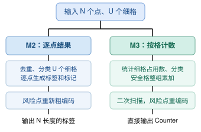
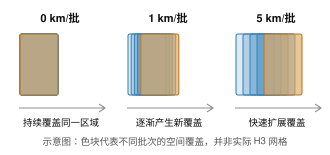
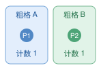
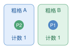
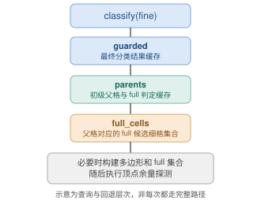
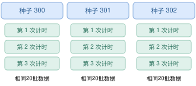

# 复杂度对比分析

## 提问目录

1. M3沿用M2的几何分类器，只改变计数执行方式。请结合实际代码解释，它省去了哪些操作，又增加了哪些操作？为什么不能据此声称整体复杂度从O(N)降到了O(U)？
2. 补充实验同时加入了列表计数B1和流式计数B1s。为什么B1s是必要基线？每个种子事后选择两者中较快者作为强参照，会怎样影响结果解释？请同时保留两个基线各自的比较结果。
3. 每批10万点、累计20批时，强参照与M3的平均耗时比分别为U组1.071、C组1.089。这两个数具体表示什么？如果改写为耗时减少百分比，是否需要从逐种子结果重新计算，而不能直接写成减少7.1%和8.9%？
4. M3在小批次中仍慢于直接编码，在边界压力组中还慢于M2。请先列出日志能够确认的事实，再提出可能原因。现有记录能否区分分组成本、风险点编码成本和计数结构成本？如果不能，最小诊断应测量什么？
5. 空间漂移实验中，0、1、5公里三种条件在10批内都没有累计优势。为什么不能直接断言，变慢完全由缓存命中率下降造成？移动距离还同时改变了哪些因素？请说明这些结果对方法适用范围的限制。
6. 四个新区域共108组、54万点，M2逐点差异和M3计数L1差均为0。为什么仍不能保证全球零误差？M3只输出计数时，为什么还需要M2提供逐点检查？旧失败回归的12次检查又为什么不能当作12个独立位置？
7. M3的Python分配峰值低于M2，但明显高于流式直接编码B1s。报告应该怎样准确描述这一结果？tracemalloc没有覆盖哪些内存？只有一条内存序列时，哪些结论还不能成立？
8. 现有M2与M3比较，以及M3与每批重建的A3比较，分别能回答什么问题？它们能否独立证明收益来自某一层缓存？如果不能，请指出仍混在一起的数据结构成本和对象生命周期差异。
9. 成本实验只有3个随机种子，每个种子重复计时3次。应该把什么作为统计单位？为什么不能把9次计时当作9个独立空间样本？在当前证据下，报告种子均值和范围是否比宣称统计显著更合适？
10. 结合密集批次的小幅收益、小批次与漂移条件的负结果，以及有限区域的正确性检查，请重新界定这项工作的贡献。哪些属于已有H3知识，哪些属于本项目的执行改动和实验发现？如果下一步根据这些结果修改方法，应怎样登记开发数据，并安排新的验证数据？

---

## 第1轮

### 用户

M3沿用M2的几何分类器，只改变计数执行方式。请结合实际代码解释，它省去了哪些操作，又增加了哪些操作？为什么不能据此声称整体复杂度从O(N)降到了O(U)？

### ChatGPT

**核心结论：M3 的优化不是将整体算法复杂度从** $O(N)$ **降为** $O(U)$**，而是将安全细格内的逐点结果生成与计数，改为按细格聚合计数。** 它减少了逐点输出列表和部分计数操作，却仍需至少两次遍历输入点，因此整体时间复杂度仍包含不可消除的 $O(N)$ 项。

根据 GitHub 仓库中的实际实现：

* **M2**：`supplement_20261117/methods.py`、`methods_v2.py`，使用 `LocalRecoder.assign()`。
* **M3**：`supplement_20261117/methods_count.py`，使用 `CountRecoder.count()`。
* **共同分类器**：M3 继承 M2 的 `LocalRecoder`，继续使用 `full` 几何筛选和 `1e-9` 度顶点余量探测，不改变安全/风险细格的判定规则。

源码：[M2 逐点赋值实现](https://github.com/Augen-Jik/h3-boundary-aggregation-study/blob/main/supplement_20261117/methods.py) · [M3 计数实现](https://github.com/Augen-Jik/h3-boundary-aggregation-study/blob/main/supplement_20261117/methods_count.py)

## **1. M2 与 M3 的执行路径差异**

执行路径示意：两种方法共享分类逻辑，差别在分类后如何形成计数结果。

## **2. M3 具体省去了哪些操作？**

M2 的核心代码是：


```python
classifications = {
    cell: self.classify(cell) for cell in set(fine_cells)
}
output = []
interior = []

for lat, lon, fine in zip(latitudes, longitudes, fine_cells, strict=True):
    parent, safe = classifications[fine]
    output.append(
        parent if safe else h3.latlng_to_cell(
            lat, lon, self.coarse_resolution
        )
    )
    interior.append(safe)

return output, interior

```


M3 则将其改成：


```python
occupancy = Counter(fine_cells)
output = Counter()
risk = set()

for fine, n in occupancy.items():
    parent, safe = self.classify(fine)
    if safe:
        output[parent] += n
    else:
        risk.add(fine)

for lat, lon, fine in zip(latitudes, longitudes, fine_cells, strict=True):
    if fine in risk:
        output[h3.latlng_to_cell(
            lat, lon, self.coarse_resolution
        )] += 1

return output

```


逐项对比如下：

| 操作 | M2 | M3 |
| --- | --- | --- |
| 统计或去重已占用细格 | `set(fine_cells)` | `Counter(fine_cells)` |
| 细格几何分类 | 每个不同细格一次 | 相同分类器 |
| 安全点输出 | 逐点 `append(parent)` | 按格 `output[parent] += n` |
| 安全点查询分类结果 | 每点一次 | 不再需要逐点查分类字典 |
| `interior` 标记列表 | 生成 N 个布尔值 | 不生成 |
| 风险点粗编码 | 逐点执行 | 逐点执行 |
| 最终计数 | 评测脚本另外执行 `Counter(output)` | 直接返回 `Counter` |

因此，**M3 省去的主要是安全点逐点展开、逐点标记和结果列表再次统计的操作，而不是所有逐点工作。**

## **3. M3 又增加了哪些操作？**

M3 新增了三个关键步骤。

**第一，构建细格占用频数表。**

`Counter(fine_cells)` 需要读取全部 N 个细格 ID，统计每个细格中有多少点。虽然最终只有 U 个键，但构建过程仍需处理 N 个元素。

**第二，维护风险细格集合。**

通过 `risk.add(fine)` 记录不能安全整组汇总的细格，并在后续逐点循环中执行 `fine in risk`。

**第三，对所有输入点进行第二次扫描。**

这一点尤其关键：


```python
for lat, lon, fine in zip(...):
    if fine in risk:
        ...
```


即使所有细格都是安全的，`if fine in risk` 也要对 N 个点逐一执行。只有风险格中的点才调用 `latlng_to_cell`，但循环本身没有消失。

## **4. 为什么不能声称 O(N) 降到 O(U)？**

定义：

* $N$：输入点总数。
* $U$：输入中不同细格的数量，$U\leq N$。
* $R$：落在风险细格内、需要重新粗编码的点数，$R\leq N$。
* $C_g$：单次细格分类成本。
* $C_e$：单次点粗编码成本。

按哈希表操作期望常数时间估计，M3 的工作量可拆解为：

| M3 处理阶段 | 复杂度 |
| --- | --- |
| 构建 `Counter(fine_cells)` | $O(N)$ |
| 对 U 个不同细格执行分类 | $O(U C_g)$ |
| 安全细格整组累加、记录风险格 | $O(U)$ |
| 第二次扫描所有输入点 | $O(N)$ |
| R 个风险点重新粗编码 | $O(R C_e)$ |

因此：


$$
\boxed{T_{\mathrm{M3}}=O(N+UC_g+RC_e)}
$$


在将分类与粗编码视为常数成本的简化模型下：


$$
T_{\mathrm{M3}}=O(N+U+R)=O(N)
$$


而 M2 也具有：


$$
T_{\mathrm{M2}}=O(N+UC_g+RC_e)
$$


两者的渐近复杂度同阶，但常数因子、对象分配和内存访问模式不同。实际几何分类还可能涉及候选细格枚举，不能在所有情况下直接视为统一常数。

即使 $U\ll N$，M3 仍需读取全部点并再次扫描，所以存在 $\Omega(N)$ 的输入处理下界。更重要的是，风险细格中的不同坐标可能映射到不同粗格，因此不能只凭每个细格的点数完成准确重编码。

**只有单独讨论“已构建占用频数表后的安全细格计数阶段”，才能说其成本由逐点处理转为按 U 个细格处理。** 这不代表完整算法已经变成 $O(U)$。

## **5. 实验结果是否支持这一解释？**

仓库已有的补充实验也说明，M3 的收益是条件性的，而非复杂度阶数上的普遍优势。

数据来源：[补充实验汇总 summary.json](https://github.com/Augen-Jik/h3-boundary-aggregation-study/blob/main/supplement_20261117/derived/summary.json)，20 个新批次累计时间，3 个种子。

| 条件 | M3 / M2 加速比 | 相对较快直接编码基线的加速比 |
| --- | --- | --- |
| U，10万点/批 | 1.071× | 1.071× |
| C，10万点/批 | 1.093× | 1.089× |
| B，1万点/批 | 0.955× | 0.446× |

这里加速比定义为参照方法耗时除以 M3 耗时，大于 1 才代表 M3 更快。

这与代码机制吻合：大量点重复落入安全细格时，整组计数可以减少逐点操作；而边界压力数据中风险点比例达到 100% 时，M3 不但无法避免风险点粗编码，还承担占用统计、分类和集合判断的额外开销。

## **6. 报告中建议采用的严谨表述**


### M3：面向计数输出的细格聚合执行优化

M3 在不改变 M2 几何分类规则的前提下，将逐点标签生成改为按细格占用频数直接计数。对于判定为安全的细格，M3 将该格内点数一次性累加至对应粗格，避免逐点生成粗格标签、内部标记及后续对完整标签列表的重复计数；对于风险细格，仍保留逐点粗编码，以维持与 M2 相同的分类后归属规则。

该优化引入了细格频数统计、风险细格集合维护和第二次输入扫描。设输入点数为 N、不同细格数为 U、风险点数为 R，则在哈希操作期望常数时间的假设下，其时间成本可表示为 O(N + UC_g + RC_e)，其中 C_g 和 C_e 分别为分类与粗编码成本。因此，M3 并未将完整处理复杂度由 O(N) 降至 O(U)，而是减少了安全细格的逐点结果物化和计数开销。

实验表明，这种执行优化在大规模、跨批次复用较充分的工作负载中能够取得一定收益，但在小批次及边界压力条件下可能被额外管理开销抵消。M3 的贡献应定位为输出需求驱动的执行路径优化及其适用边界验证，而非渐近时间复杂度的降低。


**最终应强调的创新点：M3 实现了从“逐点生成结果再计数”到“安全格整组计数、风险点精细回退”的执行优化，而不是将完整点处理问题变成了仅依赖不同细格数量的算法。**

---

## 第2轮

### 用户

补充实验同时加入了列表计数B1和流式计数B1s。为什么B1s是必要基线？每个种子事后选择两者中较快者作为强参照，会怎样影响结果解释？请同时保留两个基线各自的比较结果。

### ChatGPT

**结论：B1s 是必要的公平性基线，因为 M3 的核心改进之一就是避免生成长度为 N 的中间结果列表。如果只与需要先创建列表的 B1 比较，就可能将“省去列表物化”的常规实现收益误认为 M3 特有的算法优势。**

每个种子选取 B1、B1s 中实测更快者作为强参照，是一种更严格的性能评估方式，但它属于**按结果择优的合成参照**，不能替代两种固定基线各自的比较结果。

## **1. 为什么必须加入 B1s？**

核对仓库中的 [run\_supplement\_v3.py](https://github.com/Augen-Jik/h3-boundary-aggregation-study/blob/main/supplement_20261117/run_supplement_v3.py)，两种基线的实际区别是：


```python
def direct(lat, lon, rc, stream=False):
    it = (
        h3.latlng_to_cell(a, b, rc)
        for a, b in zip(lat, lon)
    )
    return Counter(it if stream else list(it))

```


* **B1（列表计数）**：先把 N 个点的粗格编码物化为列表，再执行 `Counter`。
* **B1s（流式计数）**：直接把生成器传给 `Counter`，避免创建中间列表。
* **M3（局部聚合计数）**：对安全细格整组累加，对风险点重新粗编码，同时维护细格频数和几何缓存。

三者都直接输出粗格计数，因此 B1s 是一个更有针对性的参照：它检验的是，M3 除了消除中间列表之外，是否还能通过安全细格整组计数获得额外收益。

这一比较尤其重要，因为流式计数不需要引入 M3 的几何分类、风险集合和跨批缓存结构。

## **2. 保留 B1、B1s 和强参照的全部结果**

数据来自仓库 [supplement\_20261117/derived/summary.json](https://github.com/Augen-Jik/h3-boundary-aggregation-study/blob/main/supplement_20261117/derived/summary.json)。

下表为 20 个新批次的累计时间加速比。每个条件包含 3 个种子、每种子 3 次重复；先取每个种子的累计时间中位数，再计算加速比并对种子求均值。

加速比 = 参照方法耗时 / M3 耗时。大于 1 表示 M3 更快，小于 1 表示 M3 更慢。

| 数据条件 | B1 / M3 | B1s / M3 | 强参照 / M3 |
| --- | --- | --- | --- |
| U，1千点/批 | 0.062 | 0.061 | 0.061 |
| U，1万点/批 | 0.371 | 0.359 | 0.359 |
| U，10万点/批 | 1.174 | 1.071 | 1.071 |
| C，1千点/批 | 0.088 | 0.088 | 0.088 |
| C，1万点/批 | 0.413 | 0.410 | 0.410 |
| C，10万点/批 | 1.197 | 1.089 | 1.089 |
| B，1万点/批 | 0.461 | 0.446 | 0.446 |

U 为均匀分布，C 为聚集分布，B 为边界压力分布。表中数值保留三位小数。

M3 相对两种直接计数基线的加速比

20 批累计时间；1.0 为速度持平线。

B-1万

B1 / M30.5

B1s / M30.4

强参照 / M30.4

B1 / M3

B1s / M3

强参照 / M3



* U-1千: B1 / M3 0.1, B1s / M3 0.1, 强参照 / M3 0.1
* U-1万: B1 / M3 0.4, B1s / M3 0.4, 强参照 / M3 0.4
* U-10万: B1 / M3 1.2, B1s / M3 1.1, 强参照 / M3 1.1
* C-1千: B1 / M3 0.1, B1s / M3 0.1, 强参照 / M3 0.1
* C-1万: B1 / M3 0.4, B1s / M3 0.4, 强参照 / M3 0.4
* C-10万: B1 / M3 1.2, B1s / M3 1.1, 强参照 / M3 1.1
* B-1万: B1 / M3 0.5, B1s / M3 0.4, 强参照 / M3 0.4

从结果可以得到三个重要判断。

**第一，B1 确实会放大部分场景下 M3 的表观优势。** 在 U、每批 10 万点条件下，M3 相对 B1 的加速比为 1.174 倍，但相对 B1s 只有 1.071 倍。在 C、每批 10 万点条件下，相应数值为 1.197 倍和 1.089 倍。

**第二，M3 的大批次优势并非完全来自消除列表物化。** 即使使用 B1s，M3 在上述两组密集批次实验中仍分别达到约 1.071 倍和 1.089 倍加速。但这只能说明相对于实际测试的 B1s 实现有额外性能收益，不能把全部收益严格归因于整组计数，还需要分阶段消融来分离缓存、分类和计数的贡献。

**第三，B1s 揭示了 M3 的内存局限。** 在单独的 `tracemalloc` 测试中，B1、B1s、M3 的 Python 峰值分配分别约为 6.12 MiB、0.024 MiB、4.12 MiB。M3 虽然降低了相对 B1 的峰值，但远高于 B1s，不能声称 M3 比所有直接计数实现都更省内存。这些数字也不能直接解释为进程总 RSS。

## **3. 每个种子事后选择较快者，会造成什么影响？**

冻结协议采用的强参照定义为：


$$
T_{\mathrm{strong},s}
=\min(T_{\mathrm{B1},s},T_{\mathrm{B1s},s})
$$


其中 $T$ 为每个种子下三次重复的累计时间中位数。强参照加速比为：


$$
S_{\mathrm{strong}}=
\frac{1}{3}\sum_{s=1}^{3}
\frac{T_{\mathrm{strong},s}}{T_{\mathrm{M3},s}}
$$


这带来以下影响：

**1. 对 M3 的速度优势评价更保守。**

因为同一种子中所选的参照时间不会大于 B1 和 B1s 各自的时间，所以强参照加速比不会高于任一固定基线的对应加速比。

如果 M3 对强参照依然表现更快，那么它在这些种子上也能击败两个单独基线。不过，这不等于获得统计显著性结论。

**2. 存在事后择优的统计偏差。**

计时存在随机波动，即使两种实现真实速度接近，选取两者实测值中的最小者，也容易选中偶然更快的测量结果。

因此，强参照的时间估计可能偏低，使 M3 相对于该参照的加速比偏小。它不是对某一种固定算法性能的无偏估计。

尤其要注意：虽然本实验的“取最小值”规则已经写入冻结协议，但**规则预先固定，并不意味着实测择优没有选择偏差**。

**3. 强参照不代表实际可直接部署的单一算法。**

它允许每个种子选择不同的计数实现，相当于使用已知运行结果的离线选择策略。

真实部署时通常无法事先知道哪种实现一定更快。因此不能将其描述为一个已经实现、能够自动取得最小运行时间的通用基线。

**4. 强参照的汇总值不一定等于两列平均加速比中的较小者。**

因为实验是先逐种子取最小值，再计算比值并求均值。

例如 C、每批 1000 点时，未四舍五入的强参照平均加速比为 0.087887，低于 B1 的 0.088354 和 B1s 的 0.088479。这是统计顺序产生的正常结果，不是数据错误。

## **4. 报告应当如何修改结论？**

建议在正文中保留 B1、B1s 的独立结果，将强参照作为补充的保守比较指标，不要只展示强参照一列。

可直接采用以下表述：


### 直接计数基线与保守性能参照

为避免将中间列表物化产生的开销误认为 M3 的特有收益，本实验同时设置列表计数 B1 与流式计数 B1s。两者均对每个输入点直接执行目标分辨率的 H3 编码并统计频数，区别在于 B1 先建立完整编码列表，而 B1s 直接通过生成器构建 Counter。

实验分别报告 M3 相对 B1、B1s 的加速比，并按照实验前冻结的规则，以每个种子中两种直接计数方法的较小累计时间中位数构建强参照。该参照对 M3 的性能优势提出更严格的比较要求，但因其使用实测结果逐种子择优，属于离线合成参照，不能代表单一固定实现，也可能受到计时波动引起的选择偏差影响。

在每批 10 万点、累计 20 个不同新批次的 U 和 C 条件下，M3 相对 B1 的平均加速比分别为 1.174 和 1.197，相对 B1s 则分别为 1.071 和 1.089。这说明 M3 在相应密集负载下的性能优势并未因采用流式计数基线而完全消失，但优势幅度明显收窄。

另一方面，在每批 1000、10000 点及边界压力条件下，M3 仍落后于直接计数基线。流式计数还具有明显更低的 Python 峰值分配开销。因此，M3 的贡献应限定为特定密集、跨批次复用工作负载下的条件性执行效率改进，而不应扩展为普遍优于直接计数、普遍节省内存或具有更低渐近复杂度的结论。


**论文展示上的最佳处理是：主表同时放 B1、B1s、M3 的累计时间及两组独立加速比；强参照作为附加列，并明确其逐种子择优定义。** 这样既能突出 M3 在大批次场景中经更强比较后仍保留的收益，又能经得住对基线公平性和事后选择偏差的审查。

---

## 第3轮

### 用户

每批10万点、累计20批时，强参照与M3的平均耗时比分别为U组1.071、C组1.089。这两个数具体表示什么？如果改写为耗时减少百分比，是否需要从逐种子结果重新计算，而不能直接写成减少7.1%和8.9%？

### ChatGPT

**是的。若严格沿用补充实验中“先按种子计算，再对种子求均值”的统计口径，就必须从逐种子结果重新计算耗时减少百分比，不能直接把 1.071 和 1.089 写成“耗时减少 7.1% 和 8.9%”。**

我已核对 GitHub 中 6 组原始计时文件，得到以下结果：

U 组 · 均匀分布

# **6.66%**

平均累计耗时减少

平均耗时比：1.0714

C 组 · 聚集分布

# **8.19%**

平均累计耗时减少

平均耗时比：1.0893

## **1. 1.071 和 1.089 具体表示什么？**

设每个种子的强参照累计耗时为 $T_{\mathrm{strong},s}$，M3 累计耗时为 $T_{\mathrm{M3},s}$。

原实验计算的是：


$$
\bar q=\frac{1}{3}\sum_{s=1}^{3}
\frac{T_{\mathrm{strong},s}}{T_{\mathrm{M3},s}}
$$


因此，U 组的 1.071 表示：**三个种子的强参照/M3 累计耗时比，平均为约 1.071 倍。**

C 组的 1.089 同理。

这是加速比（speedup ratio）的算术平均，不是耗时减少比例，也不是将所有种子的时间先求和后再相除所得的比值。

## **2. 从原始数据重新计算**

本次读取了 `supplement_v3` 中 U、C 两组，种子 300、301、302 的原始数据。每个种子的时间均为 20 批累计耗时在三次重复中的中位数，单位为秒。

| 分布 | 种子 | 强参照耗时 | M3 耗时 | 耗时减少 |
| --- | --- | --- | --- | --- |
| U | 300 | 2.6990 | 2.5365 | 6.02% |
| U | 301 | 2.8503 | 2.6434 | 7.26% |
| U | 302 | 2.6565 | 2.4781 | 6.71% |
| **U 平均** |  |  |  | **6.66%** |
| C | 300 | 2.6142 | 2.3794 | 8.98% |
| C | 301 | 2.7677 | 2.5369 | 8.34% |
| C | 302 | 2.6406 | 2.4493 | 7.24% |
| **C 平均** |  |  |  | **8.19%** |

需要说明的是，这六个种子中，实际被选为强参照的均为 B1s。但强参照的选择规则仍然是逐种子取 B1 和 B1s 中的较小累计时间。

原始数据：[U 组文件目录](https://github.com/Augen-Jik/h3-boundary-aggregation-study/tree/main/supplement_20261117/supplement_v3)；计算结果可与 [summary.json](https://github.com/Augen-Jik/h3-boundary-aggregation-study/blob/main/supplement_20261117/derived/summary.json) 中的加速比核对。

## **3. 为什么不能直接写 7.1% 和 8.9%？**

这里存在两个不同的百分比定义。

**定义 A：参照方法比 M3 多耗时多少（分母为 M3）。**


$$
\frac{T_{\mathrm{strong}}-T_{\mathrm{M3}}}
{T_{\mathrm{M3}}}\times100\%
=(q-1)\times100\%
$$


所以，1.0714 对应约 7.14%，1.0893 对应约 8.93%。它们表示强参照相对于 M3 的耗时增加比例，不是 M3 相对于强参照的耗时减少比例。

**定义 B：M3 相对于强参照减少多少耗时（分母为强参照）。**


$$
r_s=
\left(1-\frac{T_{\mathrm{M3},s}}
{T_{\mathrm{strong},s}}\right)\times100\%
$$


既然原报告采用逐种子等权平均，就应计算：


$$
\boxed{\bar r=\frac{1}{3}\sum_{s=1}^{3}r_s}
$$


得到：

* U 组：6.6648%，报告为 **6.66%**。
* C 组：8.1894%，报告为 **8.19%**。

另外，即使使用完整精度的平均加速比计算 $1-1/\bar q$，得到的也只是近似值。因为一般情况下：


$$
\frac{1}{3}\sum_s\left(1-\frac{1}{q_s}\right)
\ne
1-\frac{1}{\frac13\sum_s q_s}
$$


所以，若要求与原实验汇总口径严格一致，必须逐种子转换后再求均值。

## **4. 报告中推荐的最终表述**

建议直接修改为：

> 在每批 100000 点、累计 20 个不同新批次的条件下，M3 相对于逐种子择优的直接编码强参照，在 U 组和 C 组分别取得 1.071 倍和 1.089 倍的平均累计耗时比。按照逐种子计算相对耗时降幅、再对三个种子取算术平均的统计口径，M3 的累计耗时分别减少 **6.66% 和 8.19%**。上述结果仅对应已测试的密集批次条件，不代表全部负载下的普遍加速。

这样既保留了原始的加速比指标，也给出了统计口径一致、分母明确的耗时降幅，不会混淆“加速比高于 1 的百分比”和“实际耗时减少百分比”。

---

## 第4轮

### 用户

M3在小批次中仍慢于直接编码，在边界压力组中还慢于M2。请先列出日志能够确认的事实，再提出可能原因。现有记录能否区分分组成本、风险点编码成本和计数结构成本？如果不能，最小诊断应测量什么？

### ChatGPT

**结论：现有日志能够确认 M3 的性能劣势及其出现条件，但还不能把劣势定量归因于分组成本、风险点粗编码成本或计数结构成本。** 代码可以支持若干机制解释，但这些解释目前仍属于待验证假设。

## **一、日志已经能够确认的事实**

依据仓库中的 [实验汇总](https://github.com/Augen-Jik/h3-boundary-aggregation-study/blob/main/supplement_20261117/derived/summary.json)、[逐种子结果](https://github.com/Augen-Jik/h3-boundary-aggregation-study/blob/main/supplement_20261117/derived/seed_results.csv) 和原始批次计时记录，能够确认以下事实。

### **1. 小批次中 M3 明显慢于直接编码**

以下均为 20 个不同新批次的累计耗时，单位为秒，按原协议汇总三个种子。

| 条件 | B1s | M2 | M3 | M3/B1s 耗时倍数 |
| --- | --- | --- | --- | --- |
| U，1千点/批 | 0.0267 | 0.4371 | 0.4388 | 16.44× |
| U，1万点/批 | 0.2900 | 0.8319 | 0.8080 | 2.79× |
| C，1千点/批 | 0.0260 | 0.3009 | 0.2941 | 约11.3× |
| C，1万点/批 | 0.2657 | 0.6676 | 0.6483 | 2.44× |

这证明 M3 在这些小批次条件下并没有取得端到端的累计性能优势。

但需注意，M3 在部分条件下略快于 M2。因此，“M3 小批次效率较差”应当明确是**相对于直接计数基线**，不能笼统表述为比所有方法都慢。

### **2. 边界压力组中 M3 比 M2 更慢**

B1s

## **0.2571 s**

M2

## **0.5502 s**

M3

## **0.5763 s**

在 B 分布、每批 10000 点、累计 20 批条件下，M3 比 M2 的累计耗时约高 **4.76%**。三个种子的累计中位耗时均表现为 M3 高于 M2。

同时，原始日志显示：

* 三个种子的每一批 `risk_fraction` 均为 1.0。
* 每批约占用 2870–2900 个不同细格。
* 20 批累计新增分类缓存条目分别为 3177、3174、3175。
* M2 和 M3 的计数结果均通过了与直接编码的等价检查。

这些事实说明：**在当前 B 压力数据中，M3 没有任何安全细格中的点可通过整组计数避免粗编码。**

### **3. 已记录缓存变化，但尚未记录分阶段时间**

实验日志保存了每批的整体耗时、占用细格数、分类缓存新增量、风险点比例和输出一致性检查结果。

然而，`new_cells` 只是新增分类缓存条目数量，不能直接视为几何运算时间；`risk_fraction` 只是风险点占比，也不能单独反推出粗编码耗时。

## **二、可能原因：代码支持，但尚未定量验证**

**假设 A：小批次的分组和分类成本难以摊薄**

M3 每批都构建 `Counter(fine_cells)`，并遍历全部已占用细格调用分类器。跨批缓存虽然避免重复计算部分几何状态，但频数统计、分类查询和风险集合构造仍每批发生。对于 N 较小时，这些固定或随 U 增长的成本可能相对于直接编码更突出。

目前可以观察到总耗时劣势，但不能确定其中有多少来自分组与分类。

**假设 B：风险点比例越高，可节省的粗编码工作越少**

M3 对风险点仍执行 `h3.latlng_to_cell()`。B 组风险点比例为 100%，意味着 N 个点都必须重新粗编码，而安全格整组累加的核心收益完全无法发挥。

代码直接支持这一机制，但“风险编码占总耗时多少”仍未测得。

**假设 C：M3 的计数结构与额外遍历抵消了列表节省**

M3 需要构建占用频数表、维护 `risk` 集合、第二次扫描全部输入点、判断集合成员，并逐次更新 `Counter`。M2 则使用 `set` 去重，生成逐点列表后再进行计数。

在全部点均需重新编码的 B 组，M3 可能因为这些额外结构操作而比 M2 慢。但现有数据不能证明究竟是 `Counter(fine_cells)`、集合查询还是逐次更新主导了差异。

因此，不能直接得出“边界组慢是因为 Counter 效率低”或“小批次慢完全因为几何初始化”的结论。

## **三、现有记录能否分离三类成本？**

**不能。** 现有计时采用包围整个方法调用的 `time.perf_counter()`，未分别测量 M3 内部阶段。

| 成本类别 | 已有记录 | 能否单独量化 |
| --- | --- | --- |
| 分组成本 | N、U、总耗时 |  |
| 几何分类成本 | 新增分类缓存条目 |  |
| 风险点粗编码成本 | 风险点比例 R/N |  |
| 计数结构成本 | M2/M3 整体时间差 |  |
| 总体性能差异 | 逐批、逐重复耗时 |  |

尤其需要避免把 M3 和 M2 的整体耗时差直接解释为“计数结构成本”。两者不仅计数数据结构不同，分组方式、点遍历方式以及临时对象分配也不同。

## **四、最小诊断应该增加什么？**

建议**不修改冻结的 M2/M3 评测结果，另建独立诊断脚本**，在相同输入和相同缓存状态下测量以下阶段。

| 诊断项 | 需要测量的内容 | 目的 |
| --- | --- | --- |
| T1：分组 | `set(fine_cells)` 与 `Counter(fine_cells)` 各自耗时 | 分离去重与频数统计开销 |
| T2：分类 | 分类循环耗时、缓存命中数、未命中数、实际几何构造次数 | 判断冷启动和分类是否主导 |
| T3：风险扫描 | N 次遍历与 `fine in risk` 判断耗时 | 量化额外点遍历成本 |
| T4：风险编码 | R 次 `latlng_to_cell()` 的耗时及调用次数 | 判断风险点重编码的贡献 |
| T5：结果计数 | 已有目标格 ID 的 `Counter` 更新、整组累加、M2 列表生成与最终 `Counter` 转换成本 | 比较计数结构本身 |

T3、T4、T5 在原实现中相互交织，不能简单通过三个带计时器的循环完全分开。较稳妥的办法是结合阶段计时与独立微基准：先测真实整体执行，再在单独诊断中分别测量集合查询、H3 编码调用和 Counter 更新，检查各阶段耗时及其交互影响。

### **最小实验矩阵**

建议先只选取三个具有代表性的场景：

* **U，1000 点/批**：诊断小批次分组与分类开销。
* **B，10000 点/批**：诊断风险比例 100% 时 M3 为何慢于 M2。
* **U，100000 点/批**：作为已有正收益条件，对照哪些阶段的成本得到摊薄。

每个条件沿用原种子 300–302，分别记录第 1 批冷启动、第 2 批以及第 20 批的阶段时间，同时保存 20 批总计时。重复运行、交错顺序，保持相同输入、软硬件环境及一致的缓存初始化规则。

这样就能回答两个有价值的问题：M3 的小批次劣势主要发生在首次分类还是持续存在于后续批次？B 组的 M3/M2 差异究竟由额外分组、风险点处理还是结果计数产生？

如果要进一步建立因果解释，应在诊断后增加受控消融，而非仅依据阶段耗时相关性进行归因。

## **五、适合报告的阶段性结论**


### M3 性能负结果与成本归因的局限

补充实验表明，M3 在小批次任务中仍明显慢于直接编码基线。在边界压力条件下，M3 的20批累计耗时为0.5763 s，高于M2的0.5502 s，增幅约为4.76%。该条件下所有测试点均被分类为风险点，因此M3无法通过安全细格整组累加省去任何点级粗编码。

从实现机制看，M3需要额外执行细格频数统计、风险集合维护和第二次输入扫描。这些操作可能抵消其避免逐点结果物化的收益。同时，小批次中分组、分类及缓存建立成本可能难以通过批量处理摊薄。

但现有日志仅包含整体耗时、风险点比例及缓存新增量，尚不能定量区分分组成本、风险编码成本和计数结构成本。因此，上述解释属于代码支持的机制假设，而非已通过实验确认的成本归因。后续需要通过独立阶段计时和受控消融验证各项成本的实际贡献，并保留小批次及边界压力条件下的性能负结果。


**建议下一步优先开展这项最小诊断，而不是继续增加新的数据分布或调整分类器。** 现有实验已经能够证明 M3 的条件性优势及失败边界；补上成本拆解，才能把报告从“展示性能变化”进一步推进到“解释性能变化的机制”。

---

## 第5轮

### 用户

空间漂移实验中，0、1、5公里三种条件在10批内都没有累计优势。为什么不能直接断言，变慢完全由缓存命中率下降造成？移动距离还同时改变了哪些因素？请说明这些结果对方法适用范围的限制。

### ChatGPT

**不能把空间漂移实验中的性能下降完全归因于缓存命中率降低。** 因为实验同时改变了空间覆盖、细格集合、父格分布、几何分类工作量以及风险点的具体位置，而现有日志没有单独测量这些因素的时间贡献。

更重要的是，**0 km 无漂移条件在前 10 批内同样没有累计优势**。这说明即使空间位置稳定、分类缓存得到充分复用，M3 也未必能够在较短的批次序列中收回首次初始化和几何分类成本。

## **一、先看日志能够确认的事实**

实验条件为每批 100000 点、累计 10 批，采用 U 均匀分布、种子 400–402。漂移距离指每增加一批，采样区域相对初始位置沿 UTM 东向移动的距离。

| 每批漂移 | 10批累计新增细格分类条目（约） | 平均强参照/M3 耗时比 | 10批累计结果 |
| --- | --- | --- | --- |
| 0 km | 8,742 | 0.908 | M3 更慢 |
| 1 km | 16,505 | 0.737 | M3 更慢 |
| 5 km | 47,763 | 0.397 | M3 更慢 |

加速比小于 1 表示 M3 更慢。数值为逐种子统计后的平均值，新增条目为三个种子的近似平均。

空间漂移下 M3 的10批累计性能

强参照耗时 / M3 耗时；1 为性能持平线，低于 1 表示 M3 较慢。

5 km/批

强参照 / M30.4



* 0 km/批: 强参照 / M3 0.9
* 1 km/批: 强参照 / M3 0.7
* 5 km/批: 强参照 / M3 0.4

另外，从每批的描述性记录还可以确认：

* 0 km 组在第 10 批几乎没有新增分类条目，但累计性能仍未超过直接计数强参照。
* 1 km 和 5 km 组持续出现新的细格分类需求，且累计新增数量随着漂移距离增大而上升。
* 三组的平均风险点比例都约为 **36.7%**，没有证据表明总体风险点比例随漂移距离大幅上升。
* 所有三个漂移条件下，已记录的 M3 输出均通过计数等价检查。

这些事实支持“空间漂移与缓存复用减少、性能下降同时出现”，但还不能证明缓存复用下降是唯一原因或解释了多少性能差异。

原始依据：[空间漂移日志与执行代码](https://github.com/Augen-Jik/h3-boundary-aggregation-study/tree/main/supplement_20261117)。

## **二、为什么不能把性能下降完全归因于缓存命中率？**

从代码看，M3 的分类结果缓存在 `guarded` 字典中，几何候选集合还保存在 `full_cells` 中。空间漂移确实会让更多以前未遇到的细格进入分类流程，但\*\*“新增分类条目增加”不等于“已经证明耗时增加全部由缓存未命中造成”\*\*。

原因主要有两点。

首先，实验没有直接记录各类缓存查询的命中次数和耗时，也没有单独计时几何分类。因此无法计算缓存未命中增加究竟贡献了多少额外时间。

其次，移动采样区域不仅改变缓存复用，还会改变后续处理的输入结构。即使固定缓存状态，不同区域的数据也可能具有不同执行成本。

0 km 组提供了一个重要反例：该组第 10 批的新增分类条目在三个种子中分别只有 0、2、0 个，但前 10 批累计耗时仍未低于强参照。其首批 M3 耗时约 0.52–0.57 秒，而 B1s 首批约 0.12–0.14 秒。说明**较大的冷启动成本和有限的摊销批次数**也是需要考虑的因素。

这并不否认缓存复用的重要性，而是说明现有证据不足以把它判定为唯一原因。

## **三、移动距离还同时改变了哪些因素？**



根据 [datasets.py](https://github.com/Augen-Jik/h3-boundary-aggregation-study/blob/main/supplement_20261117/datasets.py) 和 [run\_supplement\_v3.py](https://github.com/Augen-Jik/h3-boundary-aggregation-study/blob/main/supplement_20261117/run_supplement_v3.py)，各批次首先独立生成 10 km × 10 km 的均匀采样数据，随后按 `batch * shift` 进行 UTM 东向平移。

因此，漂移同时影响下列因素：

| 因素 | 可能发生的变化 | 对 M3 的潜在影响 |
| --- | --- | --- |
| 空间覆盖范围 | 批次之间的地理重叠减少 | 可复用的细格分类减少 |
| 不同细格集合 | 新的细格 ID 不断出现 | 增加分类查询与未命中 |
| 不同粗父格集合 | 采样区域跨过更多粗格 | 可能增加父格多边形及 `full_cells` 候选集合构造 |
| 细格占用频数 | 每个细格对应的点数分布发生变化 | 改变整组累加的收益与频数表结构 |
| 安全/风险格构成 | 网格边界与采样窗口的相对位置变化 | 可能改变风险点数量、位置及粗编码调用 |
| 计数输出结构 | 涉及的粗格键及其分布变化 | 可能改变 Counter 更新和哈希表操作成本 |

其中必须特别注意两点。

**其一，风险点比例并未明显增加。** 三种漂移条件下，平均风险点比例都约为 36.7%。因此，不能用“漂移越大，风险点越多”来解释本次性能下降。不过，即使风险点比例接近，具体风险点坐标、细格分布和编码成本仍可能不同。

**其二，直接编码基线处理的空间位置也发生了变化。** B1 和 B1s 虽然每批仍处理 10 万个点，但这些点的坐标不同，其实际运行时间也可能存在差异。因此分析相对性能时，必须保留每种漂移条件下直接编码基线的同期计时，而不能假设基线耗时恒定。

## **四、现有实验能支持怎样的因果解释？**

应区分以下三个层次：

| 结论 | 证据状态 |
| --- | --- |
| 漂移距离越大，10批累计新增分类条目越多 | 已观察到 |
| 在本次测试条件下，漂移距离越大，M3 相对强参照的累计性能越差 | 已观察到 |
| 性能下降完全由缓存命中率下降造成 | 尚未验证 |

如果需要单独验证缓存作用，最小的补充诊断应当**固定同一批输入点、细格 ID、风险点数量和计数输出需求，仅改变缓存状态**，比较冷缓存、部分预热和充分预热时的 M3 总耗时与分类阶段耗时。

然后再通过匹配风险比例、占用细格数等工作负载特征的跨区域比较，研究空间位置变化带来的其余影响。

但这些属于后续可执行的受控实验，不能描述为当前已经完成的因果消融。

## **五、结果如何限制 M3 的适用范围？**

空间漂移实验使 M3 的应用条件更加明确。

**适合进一步考虑的场景**是空间覆盖相对稳定、持续产生大量新点、相同细格反复出现，并且预计可以通过足够多的批次摊销首次几何分类成本的计数任务。

**需要谨慎采用的场景**是移动观测窗口、持续扩展地理覆盖、频繁出现此前未分类细格，或计算任务只持续少量批次的情况。即使单批点数达到 10 万，M3 也不一定优于直接流式编码。

还需要区分实验观察期限：原本每批 10 万点、累计 20 批的固定区域 U/C 实验取得了正收益；而空间漂移实验只观测了 10 批，连 0 km 条件也没有累计优势。因此，**不能据此断言漂移场景永远无法回本，也不能把固定区域 20 批的正收益推广到持续移动的场景。**

报告可将这部分概括为：

> 空间漂移实验揭示了 M3 对空间复用条件和累计处理期限的依赖。在 0、1、5 km/批的三种漂移设置下，10 批累计性能均未超过直接编码强参照，且随着漂移距离增加，累计新增细格分类条目明显增多、相对性能下降。然而，漂移同时改变了细格及父格覆盖、占用分布和潜在几何工作量，现有结果不能将性能下降完全归因于缓存命中率降低。因此，M3 的性能优势仅在已验证的密集、空间覆盖稳定且具有足够复用期限的工作负载中成立，尚不能推广至持续空间漂移的在线计数任务。

**对报告最重要的意义是：M3 的性能不仅由点数 N 决定，还受空间覆盖更新速度、细格复用程度、风险点比例和批次期限共同制约。** 这比单纯宣称“缓存命中率越高越快”更符合当前实验能支持的结论。

---

## 第6轮

### 用户

四个新区域共108组、54万点，M2逐点差异和M3计数L1差均为0。为什么仍不能保证全球零误差？M3只输出计数时，为什么还需要M2提供逐点检查？旧失败回归的12次检查又为什么不能当作12个独立位置？

### ChatGPT

**核心结论：54万点零误差证明的是 M2、M3 在本次指定测试集上的一致性，并不是对全球所有坐标、所有 H3 分辨率组合和所有数值边界条件的正确性证明。**

我核对了仓库中的新区域测试代码、M2/M3 实现及旧失败回归记录。三个问题应分别从**测试覆盖范围、验证指标的信息损失，以及样本独立性**来解释。

## **一、54万点零误差，为什么仍不能保证全球零误差？**

# **108**

新区域测试组合

# **540,000**

累计测试点数

# **0**

观测到的差异

实际测试组合为：


$$
4\text{个区域}\times3\text{种分布}
\times3\text{组分辨率}\times3\text{个种子}
=108\text{组}
$$


每组 5000 点，最终得到：

* M2 逐点归属差异：0。
* M3 计数 L1 差异：0。
* 测试使用的分辨率组合：9→8、10→8、10→9。

这说明在已测试样本上，两种方法均与直接粗编码参照一致。但存在四项限制。

**1. 区域覆盖有限。** 四个新区域是北京、深圳、悉尼和雷克雅未克。每个区域使用指定中心附近的局部采样窗口，并没有覆盖全球 H3 网格。极区、跨经度 ±180° 的区域、五边形及其邻域等特殊情况，也不能认为已经得到系统验证。

**2. 数据分布有限。** 实验使用 U 均匀分布、C 聚集分布和 B 边界压力分布。这些分布提高了测试的针对性，但仍属于人为构造的有限样本，不能穷尽所有近边界坐标和浮点扰动。

**3. 几何分类器没有获得数学正确性证明。** M2 使用 `h3shape_to_cells_experimental(..., contain="full")` 筛选候选细格，再使用 `1e-9` 度顶点邻域探测排除部分风险格。有限顶点探测不等于对细格整个边界及内部所有位置进行严格验证，也没有证明其与 H3 实际点归属在全球所有位置完全等价。

**4. M3 没有修复 M2 的潜在几何误判。** M3 继承了 M2 的分类器，仅改变计数执行方式。如果某个未测试的细格被错误判为安全，两者都可能把其中的点归入错误的逻辑父格。

因此，**扩大测试规模能够增加经验可信度，但不能自动将经验验证提升为全域正确性保证。**

## **二、M3 只输出计数，为什么还需要 M2 逐点检查？**

因为**计数正确不必然意味着逐点归属正确**。

两种验证指标回答的是不同问题：

| 验证方式 | 检查内容 | 能发现什么 |
| --- | --- | --- |
| M2 逐点差异 | 对每个点比较实际粗格与直接编码粗格 | 个体点的错误归属 |
| M3 计数 L1 差 | 比较每个粗格的最终计数 | 粗格计数的偏差 |

M2 的逐点差异定义为：


$$
E_{\mathrm{point}}=\sum_{i=1}^{N}
\mathbf{1}[\hat D(p_i)\ne D(p_i)]
$$


M3 的计数 L1 差定义为：


$$
E_{\mathrm{count}}=\sum_{h\in H}
|C_{\mathrm{M3}}(h)-C_D(h)|
$$


其中，$D(p)$ 是直接粗编码结果，$H$ 为预测和参考计数中所有出现过的粗格集合。

### **一个计数正确、逐点错误的例子**

正确逐点归属



错误归属但计数相同



示意：P1、P2 的归属互换

计数 L1 = 0

在右侧示例中，两点都归错了粗格，但 A 和 B 的最终计数仍分别为 1，所以计数 L1 差为 0。

因此，仅凭 M3 的计数 L1 差为 0，无法排除相互抵消的逐点错误。

### **M2 与 M3 的双重验证如何配合？**

实际代码里，M3 继承 M2 的几何分类器。两者的隐含归属规则相同：安全细格使用逻辑父格，风险细格逐点重新粗编码。

因此：

* M2 逐点检查验证共享分类规则在指定点集上是否符合直接粗编码。
* M3 计数检查验证新执行内核有没有在占用统计、整组累加或风险点计数时产生偏差。

两项检查是互补的。在这份实现中，如果代码确实保持共享的逐点归属规则，并且 M2 逐点验证全部正确，那么 M3 的计数理论上也应正确；独立计数检查则进一步验证 M3 是否忠实实现了该规则。

这里还有一项值得在报告中说明的细节：**54万是108组中累计处理的点样本次数，不等于54万个相互独立的地理位置。**

`datasets.py` 中 U、C 的采样不依赖测试的粗分辨率，因此同一区域、分布和种子对应的三个分辨率组合会重复使用坐标；B 分布中粗分辨率相同的 9→8 与 10→8 也复用坐标。按照生成规则，54万次点级检查至多涉及约24万个不同的采样坐标（未对全部浮点坐标做独立去重）。

这不影响报告“54万次点级验证均通过”的真实性，但不能把它写成“54万个独立位置均通过验证”。

## **三、旧失败回归的12次检查，为什么不是12个独立位置？**

我核对了两个文件：

* [old\_failure\_source.json](https://github.com/Augen-Jik/h3-boundary-aggregation-study/blob/main/supplement_20261117/supplement_v3/old_failure_source.json)
* [failure\_regression.json](https://github.com/Augen-Jik/h3-boundary-aggregation-study/blob/main/supplement_20261117/supplement_v3/failure_regression.json)

旧失败记录中实际只有 **4组原始经纬度坐标**，分别为杭州1组、南京3组。

回归脚本对每组坐标重复检查三个分辨率组合：


$$
4\text{组原始坐标}\times3\text{种分辨率组合}
=12\text{次检查}
$$


具体情况如下：

| 原始坐标记录 | 地区 | 回归检查次数 |
| --- | --- | --- |
| 第1组 | 杭州 | 3 |
| 第2组 | 南京 | 3 |
| 第3组 | 南京 | 3 |
| 第4组 | 南京 | 3 |
| **合计** | **4组坐标** | **12** |

还有一个容易忽视的细节：南京第3、4组记录的经度完全相同，纬度分别为 `32.07748218375047` 和 `32.07748218375046`，仅相差约 $10^{-14}$ 度。

因此，严格按浮点坐标对统计，有4组不同坐标；按通常地理尺度识别，则只涉及约3处可区分的空间位置。

此外，这12次检查并不具有独立性：

* 同一个位置被反复用于不同分辨率组合。
* 两组南京坐标几乎重合，属于高度相关的边界扰动。
* 四组坐标均来自先前已经发现的失败案例，并非本轮独立随机抽取的新位置。
* 原始四条失败记录均出现在10→8组合中，后续只是把同样坐标扩展到另外两种分辨率组合进行回归。

此次 M2、M3 的12次回归检查均通过，是有价值的**已知失败样本回归验证**。它表明修订后的分类规则在这些具体输入及组合上没有重现原错误，但不能把12行记录解释为12个空间独立的失败位置，也不能替代独立的新边界测试。

## **四、报告中应如何准确区分证据强度？**

| 结果 | 可以支持的结论 | 不能支持的结论 |
| --- | --- | --- |
| 新区域108组 | 多区域、多分布、多分辨率下的经验验证 | 全球全部情况均正确 |
| 54万次点级检查 | M2 在全部已测点-分辨率组合上与直接编码一致 | 54万个独立位置全部通过 |
| M3计数L1差为0 | 最终粗格计数与参照一致 | 单靠该指标证明每个点都归属正确 |
| 旧失败12次回归通过 | 已登记失败坐标的三种组合均已通过 | 修复了所有同类几何或浮点问题 |

H3 官方文档也明确区分了层级索引的逻辑包含关系与近似几何包含关系；`full` 属于实验性 polygon-to-cells 接口所支持的包含模式。这正是方法需要进行保守分类与风险回退的背景，但有限数值探测并不是严格的全局证明。

GitHub+1

## **五、建议直接写入报告的结论**


### 跨区域一致性验证及其局限

为检验方法在不同地理位置和空间分布下的一致性，补充实验选择北京、深圳、悉尼和雷克雅未克四个新区域，设置U、C、B三种数据分布、三组细粗分辨率组合及三个随机种子，共完成108组实验、54万次点级评估。

在上述测试中，M2与直接粗编码参照的逐点归属差异均为0，M3与参照计数的L1差异也均为0。两类指标分别用于验证共享分类规则的逐点一致性，以及M3计数执行内核的输出一致性，避免仅通过汇总计数掩盖可能相互抵消的点级归属错误。

但本次验证仍存在有限区域、有限分辨率和有限采样分布的覆盖限制，且不同测试组合复用了部分采样坐标。M2的几何分类器依赖实验性full候选筛选和有限顶点余量探测，尚未获得对全部地理位置及数值边界情况的严格正确性证明。M3沿用这一分类器，因此计数执行方式的调整不消除原有几何局限。

此外，旧失败回归共执行12次检查，但实际来源于4组原始坐标，其中两组南京坐标仅有极小纬度差异。该结果应理解为对已知失败输入及多个分辨率组合的回归验证，而非12个独立地理位置的新样本验证。

因此，本实验支持M2和M3在指定新区域测试集及已知失败回归集上的一致性结论，但不能据此声称全球零误差或普遍严格正确性。


**对这部分报告最重要的优化是：将“跨区域经验验证”“M2逐点正确性检查”“M3计数一致性检查”“历史失败回归”列为四项不同证据，而不是将它们简单合并为一个更大的零误差样本量。** 这样能够突出验证设计的完整性，同时避免超出实际证据的正确性声明。

---

## 第7轮

### 用户

M3的Python分配峰值低于M2，但明显高于流式直接编码B1s。报告应该怎样准确描述这一结果？tracemalloc没有覆盖哪些内存？只有一条内存序列时，哪些结论还不能成立？

### ChatGPT

**报告应将这一结果定位为“特定工作负载下 Python 层峰值分配的减少”，而不能表述为 M3 具有普遍内存优势。**

M3 相对 M2 的峰值分配明显降低，但 B1s 依然是本次测试中 Python 层内存开销最低的方法。这是必须保留的负面比较结果。

## **一、现有日志能够确认什么？**

根据仓库 [memory.json](https://github.com/Augen-Jik/h3-boundary-aggregation-study/blob/main/supplement_20261117/supplement_v3/memory.json)：

| 方法 | Python 峰值分配 | 测试结束保留分配 |
| --- | --- | --- |
| B1：列表计数 | 6.12 MiB | 312 B |
| B1s：流式计数 | 0.024 MiB | 80 B |
| M2：逐点赋值与计数 | 7.90 MiB | 3.87 MiB |
| M3：按细格计数 | 4.12 MiB | 3.76 MiB |

MiB = 1,048,576 字节。数据为特定一次内存测试的观测值，不是跨种子均值。

四种方法的 Python 峰值分配

杭州U分布，每批10万点，共5批；单位MiB。



* B1: 峰值分配 6.1 MiB
* B1s: 峰值分配 0 MiB
* M2: 峰值分配 7.9 MiB
* M3: 峰值分配 4.1 MiB

由此可以得到三个准确结论。

**第一，M3 相对 M2 的峰值下降约 47.84%。** 这与 M3 不再生成长度为 N 的粗格标签列表和内部标记列表的代码机制相符，但还没有通过内存消融证明下降全部由这两项改变造成。

**第二，M3 并没有超过流式直接编码 B1s。** 本次测试中，M3 的被追踪峰值分配约为 B1s 的 175 倍。这说明即使 M3 消除了逐点输出列表，它仍然需要维护占用频数、风险集合和跨批次几何缓存。

**第三，M3 的保留分配仍较大。** M3 在五批处理结束后的保留分配约为 3.76 MiB，与 M2 的 3.87 MiB 接近。这符合两者均维护几何缓存的实现，但不能直接把全部保留字节都归属于缓存。

## **二、tracemalloc 没有覆盖哪些内存？**

核对 [run\_supplement\_v3.py](https://github.com/Augen-Jik/h3-boundary-aggregation-study/blob/main/supplement_20261117/run_supplement_v3.py)，实验先生成五批输入数据，再分别启动 `tracemalloc` 测量各方法。

因此，需要明确以下区别。

| 内存类别 | 当前统计是否完整覆盖 |
| --- | --- |
| 启动追踪后新建的 Python 列表、字典、Counter 等 | 通常可以追踪 |
| 启动追踪前已经分配的输入数据 | 不计入本次新增追踪分配 |
| H3 C 扩展内部使用原生 `malloc` 等直接申请的内存 | 通常不覆盖，除非扩展显式接入追踪 |
| NumPy、PROJ 等底层原生缓冲区 | 不能假定完整覆盖 |
| Python 解释器及已加载模块此前占用的内存 | 不完整覆盖 |
| 内存分配器保留的内存页、碎片化及进程 RSS | 不能由该指标直接衡量 |

这里最重要的区别是：

`tracemalloc` **记录的是被 Python 内存追踪机制纳入的分配，而不是整个进程实际占用的物理内存。**

例如，Python 对象即使已经释放，底层内存分配器也可能暂时保留相关内存页，导致进程 RSS 不会同比例下降。反过来，某些 C 扩展的原生内存分配也可能没有反映在 `tracemalloc` 的峰值中。

此外，当前脚本在调用 `tracemalloc.start()` 之前已经准备好全部输入坐标及细格列表。因此表中的 0.024 MiB 不能解释为 B1s 完成整个数据处理任务只需 0.024 MiB 的总内存。

## **三、只有一条内存序列，哪些结论不能成立？**

当前内存实验只包含：

## **100,000**

点/批

## **5**

个新批次

## **1**

个种子（600）

地点为杭州，分布为 U，细粗分辨率为 10→8。脚本只执行这一条内存工作负载，没有像性能实验一样对多个种子和重复进行内存统计。

所以尚不能得出：

* M3 在所有点数、空间分布、地理区域和分辨率组合下都比 M2 省内存。
* M3 在空间漂移、长时间运行或大量新增细格情况下依然保持较低峰值。
* M3 的进程 RSS 比 M2 低约 47.84%，或者 M3 的整体内存复杂度更低。
* M3 不存在长期缓存增长问题，或者 47.84% 的降幅具有统计稳定性。

尤其是最后一点。M3 和 M2 的缓存都会随着新的细格及父格几何状态增加而增长。五批之后的内存快照不足以判断更长运行周期中的增长趋势，也无法区分缓存增长与一次性临时对象分配的贡献。

## **四、最小补充诊断建议**

不必重新开展大规模性能实验。建议建立独立的内存诊断脚本，保留原始冻结结果。

| 诊断 | 最小补充 |
| --- | --- |
| 工作负载变化 | U/C/B × 1千、1万、10万点 |
| 长期缓存 | 记录第1、5、10、20批的内存变化 |
| 空间漂移 | 对照0、1、5 km/批 |
| 统计稳定性 | 每种条件至少3个种子、3次独立重复 |
| 进程总内存 | 同时记录 RSS 和 `tracemalloc` |
| 内存归因 | 分别统计占用频数、输出计数及几何缓存的条目数与分配变化 |

对于 RSS，最好让每个方法在独立子进程中运行，并测量进程峰值 RSS 与阶段性 RSS，避免前一方法的内存分配器状态影响后一方法。

这些补充可以把当前的单次峰值比较，推进到内存变化趋势和成本来源的分析。但在完成前，不应将它们写为已验证结论。

## **五、建议直接替换报告中的表述**


### Python内存分配开销及其局限

为分析不同计数执行方式的内存开销，本实验在杭州U分布、每批100000点、连续5个新批次的条件下，使用Python的tracemalloc工具分别记录B1、B1s、M2和M3的峰值分配。

结果显示，M2和M3的被追踪Python峰值分配分别约为7.90 MiB和4.12 MiB，M3相对M2降低约47.84%。这一现象与M3避免生成长度为N的逐点粗格标签列表及内部标记列表的执行方式相符。

然而，流式直接计数B1s的被追踪峰值分配仅约0.024 MiB，明显低于M3。同时，M3在五批结束后仍保留约3.76 MiB的被追踪分配，说明其频数统计及跨批次几何缓存等结构仍具有不可忽略的内存开销。

需要指出的是，tracemalloc主要统计纳入Python内存追踪机制的分配，不能完整反映H3等底层扩展的原生内存申请、输入数据预分配及进程整体RSS。因此，上述数值不能直接解释为算法的总内存占用。

此外，本次内存评估仅覆盖一个随机种子、单一空间分布及5个批次，尚不足以证明内存优势在其他规模、地理区域、空间漂移或长期运行条件下仍然成立。

综上，现有结果支持M3在指定工作负载下显著减少相对M2的Python峰值分配，但不支持其具有普遍内存优势或低于流式直接计数基线的结论。


**报告的创新点应当落在“避免逐点结果物化带来的条件性内存收益”，而不是“低内存算法”。** 同时保留 B1s 的明显优势，以及尚未测量总进程内存和长期缓存增长这两项局限，结论会更准确。

---

## 第8轮

### 用户

现有M2与M3比较，以及M3与每批重建的A3比较，分别能回答什么问题？它们能否独立证明收益来自某一层缓存？如果不能，请指出仍混在一起的数据结构成本和对象生命周期差异。

### ChatGPT

**核心结论：M2–M3 对照回答“改变计数执行方式是否有收益”；M3–A3 对照回答“跨批次复用整个计数器对象是否有收益”。两组实验都具有明确价值，但都不能独立证明收益来自** `guarded`**、**`parents` **或** `full_cells` **中的某一层缓存。**

根据仓库实际源码，这两组对照需要严格区分。

## **一、两组实验分别回答什么问题？**

| 比较 | M2 vs M3 | M3 vs A3 |
| --- | --- | --- |
| 几何分类规则 | 相同 | 相同 |
| 计数执行内核 | 不同 | 相同 |
| 跨批次保留对象 | 都保留 | M3保留，A3每批重建 |
| 缓存机制 | 相同的三级缓存机制 | 相同的三级缓存机制 |
| 核心研究问题 | 计数方式改造的整体收益 | 完整对象跨批次复用的整体收益 |
| 能否识别单层缓存贡献 | 不能 | 不能 |

### **1. M2 vs M3：计数执行路径对照**

M2 使用：


```python
classifications = {
    cell: self.classify(cell)
    for cell in set(fine_cells)
}
# 逐点生成 output、interior
# 评测时再执行 Counter(output)
```


M3 使用：


```python
occupancy = Counter(fine_cells)
# 安全细格整组累加
# 风险细格逐点粗编码并更新 Counter
```


两者都在每次重复开始时创建新对象，随后跨20批复用各自的对象和几何缓存。

因此，这组实验能够评估：**在共享分类规则、跨批次复用机制及最终计数输出需求的条件下，M3 计数内核整体替换 M2 计数路径所带来的净性能变化。**

例如，20批累计时间：

| 条件 | M2 | M3 | 观察结果 |
| --- | --- | --- | --- |
| U，10万点/批 | 2.733 s | 2.553 s | M3更快 |
| C，10万点/批 | 2.681 s | 2.455 s | M3更快 |
| B，1万点/批 | 0.550 s | 0.576 s | M3更慢 |

但该比较并不只改变一个微观操作。

M2 和 M3 同时存在以下差异：

* `set(fine_cells)` 与 `Counter(fine_cells)` 的构建成本不同。
* M2 创建批内 `classifications` 字典，M3 创建 `risk` 集合及 `occupancy`。
* M2 生成逐点标签、布尔标记并再次计数；M3 整组累加并进行第二次逐点扫描。
* M2 和 M3 的细格分类遍历顺序可能不同，影响缓存建立和访问的实际执行次序。
* 两者的临时对象分配、释放和哈希表更新次数不同。

所以，**M2–M3 的耗时差可以归因于整体执行路径变化，但不能全部归因于“省去列表”或“整组计数”中的某一个操作。**

### **2. M3 vs A3：完整对象生命周期对照**

根据 [run\_supplement\_v3.py](https://github.com/Augen-Jik/h3-boundary-aggregation-study/blob/main/supplement_20261117/run_supplement_v3.py)，关键代码是：


```python
if name == "A3":
    obj = CountRecoder(8)
elif name not in objects:
    obj = CountRecoder(8)
    objects[name] = obj
else:
    obj = objects[name]

result = obj.count(lat, lon, fine)
```


其中 A3 每批都重新创建 `CountRecoder(8)`，M3 在同一次重复的20批之间持续使用同一个对象。A3 在单个批次内也有正常的缓存复用，并非完全不使用缓存。

实测结果显示：

| 条件 | M3 | A3 | 观察结果 |
| --- | --- | --- | --- |
| U，1千点/批 | 0.439 s | 3.640 s | M3明显更快 |
| U，10万点/批 | 2.553 s | 10.761 s | M3明显更快 |
| C，10万点/批 | 2.455 s | 10.093 s | M3明显更快 |
| B，1万点/批 | 0.576 s | 3.779 s | M3明显更快 |

这一对照支持：**对于已测试的20批工作负载，跨批次复用完整** `CountRecoder` **对象比每批重新创建对象更加高效。**

但它还不能证明时间节省完全来自某个几何缓存，因为每批重建同时增加了对象初始化、字典创建、H3版本信息读取和重复分类等成本。

## **二、实际存在三层相互依赖的缓存**

源码中的分类流程可以表示为：



三级缓存的作用不同：

| 缓存 | 缓存内容 | 复用可避免的工作 |
| --- | --- | --- |
| `guarded` | 细格最终 `(parent, safe)` 结果 | 再次访问初级分类与顶点余量探测 |
| `parents` | 细格初级父格及 `full` 安全判断 | 重复计算初级分类 |
| `full_cells` | `(parent, fine_resolution)` 对应的 `full` 细格集合 | 重复创建父格多边形、执行候选细格枚举 |

关键在于：**缓存之间有短路关系。**

如果 `guarded` 命中，程序直接返回，后两层完全不会被访问；如果 `parents` 命中，则可能不会访问 `full_cells`。

因此，不能根据某一层缓存最终保存了多少条记录，直接推断它独立节省了多少时间。

## **三、M3–A3 比较还混合了哪些对象生命周期差异？**

A3 每批创建新对象会同时发生：

1. 重新执行 `__init__`，读取 H3 版本信息。
2. 重新创建 `parents`、`full_cells`、`guarded` 和 `exceptions` 容器。
3. 重新分类此前批次已经出现过的细格。
4. 重新执行可能已完成过的父格多边形构造和 `full` 集合生成。
5. 重新执行必要的顶点余量探测。
6. 产生新对象分配及旧对象释放相关成本。

M3 则将对象生命周期延长到整次重复结束，保留全部历史分类状态。

所以 A3 不只是“关闭某一层缓存的 M3”，而是**每批完整重置对象状态的 M3**。

还有一项容易混淆的情况：A3 虽然每批丢弃历史缓存，但仍然要在本批构建 `Counter(fine_cells)`、`risk` 和输出 `Counter`；M3 也一样。这些都是批内临时结构，跨批次复用对象不会消除它们的构建成本。

这意味着，M3 相对 A3 的收益不能解释为避免了所有分组或计数结构开销。

## **四、怎样最小化地分离缓存贡献？**

建议保留已有 M2、M3、A3 结果，额外构建一个诊断性消融矩阵。

| 诊断配置 | 修改内容 | 希望识别的贡献 |
| --- | --- | --- |
| D0 | 原版 M3 | 完整跨批复用参照 |
| D1 | 保留对象，但每批清空全部分类缓存 | 缓存整体保留的价值，与重建对象成本分开 |
| D2 | 清空 `guarded`，保留 `parents` 和 `full_cells` | 最终分类结果缓存的作用 |
| D3 | 绕过 `guarded` 与 `parents` 命中，允许复用 `full_cells` | full 候选集合复用的作用 |
| D4 | 绕过全部缓存，但保留同一个对象 | 与 A3 比较，辅助分离对象构造及生命周期成本 |

D2、D3 必须在不改变分类结果的前提下进行，并记录实际命中次数。由于缓存有短路和交互，单个消融差值不宜直接称为该层缓存的普遍独立贡献。

至少需要记录 `guarded` 命中次数、`parents` 命中次数、`full_cells` 命中次数、几何枚举调用次数，以及对象初始化和分类阶段耗时。

这样才能进一步回答：性能主要来自避免重复顶点探测，还是避免重复 `full` 集合构造，抑或仅仅来自对象重建成本的减少。

## **五、报告中可采用的结论**

> M2–M3 对照表明，在采用相同几何分类规则和跨批次缓存机制的前提下，面向计数输出的执行路径改造可在部分密集负载中取得性能收益，但该差异同时包含批内分组、逐点遍历、中间结果物化和计数更新等多项成本变化，不能归因于单一操作。
>
> M3–A3 对照进一步表明，跨批次复用完整 `CountRecoder` 对象相比每批重建具有显著的累计效率优势。然而，该对照同时改变了对象初始化频率及 `guarded`、`parents`、`full_cells` 三层缓存的生命周期，尚不能量化单层缓存的独立贡献。
>
> 因此，当前证据支持“计数执行路径优化”和“完整对象跨批次复用”两项整体机制的有效性及其适用条件，但关于各层缓存和数据结构成本的具体贡献仍需受控消融验证。

**最重要的区分是：M2–M3 主要比较执行内核，M3–A3 主要比较对象生命周期；前者不能孤立证明整组计数的收益，后者不能孤立证明某一层缓存的收益。** 将两者并列为互补的机制对照，比把全部收益归为“几何缓存优化”更准确，也更有利于形成可验证的创新论证。

---

## 第9轮

### 用户

成本实验只有3个随机种子，每个种子重复计时3次。应该把什么作为统计单位？为什么不能把9次计时当作9个独立空间样本？在当前证据下，报告种子均值和范围是否比宣称统计显著更合适？

### ChatGPT

**结论：应将“随机种子对应的一整条工作负载序列”作为主要统计单位，而不是将9次计时当作9个独立空间样本。** 目前采用“每个种子3次计时取中位数，再对3个种子的结果报告均值和范围”更符合证据强度。不宜仅凭这组实验宣称统计显著。

## **一、实验中真正的统计单位是什么？**

根据仓库 `run_supplement_v3.py` 的实现，每个成本条件包括：

3个种子生成3条工作负载序列；每条序列重复计时3次，用于估计运行时间的测量波动。

| 层次 | 数量 | 统计作用 |
| --- | --- | --- |
| 随机种子 | 3 | 反映不同随机工作负载之间的变化 |
| 每种子的计时重复 | 3 | 反映同一工作负载的执行时间波动 |
| 每次重复中的新批次 | 20 | 构成一个连续、共享缓存状态的工作负载 |
| 独立工作负载实现 | **3** | 主要统计单位 |

因此，研究在给定采样机制下的跨工作负载性能时，有效的独立工作负载样本数应按 **n=3** 理解，而不是 n=9 或 n=180。

## **二、为什么9次计时不是9个独立空间样本？**

因为每个种子的三次重复使用的是相同的输入坐标、细格集合和批次序列。

虽然每次重复都会重新创建 M3 对象、不跨重复预热，但输入数据没有重新随机生成。

这意味着：

* 同一种子内的三次计时，主要反映 CPU 调度、缓存状态、系统负载等运行测量波动。
* 不同种子生成不同随机工作负载，才能在有限程度上反映数据空间分布变化所带来的性能差异。
* 同一次重复中的20批虽然是不同新批次，但共享持续增长的几何缓存，不能把它们视为20次独立的完整算法实验。

如果将9次重复计时都当作独立空间样本，就会产生**伪重复（pseudoreplication）**：人为扩大样本量，可能低估不确定性，并使显著性结论过于乐观。

此外，3个种子仍然使用相同地理区域和同一数据生成机制。因此，即便种子之间的数据实现不同，也不能视为对三个独立地理场景的验证。

## **三、正确的统计汇总方法**

建议沿用现有冻结协议。

首先，计算每个种子、每次重复的20批累计耗时：


$$
T_{m,s,r}=\sum_{b=1}^{20}t_{m,s,r,b}
$$


然后，对同一种子的三次重复取中位数：


$$
\widetilde T_{m,s}
=\operatorname{median}_{r=1,2,3}T_{m,s,r}
$$


接着计算每个种子的配对加速比：


$$
q_s=\frac{\widetilde T_{\mathrm{baseline},s}}
{\widetilde T_{\mathrm{M3},s}}
$$


最后对三个种子汇总：


$$
\bar q=\frac{q_1+q_2+q_3}{3},
\qquad
q_{\min}=\min_s q_s,\quad q_{\max}=\max_s q_s
$$


这里的基线可以分别为 B1、B1s，或者按冻结规则选取的逐种子强参照。应保留各自结果，不混用不同定义。

## **四、现有结果适合怎样报告？**

以每批10万点、累计20批的强参照比较为例：

| 数据分布 | 平均加速比 | 种子范围 | 当前可支持的判断 |
| --- | --- | --- | --- |
| U 均匀 | 1.0714 | 1.0641–1.0783 | 3个测试种子均观察到正收益 |
| C 聚集 | 1.0893 | 1.0781–1.0987 | 3个测试种子均观察到正收益 |

这些结果能够说明：

**在当前三个种子对应的工作负载上，M3 的累计运行时间均低于强参照，且加速比表现出有限范围内的一致性。**

但不能直接证明：

* 对所有随机种子都能取得正收益。
* 对总体工作负载的平均收益已经达到某一统计显著性水平。
* 对其他城市、分辨率组合或长期运行场景也具有相同收益。

三个种子不足以稳定估计跨工作负载方差。即使能够形式上计算 p 值或置信区间，其结果也会高度依赖少量观测和统计假设。

同时需要避免反向误读：**没有充分证据宣称统计显著，不代表已经证明性能收益不存在。** 当前可以陈述观察到的性能差异，但应控制推断范围。

## **五、报告中的推荐表述**


### 性能结果的统计单位与不确定性

本实验在每个工作负载条件下设置3个随机种子，每个种子生成一条由20个不同新批次组成的工作负载序列，并进行3次独立计时重复。三次重复使用相同输入数据，但重新初始化方法对象，以考察运行时间的测量波动。

统计时，首先计算每次重复的20批累计耗时，并取同一种子下三次重复的中位数；随后计算各方法在相同种子上的配对耗时比，最后报告3个种子的平均值及最小—最大范围。

由于同一种子下的三次重复不构成新的独立空间样本，本实验将随机种子对应的完整工作负载序列作为主要统计单位，避免将9次计时作为9个独立样本产生伪重复。

在每批100000点、累计20批的条件下，M3相对于直接编码强参照在U和C分布中分别取得1.0714和1.0893的平均加速比，三个种子上的加速比范围分别为1.0641–1.0783和1.0781–1.0987。

这些结果表明，M3在已测试的密集工作负载中表现出一致的正向性能收益。然而，由于独立随机工作负载数量仅为3，且测试区域和数据生成机制有限，现有结果尚不足以对更广泛的工作负载总体作出可靠的统计显著性推断。因此，本研究将其定位为有限样本下的重复性与种子敏感性证据，而不宣称具有普遍统计显著性。


**建议论文主表采用“均值 + 范围 + 3个单种子结果”，而非只给一个平均加速比。** 后续如果需要正式做显著性检验，应优先增加独立随机工作负载的数量，并按种子进行配对分析；单纯将同一批输入重复计时更多次，无法解决空间样本不足的问题。

---

## 第10轮

### 用户

结合密集批次的小幅收益、小批次与漂移条件的负结果，以及有限区域的正确性检查，请重新界定这项工作的贡献。哪些属于已有H3知识，哪些属于本项目的执行改动和实验发现？如果下一步根据这些结果修改方法，应怎样登记开发数据，并安排新的验证数据？

### ChatGPT

# **H3 跨分辨率聚合研究：贡献重新定位与下一轮验证规划**

**建议将这项工作的核心贡献重新定位为：面向直接粗编码统计口径的、风险感知的跨分辨率计数执行方案，以及对其正确性、性能收益和适用边界的实证评估。**

不宜将其定位为“发现 H3 层级几何不一致”“提出全新的 H3 聚合理论”或“实现普遍优于直接编码的高效算法”。

现有证据更适合支持以下研究主线：

**明确统计口径 → 识别层级归属风险 → 构建保守局部重编码实现 → 优化计数执行 → 通过正负结果确定适用条件。**

## **一、哪些属于已有 H3 知识，哪些是项目贡献？**

| 内容 | 归属 | 可以如何表述 |
| --- | --- | --- |
| H3 采用层级索引，支持父子格转换 | 已有知识 | 问题背景 |
| H3 逻辑父子关系不保证严格几何包含 | 已有知识 | 研究动机，不能声称首次发现 |
| `latlng_to_cell`、`cell_to_parent` 等接口 | 已有技术 | 基础算子 |
| `h3shape_to_cells_experimental` 的 `full` 模式 | 已有技术 | 候选细格筛选工具 |
| 父格映射与直接粗编码可能不同 | 已有性质的具体体现 | 可通过反例说明，不作为新理论 |
| 以直接粗编码 $D(p)$ 为目标，研究已有细格编码的计数任务 | 本项目的问题定义 | 特定数据与统计口径下的工程问题 |
| 按已占用细格分类，安全格汇总、风险格逐点回退 | 本项目的实现组合 | 局部重编码处理方案 |
| `full` 筛选后加入 `1e-9` 度顶点余量探测 | 本项目的经验性修订 | 失败驱动的保守分类改进 |
| `parents`、`full_cells`、`guarded` 跨批复用 | 本项目的工程设计 | 组合几何状态复用，不声称单层缓存创新已证明 |
| M3 取消逐点结果物化，改为安全格整组计数 | 本项目的执行改动 | 面向计数输出需求的内核优化 |
| 系统比较小批次、密集批次、边界压力和空间漂移 | 本项目的实验工作 | 条件性效率与失败边界评估 |

H3 官方说明其层级索引具有精确的逻辑包含关系，但几何包含只是近似的；h3-py 也已提供具有 `full` 包含模式的实验性接口。这些属于既有技术背景。

H3+1

**需要特别区分“本项目实现了某个机制”和“该机制是本项目首次提出”。** 当前可以证明前者，但没有系统的先前工作对比来支持后者。

## **二、实验真正支持的贡献是什么？**

**贡献1：形成了以直接粗编码为目标的局部归属处理方案**

已实现细格分类、风险点回退及跨批次几何状态复用。原版出现的4条极近边界误判推动了保守修订。该贡献是可复现的实现和失败驱动的改进，而非全球严格正确性的数学证明。

**贡献2：实现了面向计数输出的 M3 执行优化**

相同几何分类规则下，M3 将安全细格逐点结果生成改为按占用频数整组累加，并保留风险点重新粗编码。该优化减少部分中间对象及逐点计数操作，但整体仍需扫描全部输入点，不能声称时间复杂度由 $O(N)$ 降至 $O(U)$。

**贡献3：量化了收益窗口及失效条件**

实验不仅给出密集工作负载的正收益，还保留小批次、边界压力和空间漂移条件下的负结果。这使方法的适用范围可以依据实测数据界定，而不是仅凭有利条件下的加速比判断。

### **关键结果应当同时展示**

| 实验条件 | 已验证发现 | 证据边界 |
| --- | --- | --- |
| U，10万点/批，20批 | 相对强参照平均加速比1.071，逐种子平均耗时减少6.66% | 3个成本种子 |
| C，10万点/批，20批 | 相对强参照平均加速比1.089，逐种子平均耗时减少8.19% | 3个成本种子 |
| U/C，每批1000或10000点 | M3累计耗时仍高于直接编码 | 小批次收益不成立 |
| B，1万点/批 | M3慢于M2，也慢于直接编码 | 全风险点条件下整组计数收益消失 |
| 0/1/5 km每批漂移，10批 | 三种条件均无累计优势 | 无法单独归因于缓存命中率 |
| 四个新区域，108组，54万次点级检查 | M2逐点差异及M3计数L1差均为0 | 有限合成样本，不证明全球零误差 |
| Python内存测试 | M3峰值低于M2，但高于B1s | 仅一条工作负载，非总进程内存 |

来源为当前仓库的 [原始实验汇总](https://github.com/Augen-Jik/h3-boundary-aggregation-study/blob/main/supplement_20261117/derived/summary.json) 和 [冻结协议](https://github.com/Augen-Jik/h3-boundary-aggregation-study/blob/main/supplement_20261117/supplement_v3/PROTOCOL.md)。

## **三、最终应该怎样界定适用范围？**

本方法目前适合被描述为：

> 面向已经具备细分辨率 H3 编码、同时保留原始坐标、需要持续生成粗分辨率计数的任务，在空间覆盖相对稳定、单批数据较密集、细格复用充分、风险点比例适中且运行批次足够多时，局部重编码与跨批复用可能获得一定累计性能收益。

同时必须明确：

* **不保证小批次更快。**
* **不保证高风险边界分布更快。**
* **不保证持续空间漂移时仍有收益。**
* **不保证比流式直接编码更省内存。**
* **不保证对全球所有 H3 单元严格零误差。**
* **不保证从原始坐标开始的端到端流水线更快。**

最后一项尤其重要：当前性能实验将输入点生成和细分辨率 H3 编码排除在计时外，所以收益仅针对“已有细格编码之后的增量处理阶段”。

从课程研究的角度，**“说明一种局部优化何时有效、何时失效，以及失败原因目前能解释到什么程度”比泛化成普遍高效算法更有说服力。**

## **四、如果下一步修改方法，哪些数据必须重新归类？**

这是下一轮实验设计中最重要的一点：

**任何已经被查看、分析，并用于决定下一版方法结构、参数或适用条件的数据，都必须登记为该新版方法的开发证据。**

这些数据最初可能是独立评测数据，但一旦根据其结果调整方法，就不再是新方法的未见验证数据。原来的历史结果仍然有效，不能删除或改写，只需准确说明其在新一轮开发中的作用。

### **建议建立开发数据登记表**

| 已有数据 | 当前用途 | 下一版方法中的状态 |
| --- | --- | --- |
| 原版90组开发、180组随机评测 | 发现与分析初版方法表现 | 已见历史数据 |
| 4条旧边界误判及修订回归 | 形成 `1e-9` 余量保护 | 已见失败开发数据 |
| 修订版随机评测与成本日志 | 判断分类正确性及收益窗口 | 已见历史验证数据 |
| M3成本实验，seed 300–302 | 观察密集批次收益、小批次失败 | 已见开发证据 |
| 空间漂移，seed 400–402 | 判断空间复用和漂移问题 | 已见开发证据 |
| 四个新区域，seed 500–502 | 检查跨区域一致性 | 已见验证结果；若据此改法则转为开发证据 |
| 内存测试，seed 600 | 判断 Python 分配开销 | 已见开发证据 |
| 旧失败12次回归 | 检查4组旧坐标上的3种分辨率组合 | 固定回归集 |

这里要保留两个版本层面的区别。

对于原来的 M2/M3，四个新区域仍然可以如实称为当时的新增区域验证。对于**看过这些结果后修改出来的下一版方法**，如果修改决策利用了这些结果，就不能再将同一批样本宣称为新方法的全新独立验证。

推荐在仓库中增加：

`experiments/data_registry.csv`

每条记录至少包含：

| 字段 | 记录内容 |
| --- | --- |
| `dataset_id` | 数据集唯一标识 |
| `role` | DEV / REGRESSION / LOCKED\_TEST |
| `region` | 区域及采样窗口 |
| `distribution` | U、C、B 或其他 |
| `seed` | 随机种子 |
| `resolution_pair` | 细粗分辨率 |
| `generator_version` | 数据生成代码版本 |
| `sha256` | 数据或配置哈希 |
| `first_inspected_at` | 首次查看结果日期 |
| `used_for_decision` | 是否已用于方法修改 |
| `decision_id` | 对应修改决定及理由 |

**只改随机种子并不能自动保证独立性。** 新验证还应考虑空间区域、分布生成机制和边界压力模式是否与开发阶段充分区分。

## **五、下一轮优化应当优先解决什么？**

我建议不要立即增加更复杂的几何规则，而是优先验证一个更明确的问题：

**能否在不牺牲既有计数一致性的前提下，降低 M3 在小批次和空间漂移条件下的额外成本？**

1. **阶段A：先诊断，不改变算法**

   对 M3 分别计时细格分组、分类、缓存查询、风险点编码和计数更新；再通过受控消融分析三层缓存贡献。所有数据仅用于开发诊断。
2. **阶段B：仅选择一项主要优化**

   优先考虑减少分组与计数的额外开销，或研究在公开可用的负载特征下选择 B1s/M3 的执行策略。应记录决策开销，不能使用执行之后才知道的耗时或准确结果选择方法。
3. **阶段C：冻结新版实现与实验协议**

   在查看最终验证数据前，固定源码、阈值、依赖版本、数据生成规则、比较方法、统计口径和失败判据。
4. **阶段D：独立验证并保留全部结果**

   在新区域、新种子及预登记的边界压力条件下，同时报告正确性、累计耗时、负结果和内存成本。失败不能通过临时删样本、改阈值或缩短观察窗口消除。

尤其对于运行时自适应切换策略，必须将负载特征提取、决策和可能产生的重复处理成本计入总耗时。不能先完整运行 M3，再根据结果选择较快方法，却不计选择成本。

## **六、建议的下一轮独立验证矩阵**

以下是建议在下一次修改前登记的**新实验方案**，不是已经完成的结果。

### **1. 正确性验证**

建议使用此前未参与方法开发的区域，例如成都、雅加达、开普敦、利马、安克雷奇和苏瓦，并另外构建跨国际日期变更线、五边形邻域及极近边界扰动的专门压力集。

建议的新区域常规正确性验证规模

# **270 组 · 135万次点级检查**

6区域 × 3分布 × 3分辨率组合 × 5种子 × 每组5000点

分辨率保持 9→8、10→8、10→9，以便同历史结果比较。特殊边界压力集单独统计，不应并入普通随机样本冒充更大的独立随机验证规模。

核心指标仍为 M2 式逐点归属差异及 M3 计数 L1 差。新版方法如果不提供逐点输出，应使用独立验证路径检查其隐含的点归属规则。

### **2. 性能验证**

| 维度 | 建议设计 |
| --- | --- |
| 新区域 | 至少2个未参与开发的区域 |
| 批次规模 | 1000、10000、100000点 |
| 分布 | U、C，以及单列的B压力组 |
| 批次期限 | 完整运行20批，预先报告第1、5、10、20批累计结果 |
| 独立种子 | 每区域、每条件建议10个 |
| 计时重复 | 每种子3次，重新创建方法对象 |
| 基线 | B1、B1s、M2、M3、A3 |
| 漂移条件 | 0、1、5 km/批，使用新的工作负载 |
| 统计单位 | 每个种子对应的一整条工作负载序列 |

如果下一版是基于 M3 的改进方法，应把旧 M3 保留为固定对照。若修改后的执行逻辑已经不同，需给出新的方法标识，不能直接覆盖 M3 的历史结果。

性能评估建议**优先使用固定的 B1s 作为主要直接计数基线**，并保留 B1 和逐种子强参照的辅助结果，以免事后择优参照成为唯一证据。

### **3. 提前冻结判定规则**

建议将结论分为三个层级：

| 层级 | 判定原则 |
| --- | --- |
| 正确性 | 所有新测试均报告逐点和计数差异；若非零必须保留失败案例 |
| 性能收益 | 在预先指定的密集负载上比较配对累计耗时，同时完整披露小批次及漂移结果 |
| 适用范围 | 仅针对实际通过测试且具有可重复收益的负载条件建立结论 |

不要把“平均加速比大于1”直接设为普遍成功的充分条件。应同时查看不同种子、不同区域的结果，以及是否存在明显性能退化。

测试集一旦被用于修改代码或选择阈值，应标记为已经参与开发；新版本必须重新安排未见验证集。否则容易形成反复利用同一测试数据优化方法的评价偏差。

## **七、版本与实验留痕建议**

建议在现有仓库中追加下列目录，不覆盖历史结果：


```text
experiments/
├── data_registry.csv
├── decision_log.md
├── dev_next/
│   ├── protocol.md
│   ├── profiling/
│   ├── ablation/
│   └── results/
├── locked_test_next/
│   ├── protocol.md
│   ├── manifest.json
│   └── results/
└── comparison/
    ├── historical_vs_new.csv
    └── claim_audit.md
```


`decision_log.md` 应明确记录每次修改的触发证据、修改内容、预期收益、可能新增成本，以及修改是由谁提出或选择的。对于 AI 辅助建议、人工修改选择与已经执行验证的结果，应分别标识，保持研究过程可追溯。

最终验证协议应在运行前保存提交哈希、配置哈希和预设指标。结果只追加，不覆盖。对任何不利结果也保留原始计时与错误记录。

## **八、推荐的最终论文贡献表述**

可以将论文贡献浓缩为三个方面：

**（1）面向特定统计口径的局部处理实现。** 针对已获得细分辨率 H3 编码且保留原始坐标的点数据，组合已占用细格分类、安全格汇总与风险点局部重编码，使计算结果在已验证样本上与直接粗编码口径保持一致。

**（2）面向计数输出需求的执行路径改造。** 在不改变几何分类器的基础上，将安全细格中的逐点结果物化替换为整组计数，并通过跨批次对象复用减少部分重复计算。该改造获得条件性时间和 Python 层内存收益，但不改变整体线性点扫描需求。

**（3）收益窗口与失效条件的系统评估。** 通过强直接编码基线、小批次、边界压力、空间漂移、新区域和历史失败回归，量化方法在密集稳定负载中的有限收益，同时明确其在低复用和高风险场景中的性能劣势与正确性证据边界。

这三点都属于**本项目可以用代码和实验记录支撑的实际贡献**。它们不依赖“首次发现”“全域严格正确”或者“复杂度突破”等尚无充分证据的主张。

**最终建议：保留当前 M2/M3 作为经过完整记录的研究阶段，不急于重写方法。下一步先完成成本诊断，再选择一项针对负结果的执行优化；把所有已见实验登记为新版开发证据，然后使用冻结的新区域、新种子与新压力数据验证。**

这样形成的研究不仅有正向实验，也有清晰的失败机制、适用条件和后续验证逻辑。对于课程报告乃至后续小论文，比继续增加未经充分隔离的新模块更有说服力。

---
