# H3 跨分辨率聚合中的边界归属偏差与局部重编码方法

作者 jinchenying  
课程 数据挖掘与技术  
研究范围 两处局部区域的合成点计数与重复新批次成本

公开仓库 https://github.com/Augen-Jik/h3-boundary-aggregation-study  
实际 AI 对话 Markdown https://github.com/Augen-Jik/h3-boundary-aggregation-study/blob/main/conversations/01_codex_actual.md  
网页 GPT 审查记录 https://github.com/Augen-Jik/h3-boundary-aggregation-study/blob/main/conversations/02_web_gpt_review.md  
代码、原始结果、图表与报告已公开。对话记录保留实际提问、公开回答、失败与修订，服务器凭据脱敏。

本报告使用 AI 协助资料核查、编程、实验执行和写作。文中设计由 AI 提出或实现的部分在 decisions.md 中登记。题目计划与实际聊天分开保存，个人感想以作者实际表达为依据。

## 摘要

本项目研究已有细分辨率H3编码的点数据如何汇总到直接粗编码口径。原版局部重编码在180组随机评测中逐点一致，但后续46080次极近边界检查发现4条内部筛选误判。针对该机制，修订版增加顶点余量探测，重新通过边界回归与90组开发验证，并使用新种子200至209完成180组评测，180万次点归属检查均与直接粗编码一致。效率以18条不同新批次工作负载测量，每批10万点、累计20批时，修订版的直接编码耗时与局部方法耗时之比为U组1.108、C组1.124。比值大于1表示局部方法更快，小于1表示更慢。每批1000与10000点时，20批内修订版仍更慢。结果支持对正确性边界、缓存成本与适用条件进行具体分析，不能提供全球零误差保证。

## 1 问题与目标口径

同一坐标点可以先编码到细分辨率，再通过索引取得逻辑父格，也可以直接编码到粗分辨率。设细分辨率大于粗分辨率，分别记为 rf 与 rc。

\[
D(p)=H3(p,r_c),\quad P(p)=Parent(H3(p,r_f),r_c).
\]

本实验选择 D(p) 为参考。H3 官方已说明逻辑包含精确而几何包含近似，因此二者的差异是任务口径差异。直接粗编码也只代表指定库版本的参考实现。

## 2 已有知识与课程探索

H3 的层级非严格几何包含属于官方已知性质。完全包含覆盖模式也已由库提供。本项目没有发明这两项基础能力。课程探索包括按已占用细格进行几何筛选、仅对风险格中的坐标重编码、跨新批次缓存固定几何关系，以及同时检查逐点归属、计数与热点变化。

运行缓存需要保留原始坐标。若只剩细格总计数，通常不能恢复跨界细格内部的点位置。该输入限制直接决定方法的应用范围。

本作业的探索分为三项。第一，将逻辑层级与指定统计口径之间的区别落实为点级差异、计数差异与热点排序三个可重复测量的结果，检验聚合是否掩盖点级变化。第二，构建按已占用细格处理的局部重编码程序，缓存固定几何关系，完整记录首次处理与后续新单元成本。第三，针对数值边界检查实际发现的误判，增加保守余量探测，并为修订版重新划分随机评测种子。这三项均有本项目代码和实测记录，仍不代表全球首次提出。

| 环节 | 现有知识或接口 | 本项目落实的探索 | 对应证据 |
|---|---|---|---|
| 统计口径 | H3逻辑父子关系与几何包含不同 | 同数据比较逐点、计数和热点，记录相互抵消现象 | 180组原版结果与散点图 |
| 局部处理 | full覆盖模式与粗编码接口 | 已占用细格分组、风险回退及版本化几何缓存 | methods.py及缓存消融 |
| 数值边界 | 实验性接口存在实现局限 | 找到4条内部误判，登记顶点余量探测修订 | boundary_probes与methods_v2.py |
| 实用性 | 缓存需要摊销初始化 | 不同新批次对比，包含不利的稀疏工作负载 | 18条原版成本记录 |

原始计划与程序方案主要由AI辅助形成。作者提供任务与提交要求并授权执行。报告按实际贡献说明这一过程，不能把已经发生的AI技术审查改写成作者独立反驳的故事。

## 3 方法

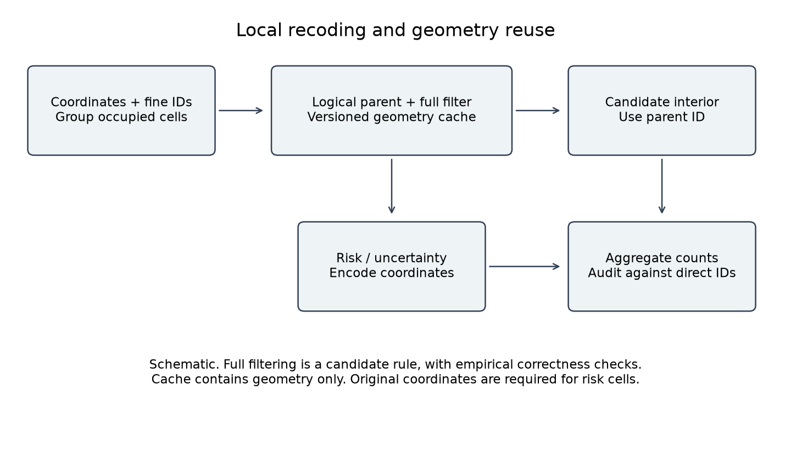

流程图展示实现分支。候选内部筛选的经验核验范围与最终计数输出分开检查。

对每个不同细格计算逻辑父格。将父格完整边界交给 h3shape_to_cells_experimental，使用 full 模式获得候选内部细格。仅当已占用细格属于这个集合时，沿用父格。其他点按原坐标调用直接粗编码。五边形和接口异常保守回退，并保留异常记录。

缓存键包含细格、粗分辨率、H3 Python与C版本，以及筛选实现版本。缓存保存几何关系。实验参考答案不进入缓存。冷启动和后续出现新单元时的几何处理均应计入运行成本。

## 4 实验设计

杭州区域中心经纬度为120.15、30.25，南京为118.80、32.06。分别使用UTM51N与50N生成10 km乘10 km局部正方形内的模拟点。每组10000点，分辨率对为9到8、10到8与10到9。开发种子0至4，独立评测种子100至109。

U组为均匀分布。C组由80%固定三簇高斯样本与20%均匀背景组成，簇中心先于归属检查确定。B组沿粗格边界投影线段采样，法向偏移正负20米。B组是人为构造的压力分布，独立报告。

研究包含B0逻辑父级汇总、B1全量直接编码、M局部重编码与缓存，以及A1每批重建几何关系四种方法。所有方法采用相同点数据与Counter聚合。重复同批计时与不同新批次累计成本分开报告。计时重复7次，不能当作7个独立空间样本。

逐点差异率检查每个点是否匹配参考。归一化计数差异对全部粗格计数绝对差求和，再除以2N。Top-10热点使用Jaccard，并在并列时按H3编码排序。分层统计以独立种子为单位，原始明细保留每次重复耗时。

实验运行于Intel Xeon Platinum 8352V 2.10GHz的Linux容器，CPU配额12核。计时进程将OMP、MKL与OPENBLAS线程数设为1，四种方法串行交错执行。Python3.12，H3 Python/C均为4.5.0，numpy1.26.4、pyproj3.8.0。GPU未被项目代码调用。数据生成、绘图和正确性审计位于计时之外；各方法必需的编码、几何检查、查询和计数聚合均在相应计时范围内。

## 5 最小反例

在seed0的1000个模拟点中，9到8汇总产生68个归属差异。首个反例纬度为30.227154132654743，经度为120.18047689694129。细格89309a42bd7ffff的逻辑父格为88309a42bdfffff，而直接粗格为88309a42b9fffff。

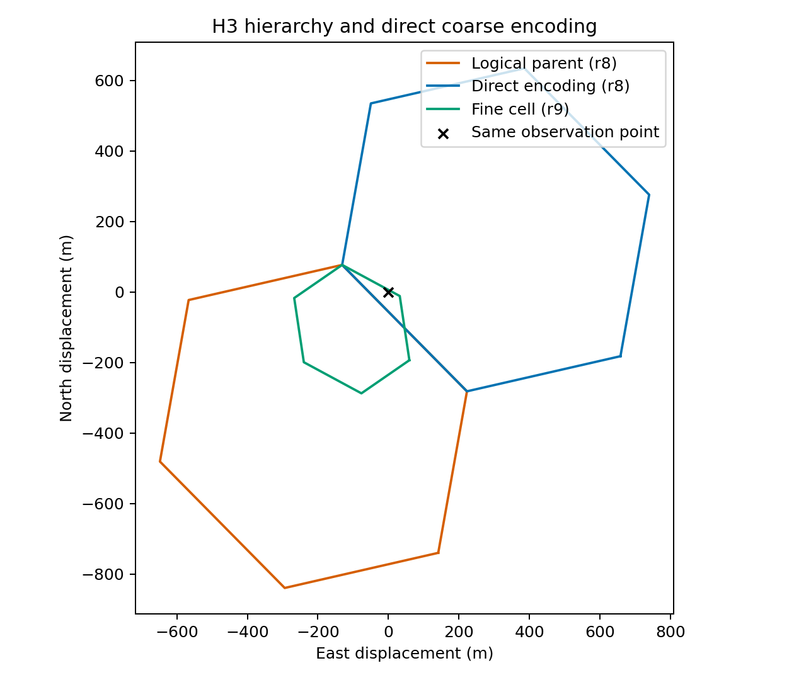

图1采用库返回的完整边界和米制投影。点的位置固定，两个粗格的统计口径不同。68/1000只描述该预实验样本。

## 6 修订前的随机评测结果

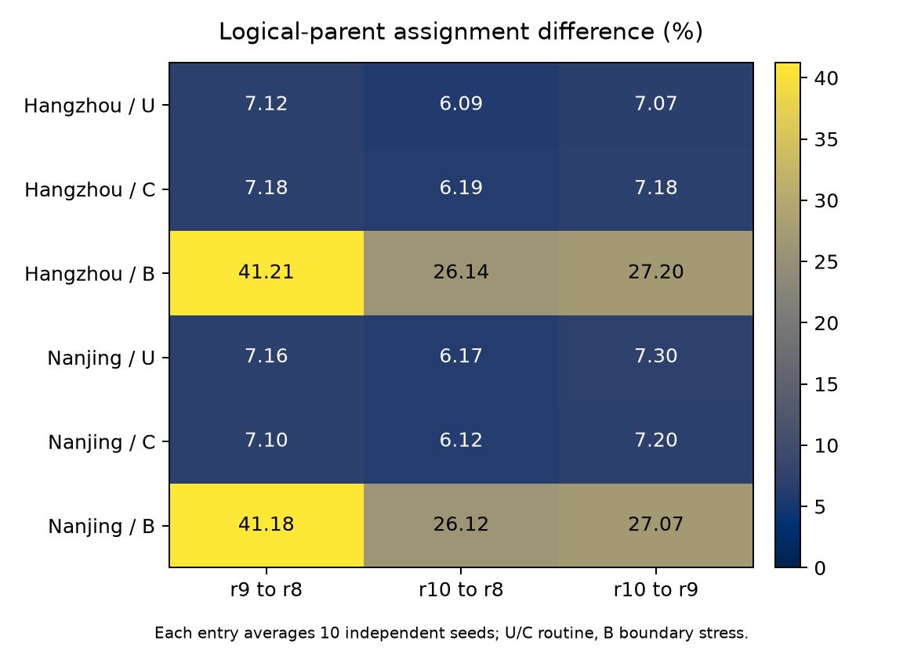

图2每个色块为10个独立种子的均值，每个种子10000点。均匀与聚集分布的逐点差异率接近，但不能因此断言所有城市分布均有相同差异。压力分布明显提高差异，因为它集中采样粗格边界附近。

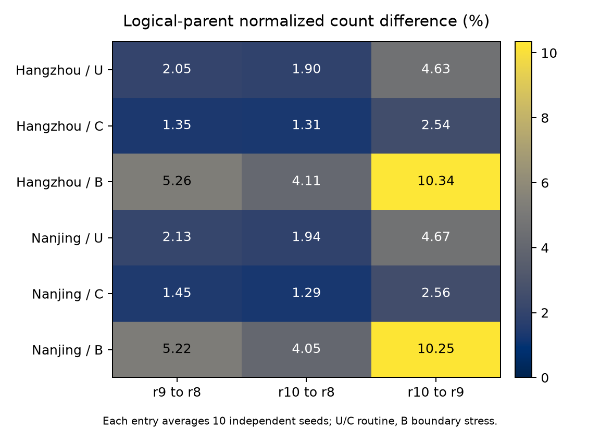

图3用于区分点级归属改变与汇总计数改变。相反方向的归属变化可以部分抵消，因此两个指标需要同时保留。

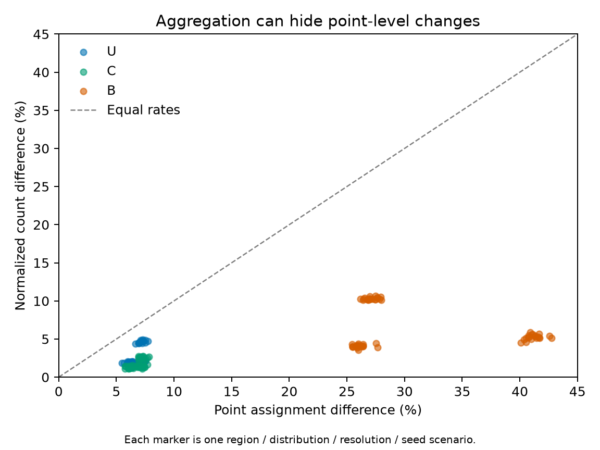

散点图中每个点是一组区域、分布、分辨率和种子条件。全部180组散点均位于等值线下方，说明在这些数据中，聚合计数差异小于点级归属变化。散点间仍共享区域和生成规则，不能按180个独立地理区域解释。

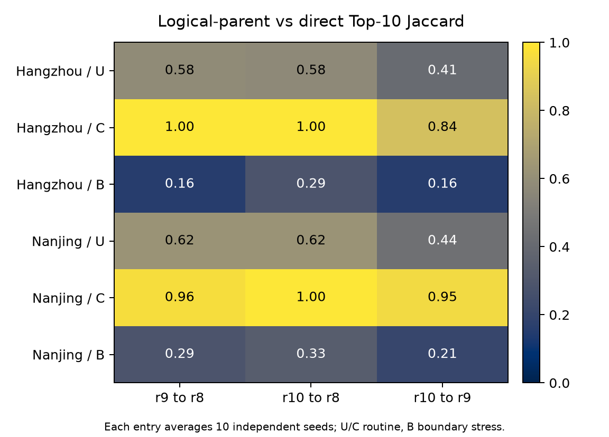

图4只度量计数最高网格集合的重合。它受计数接近及并列排序影响，不能单独说明实际应用损失。

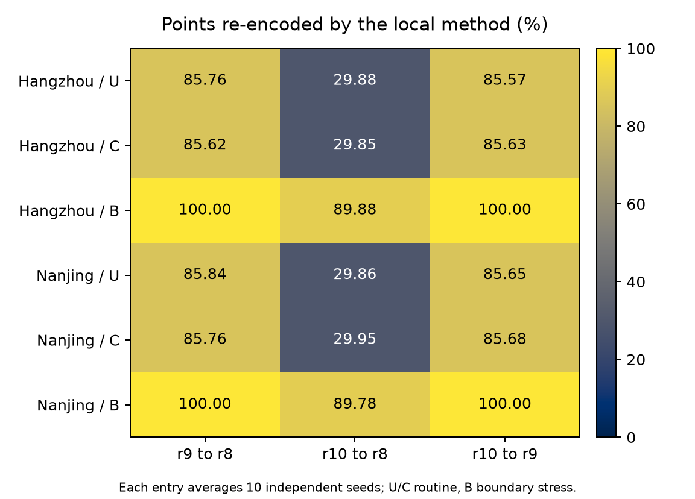

图5说明局部方法仍需重编码多少点。逐点一致并不意味着少量重编码就足够，更不直接证明加速。180组独立样本的局部输出逐点差异和计数差异均为0，内部单元误判点数为0。详细分层均值与种子标准差见results/derived/independent_summary.csv。

## 7 修订前的成本与适用条件

成本实验共18条工作负载，规模为1000、10000、100000点，杭州U/C分布，独立种子100至102，每条工作负载使用20个不同新批次，重复7次。每个种子先取7次重复的累计耗时中位数，再对3个种子平均。曲线阴影表示种子最小值至最大值，不作为置信区间。

| 分布 | 每批点数 | 20批直接编码秒 | 20批局部方法秒 | 各种子B1/M比值的均值 |
|---|---|---|---|---|
| U | 1000 | 0.0252 | 0.1977 | 0.128 |
| U | 10000 | 0.2540 | 0.4370 | 0.581 |
| U | 100000 | 2.7214 | 2.0268 | 1.343 |
| C | 1000 | 0.0249 | 0.1754 | 0.142 |
| C | 10000 | 0.2473 | 0.3522 | 0.702 |
| C | 100000 | 2.4025 | 1.7726 | 1.357 |

表中小于1的耗时比表示局部方法更慢。比值按种子计算后平均，因此可能略有别于两列均值直接相除。首批冷启动在全部规模和U/C分布中都慢于B1。100000点每批时，5批处局部方法累计均值已低于B1，20批处的差距继续扩大。对1000与10000点每批的数据，20批内仍未看到累计优势。不能将密集批次的收益外推至所有点计数任务。

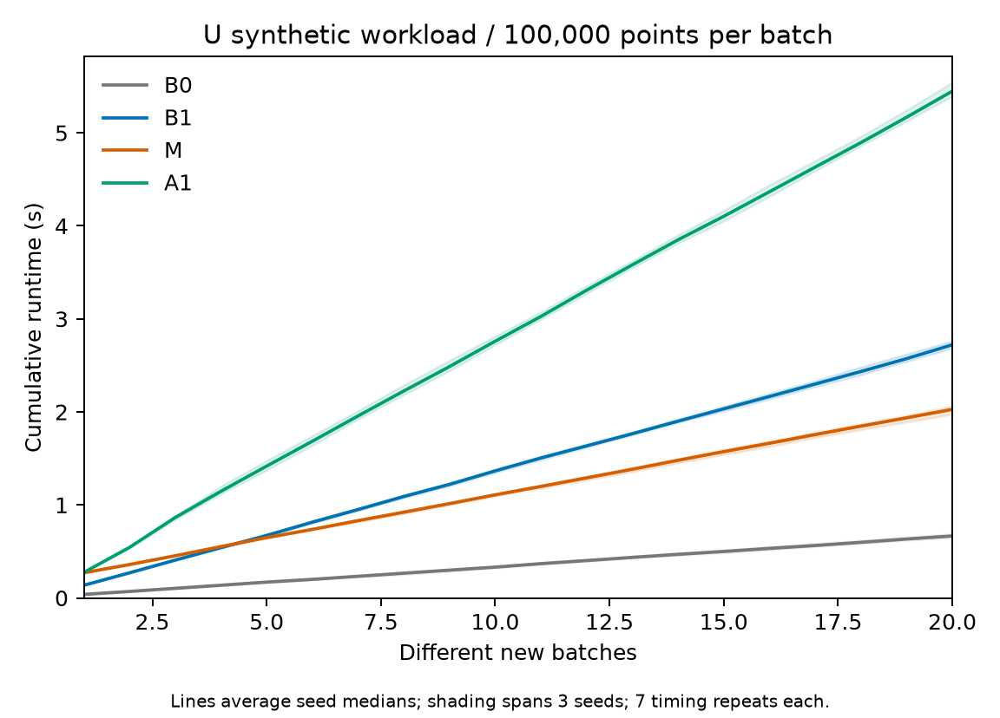

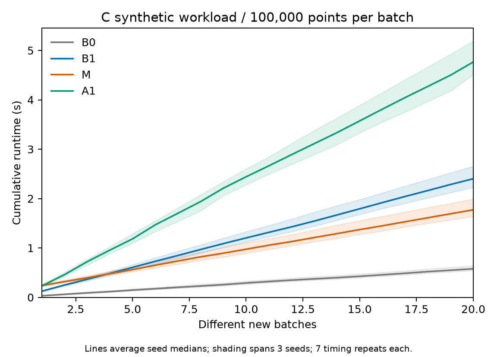

两张曲线均包含首批几何建立和后续新增单元处理。A1每批重建，展示缓存对本实现成本的作用。B0的语义与目标不同，作为速度参考。全部规模的曲线、1/5/20批统计和种子范围保留在结果目录。

若直接编码每批成本已经低于局部方法，则不存在仅靠重复批次达到的盈亏平衡点。稀疏数据中几何建缓存和分组开销可能占主导。相同数据反复查询时，预存粗编码或粗计数是更强的基线，须另行检查。

补充实验对同一份不变数据直接保存粗计数，并测量返回计数字典副本的成本。10000点时，7次重复的直接编码中位数为0.01626秒，已有计数副本约0.00000820秒；100000点时分别为0.11033秒与0.00001746秒。已有计数的初始化已通过直接编码完成，这项检查只描述数据不变时的后续查询。它不能作为新批次实验的参照，却说明在同一不变数据反复查询的任务中，应优先考虑保存所需粗计数。

上述计时以细格编码已经存在为输入条件。它不能直接说明从原坐标开始的端到端收益。几何缓存内存按Python分配单独测量，不计入计时，且不覆盖C库全部驻留内存。该内存口径与CPU耗时口径均需随结果保留。

## 8 失败记录与局限

### 数值边界修订与新的评测

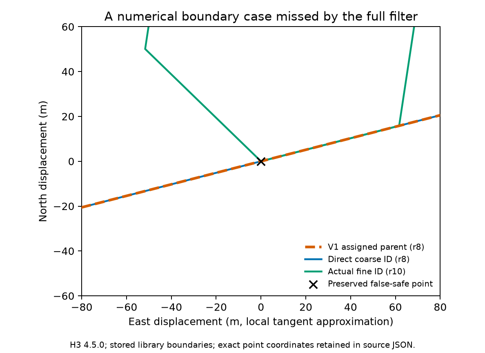

图中黑叉是保存的杭州失败点。粗格共享边界在该尺度上重合，细格顶点贴近粗格边界，因此常规随机采样可能漏掉这种情况。图形用于定位，不能分辨浮点邻近点之间的距离；实际差异依据保存的双精度坐标和H3调用输出判断。

原版边界失败后，修订版保留full筛选，并增加完整边界各顶点的粗格归属及正负1e-9度角向扰动检查。任一探测点跨出父格，就将该细格降级为风险单元，直接编码其中全部实际点。该规则针对可复现的数值触边机制，不保存失败点坐标作为例外名单。1e-9度余量预先登记，没有在多个阈值中挑选最有利结果。有限探测仍不能替代严格球面几何证明。

修订版先重新通过46080次极近边界检查与90组开发验证，再使用200至209的新随机种子，完成两区域、三分布、三分辨率组合的180组评测，共180万次点归属检查。新评测的逐点差异、计数差异及内部误判点数均为0。两个区域仍属于开发时已知区域，独立的是随机样本，不能称为空间域外泛化。修订版成本另用种子200至202完成18条工作负载，原版速度结果不作为修订版速度证据。

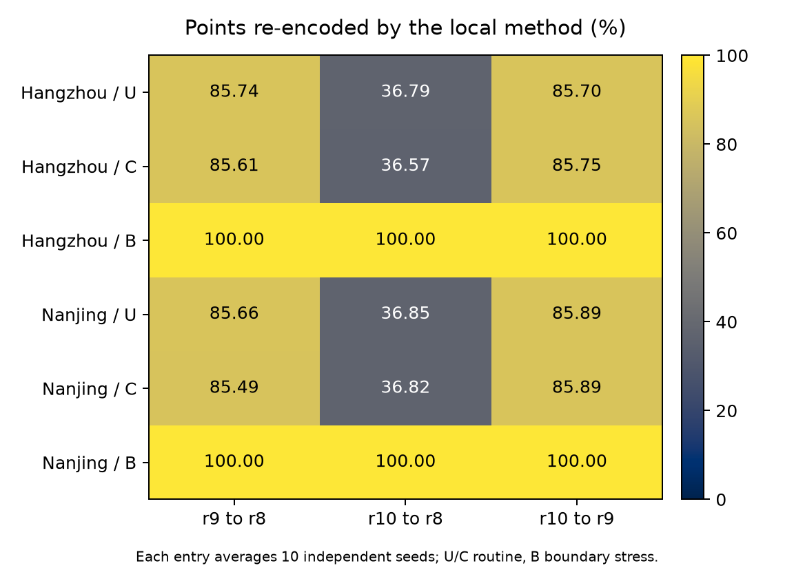

保守检查会让部分原候选内部格改为风险格。该变化可能提高重编码比例和冷启动成本，因此必须在修订版重新测量效率，不能沿用原版加速比。

在随机评测之后新增的极近边界检查中，原局部方法出现4条逐点归属不一致记录，全部发生于10到8组合。杭州1条、南京3条，均被原筛选标为内部。南京3条中有2条来自几乎相同坐标，因此不将它们当作独立空间事件。该检查每个区域每个分辨率对取128个开发细格，在完整边界顶点、边中点及极小扰动位置生成测试点。六组共46080次检查。具体坐标与错误格编号保留于supplement/boundary_probes.json。它们说明full候选筛选不能直接提供严格无损保证。随机样本中的零差异与数值边界上的失败需要同时报告。该发现触发了单独登记的修订与新种子验证。原成本收益仅针对原实现。

首次绘图遇到远端环境的数组兼容错误，在项目独立环境中修复依赖后成功重跑。开发用小规模工作负载曾与独立评测计时短暂并行。受影响场景原记录已保留，完成串行重跑。续跑配置检查又暴露JSON元组/列表表示差异，修复仅涉及配置比较，并登记前后代码哈希。

网页GPT审查提示H3上游PR1271报告full模式假阳性。项目在相同Python/C版本4.5.0下运行其指定案例，实际返回空集合，未复现报告中的外侧相邻格。该结果不能否定上游报告，也不能证明全域安全。当前证据范围是两处局部区域、指定分辨率和生成分布中的样本。

## 9 修订版的完整结果与成本

修订版180组新种子评测的逐点差异和归一化计数差异均为0。下面的成本与原版分别计量，每条工作负载含20个不同新批次，每个种子重复7次。先取种子内累计耗时中位数，再汇总3个种子。

| 分布 | 每批点数 | B1累计秒 | M2累计秒 | B1/M2 |
|---|---|---|---|---|
| C | 1000 | 0.0250 | 0.2892 | 0.086 |
| C | 10000 | 0.2377 | 0.5780 | 0.411 |
| C | 100000 | 2.3430 | 2.0857 | 1.124 |
| U | 1000 | 0.0223 | 0.3521 | 0.063 |
| U | 10000 | 0.2222 | 0.5921 | 0.375 |
| U | 100000 | 2.6040 | 2.3500 | 1.108 |

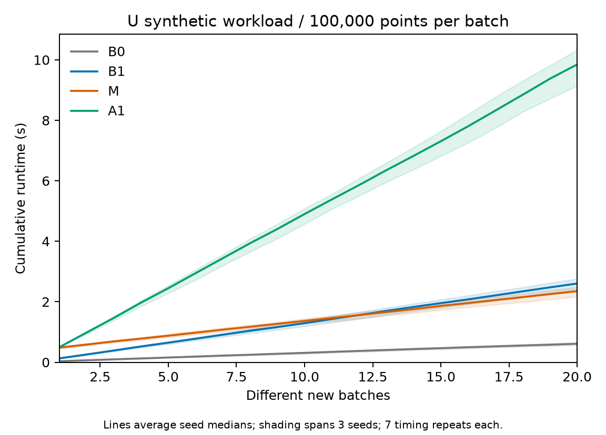

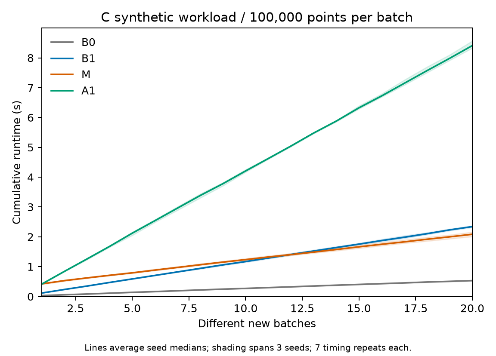

图中线为3个种子中位数的平均值，阴影为种子范围。首批与新增细格的完整处理均计入。原版和修订版采用不同独立种子，版本间耗时差异仅作描述；修订版与同期B1、A1的对照用于判断其实际成本。

| 分布 | 每批点数 | 20批后Python缓存相关保留内存 MiB |
|---|---|---|
| C | 1000 | 2.093 |
| C | 10000 | 3.712 |
| C | 100000 | 3.783 |
| U | 1000 | 3.502 |
| U | 10000 | 3.756 |
| U | 100000 | 3.922 |

内存单独使用tracemalloc测量，覆盖Python分配而非C库全部驻留内存。已有细格编码是各方法共同的输入前提；从原始坐标开始还需考虑细编码、数据组织和存储成本，不能将这里的增量耗时比直接称作端到端加速。

| 分布 | 每批点数 | 首批每个已占用细格的平均点数 N/U | 20批累计缓存细格数 |
|---|---|---|---|
| C | 1000 | 1.695 | 3811.0 |
| C | 10000 | 4.027 | 8571.3 |
| C | 100000 | 12.646 | 8730.7 |
| U | 1000 | 1.057 | 7781.3 |
| U | 10000 | 1.690 | 8716.0 |
| U | 100000 | 11.501 | 8744.7 |

N/U先在每个种子的首个批次计算，再对3个种子平均。它描述占用密度，不能与后续批次的新单元数量混为一项。累计缓存数直接来自每批新增单元日志，所有新增几何判断已计入计时。

数值余量使用角度单位，约束的是探测坐标的变化。它不是全球统一的米制缓冲距离，不同纬度的物理尺度不同。当前实验只覆盖指定中纬度区域，不推断极区或跨日期变更线的可靠性。

## 10 AI协作与个人贡献记录

我提供选题计划和老师要求，确定研究执行与提交范围，并委托AI协助编程、远程实验、审计、绘图与报告制作。网页GPT技术审查由执行助手代发，记录明确标注这一事实。设计与技术执行中AI参与较深，decisions.md登记了具体分工。Codex实际记录与网页GPT问答分别导出Markdown，保留错误、修订和真实工具结果。随机样本一致之后又发现数值边界失败，这一过程表明，协作评价需要检查证据覆盖范围，不能仅凭AI的初步结论判断方法可靠性。

## 11 结论

本作业将H3层级与几何口径差异转化为可复现的点计数实验，并通过极近边界检查发现了常规随机评测遗漏的失败。保守修订在新随机样本和已登记边界回归中得到逐点一致，但有限数值探测仍不构成全域证明。几何缓存是否值得采用，应同时检查批次规模、格内密度、首次建立成本、新单元增量与原始坐标是否可用。同一份不变数据的重复查询可优先保存粗计数。所有不利结果与失败证据均随报告公开。

## 参考资料

1. H3官方Indexing说明。https://h3geo.org/docs/highlights/indexing/
2. h3-py API详细文档。https://uber.github.io/h3-py/api_verbose.html
3. H3 PR1271，CONTAINMENT_FULL共享边界问题报告。https://github.com/uber/h3/pull/1271

参考资料支持背景、接口与风险说明。定量结果来自本项目保存的实际实验文件。
