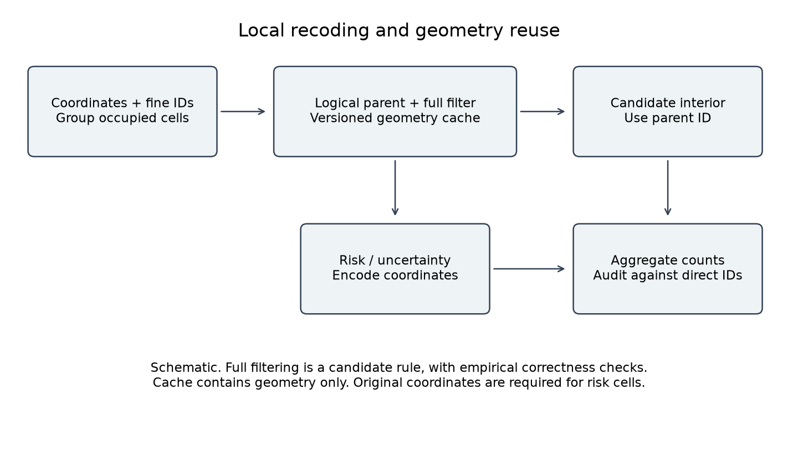

# H3 跨分辨率聚合中的边界归属偏差与局部重编码方法

作者 jinchenying  
课程 数据挖掘与技术  
状态 实验结果部分已核验，成本实验与提交核查进行中

公开仓库 https://github.com/Augen-Jik/h3-boundary-aggregation-study  
实际 AI 对话 Markdown https://github.com/Augen-Jik/h3-boundary-aggregation-study/blob/main/conversations/01_codex_actual.md  
网页 GPT 审查记录 https://github.com/Augen-Jik/h3-boundary-aggregation-study/blob/main/conversations/02_web_gpt_review.md  
代码、独立评测数据、图表与本初稿已上传公开仓库。对话文件是截至导出时的快照，最终提交前需补齐之后新增内容。

本报告使用 AI 协助资料核查、编程、实验执行和写作。文中设计由 AI 提出或实现的部分在 decisions.md 中登记。题目计划与实际聊天分开保存，个人感想以作者实际表达为依据。

## 摘要

本项目研究一种具体的空间统计口径差异。在已有细分辨率 H3 编码的条件下，逻辑父级汇总与原始坐标直接粗编码可能给出不同的归属。我将直接粗编码指定为目标口径，对比逻辑父级汇总、全量直接编码，以及使用完全包含筛选的局部重编码。实验采用两处中纬度局部区域的模拟观测点，分别生成均匀、聚集及边界压力分布。独立种子100至109、三个分辨率组合共形成180组、180万次点归属检查。局部重编码在这些样本中与直接粗编码逐点一致。常规均匀与聚集分布下，逻辑父级汇总的分层平均差异率为6.09%至7.30%。边界压力组达到26.12%至41.21%，只用于压力测试解释。18条重复新批次工作负载显示，1000与10000点每批时，局部方法在20批内仍慢于直接编码；100000点每批时，20批累计的直接编码与局部方法耗时比约为1.34至1.36。收益具有规模与复用条件。本项目的探索重点是组合现有几何接口、建立审计与复现实验，并确定适用范围。

## 1 问题与目标口径

同一坐标点可以先编码到细分辨率，再通过索引取得逻辑父格，也可以直接编码到粗分辨率。设细分辨率大于粗分辨率，分别记为 rf 与 rc。

\[
D(p)=H3(p,r_c),\quad P(p)=Parent(H3(p,r_f),r_c).
\]

本实验选择 D(p) 为参考。H3 官方已说明逻辑包含精确而几何包含近似，因此二者的差异是任务口径差异。直接粗编码也只代表指定库版本的参考实现。

## 2 已有知识与课程探索

H3 的层级非严格几何包含属于官方已知性质。完全包含覆盖模式也已由库提供。本项目没有发明这两项基础能力。课程探索包括按已占用细格进行几何筛选、仅对风险格中的坐标重编码、跨新批次缓存固定几何关系，以及同时检查逐点归属、计数与热点变化。

运行缓存需要保留原始坐标。若只剩细格总计数，通常不能恢复跨界细格内部的点位置。该输入限制直接决定方法的应用范围。

本作业的探索分为三项。第一，将逻辑层级与指定统计口径之间的区别落实为点级差异、计数差异与热点排序三个可重复测量的结果，检验聚合是否掩盖点级变化。第二，构建按已占用细格处理的局部重编码程序，缓存固定几何关系，完整记录首次处理与后续新单元成本。第三，针对数值边界检查实际发现的误判，增加保守余量探测，并为修订版重新划分随机评测种子。这三项均有本项目代码和实测记录，仍不代表全球首次提出。

| 环节 | 现有知识或接口 | 本项目落实的探索 | 对应证据 |
|---|---|---|---|
| 统计口径 | H3逻辑父子关系与几何包含不同 | 同数据比较逐点、计数和热点，记录相互抵消现象 | 180组原版结果与散点图 |
| 局部处理 | full覆盖模式与粗编码接口 | 已占用细格分组、风险回退及版本化几何缓存 | methods.py及缓存消融 |
| 数值边界 | 实验性接口存在实现局限 | 找到4条内部误判，登记顶点余量探测修订 | boundary_probes与methods_v2.py |
| 实用性 | 缓存需要摊销初始化 | 不同新批次对比，包含不利的稀疏工作负载 | 18条原版成本记录 |

原始计划与程序方案主要由AI辅助形成。作者提供任务与提交要求并授权执行。报告按实际贡献说明这一过程，不能把已经发生的AI技术审查改写成作者独立反驳的故事。

## 3 方法

流程图展示实现分支。候选内部筛选的经验核验范围与最终计数输出分开检查。

对每个不同细格计算逻辑父格。将父格完整边界交给 h3shape_to_cells_experimental，使用 full 模式获得候选内部细格。仅当已占用细格属于这个集合时，沿用父格。其他点按原坐标调用直接粗编码。五边形和接口异常保守回退，并保留异常记录。

缓存键包含细格、粗分辨率、H3 Python与C版本，以及筛选实现版本。缓存保存几何关系。实验参考答案不进入缓存。冷启动和后续出现新单元时的几何处理均应计入运行成本。

## 4 实验设计

杭州区域中心经纬度为120.15、30.25，南京为118.80、32.06。分别使用UTM51N与50N生成10 km乘10 km局部正方形内的模拟点。每组10000点，分辨率对为9到8、10到8与10到9。开发种子0至4，独立评测种子100至109。

U组为均匀分布。C组由80%固定三簇高斯样本与20%均匀背景组成，簇中心先于归属检查确定。B组沿粗格边界投影线段采样，法向偏移正负20米。B组是人为构造的压力分布，独立报告。

研究包含B0逻辑父级汇总、B1全量直接编码、M局部重编码与缓存，以及A1每批重建几何关系四种方法。所有方法采用相同点数据与Counter聚合。重复同批计时与不同新批次累计成本分开报告。计时重复7次，不能当作7个独立空间样本。

逐点差异率检查每个点是否匹配参考。归一化计数差异对全部粗格计数绝对差求和，再除以2N。Top-10热点使用Jaccard，并在并列时按H3编码排序。分层统计以独立种子为单位，原始明细保留每次重复耗时。

## 5 最小反例

在seed0的1000个模拟点中，9到8汇总产生68个归属差异。首个反例纬度为30.227154132654743，经度为120.18047689694129。细格89309a42bd7ffff的逻辑父格为88309a42bdfffff，而直接粗格为88309a42b9fffff。

图1采用库返回的完整边界和米制投影。点的位置固定，两个粗格的统计口径不同。68/1000只描述该预实验样本。

## 6 独立评测结果

图2每个色块为10个独立种子的均值，每个种子10000点。均匀与聚集分布的逐点差异率接近，但不能因此断言所有城市分布均有相同差异。压力分布明显提高差异，因为它集中采样粗格边界附近。

图3用于区分点级归属改变与汇总计数改变。相反方向的归属变化可以部分抵消，因此两个指标需要同时保留。

散点图中每个点是一组区域、分布、分辨率和种子条件。全部180组散点均位于等值线下方，说明在这些数据中，聚合计数差异小于点级归属变化。散点间仍共享区域和生成规则，不能按180个独立地理区域解释。

图4只度量计数最高网格集合的重合。它受计数接近及并列排序影响，不能单独说明实际应用损失。

图5说明局部方法仍需重编码多少点。逐点一致并不意味着少量重编码就足够，更不直接证明加速。180组独立样本的局部输出逐点差异和计数差异均为0，内部单元误判点数为0。详细分层均值与种子标准差见results/derived/independent_summary.csv。

## 7 成本与适用条件

成本实验共18条工作负载，规模为1000、10000、100000点，杭州U/C分布，独立种子100至102，每条工作负载使用20个不同新批次，重复7次。每个种子先取7次重复的累计耗时中位数，再对3个种子平均。曲线阴影表示种子最小值至最大值，不作为置信区间。

| 分布 | 每批点数 | 20批直接编码秒 | 20批局部方法秒 | 各种子B1/M比值的均值 |
|---|---|---|---|---|
| U | 1000 | 0.0252 | 0.1977 | 0.128 |
| U | 10000 | 0.2540 | 0.4370 | 0.581 |
| U | 100000 | 2.7214 | 2.0268 | 1.343 |
| C | 1000 | 0.0249 | 0.1754 | 0.142 |
| C | 10000 | 0.2473 | 0.3522 | 0.702 |
| C | 100000 | 2.4025 | 1.7726 | 1.357 |

表中小于1的耗时比表示局部方法更慢。比值按种子计算后平均，因此可能略有别于两列均值直接相除。首批冷启动在全部规模和U/C分布中都慢于B1。100000点每批时，5批处局部方法累计均值已低于B1，20批处的差距继续扩大。对1000与10000点每批的数据，20批内仍未看到累计优势。不能将密集批次的收益外推至所有点计数任务。

两张曲线均包含首批几何建立和后续新增单元处理。A1每批重建，展示缓存对本实现成本的作用。B0的语义与目标不同，作为速度参考。全部规模的曲线、1/5/20批统计和种子范围保留在结果目录。

若直接编码每批成本已经低于局部方法，则不存在仅靠重复批次达到的盈亏平衡点。稀疏数据中几何建缓存和分组开销可能占主导。相同数据反复查询时，预存粗编码或粗计数是更强的基线，须另行检查。

补充实验对同一份不变数据直接保存粗计数，并测量返回计数字典副本的成本。10000点时，7次重复的直接编码中位数为0.01626秒，已有计数副本约0.00000820秒；100000点时分别为0.11033秒与0.00001746秒。已有计数的初始化已通过直接编码完成，这项检查只描述数据不变时的后续查询。它不能作为新批次实验的参照，却说明在同一不变数据反复查询的任务中，应优先考虑保存所需粗计数。

上述计时以细格编码已经存在为输入条件。它不能直接说明从原坐标开始的端到端收益。几何缓存内存按Python分配单独测量，不计入计时，且不覆盖C库全部驻留内存。该内存口径与CPU耗时口径均需随结果保留。

## 8 失败记录与局限

在随机评测之后新增的极近边界检查中，原局部方法出现4条逐点归属不一致记录，全部发生于10到8组合。杭州1条、南京3条，均被原筛选标为内部。南京3条中有2条来自几乎相同坐标，因此不将它们当作独立空间事件。该检查每个区域每个分辨率对取128个开发细格，在完整边界顶点、边中点及极小扰动位置生成测试点。六组共46080次检查。具体坐标与错误格编号保留于supplement/boundary_probes.json。它们说明full候选筛选不能直接提供严格无损保证。随机样本中的零差异与数值边界上的失败需要同时报告。当前方法仍需保守修复和新的验证，原成本收益也仅针对原实现。

首次绘图遇到远端环境的数组兼容错误，在项目独立环境中修复依赖后成功重跑。开发用小规模工作负载曾与独立评测计时短暂并行。受影响场景原记录已保留，完成串行重跑。续跑配置检查又暴露JSON元组/列表表示差异，修复仅涉及配置比较，并登记前后代码哈希。

网页GPT审查提示H3上游PR1271报告full模式假阳性。项目在相同Python/C版本4.5.0下运行其指定案例，实际返回空集合，未复现报告中的外侧相邻格。该结果不能否定上游报告，也不能证明全域安全。当前证据范围是两处局部区域、指定分辨率和生成分布中的样本。

## 9 AI协作与个人贡献记录

用户提供选题计划和老师要求，指定研究执行范围与作者署名。AI实现数据生成、方法、实验审计和图表，并另向网页GPT提交真实技术审查请求。该请求已注明由执行助手代发。尚未由作者表达的反驳与感想不写成实际发生的互动。Codex实际记录及网页GPT问答已分别导出Markdown，导出后新增内容需在最终提交前补齐。

## 参考资料

1. H3官方Indexing说明。https://h3geo.org/docs/highlights/indexing/
2. h3-py API详细文档。https://uber.github.io/h3-py/api_verbose.html
3. H3 PR1271，CONTAINMENT_FULL共享边界问题报告。https://github.com/uber/h3/pull/1271

参考资料支持背景、接口与风险说明。定量结果来自本项目保存的实际实验文件。
